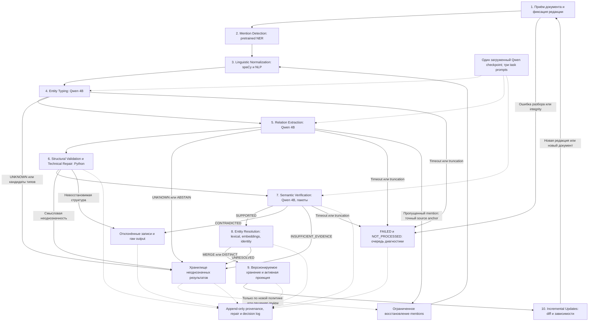

# Последовательная гибридная архитектура построения графа знаний v2

**Статус: архитектура DRAFT; Ontology v2.0 APPROVED (11 типов / 20 отношений); NER-V2-PREP подготовлен без inference.**

Дата проекта: 31 октября 2026 года, Europe/Moscow. Ветка: `design-v2-sequential-kg`. Основание: `main` на commit `06f2bac1b02b7cbe90eb36a0ebec0ea78aa328d4`.

Это проект полной архитектуры и будущего протокола исследования. Наборы типов и отношений Ontology v2 утверждены как версия схемы 2.0 и опубликованы отдельно в [ontology.v2.json](../../contracts/ner_v2/ontology.v2.json). На этапе NER-V2-PREP подготовлены Mention Detection и Linguistic Normalization, зависимости, локальные pretrained GLiNER checkpoints и 12 аннотаций OpenAlex. Forward pass GLiNER, NER inference, Qwen typing/RE/verification, resolution, embedding inference, обучение и Gold-разметка не выполняются. Остальные компоненты ниже остаются проектом. Ontology v1.0, Gold и исторические результаты C и B-001 сохраняются без изменений. Подробности подготовки и будущий CLI: [NER_V2_PREP.md](../NER_V2_PREP.md).

## Оглавление

1. Исследовательская цель (Research Goal).
2. Уроки C и B-001 (Lessons from C and B-001).
3. Принципы проектирования (Design Principles).
4. Полная схема архитектуры (Full Architecture Diagram).
5. Подробный pipeline (Detailed Pipeline).
6. Утверждённая онтология v2 (Ontology v2.0).
7. Контракты данных (Data Contracts).
8. Нормализация и разрешение идентичности (Entity Normalization & Resolution).
9. Векторные представления (Embeddings).
10. Структурная и смысловая проверка (Validation & Verification).
11. Хранение и инкрементальные обновления (Graph Storage & Incremental Updates).
12. Экспериментальная оценка (Experimental Evaluation).
13. Производительность и ресурсы (Performance & Resource Budget).
14. Риски и режимы отказа (Risks and Failure Modes).
15. Поэтапный план реализации (Implementation Roadmap).
16. Открытые вопросы и решения для согласования (Open Questions & Decisions Pending Approval).

## 1. Исследовательская цель (Research Goal)

Спроектировать систему точного, быстрого и инкрементального построения графов знаний из научных публикаций с небольшой готовой LLM примерно на 4B параметров. Целевой сценарий — локальный обычный компьютер, ограниченная память, последовательная обработка новых публикаций и новых редакций известных документов. Нужны воспроизводимость и возможность установить, из какого фрагмента, какой редакции и каким решением возникло утверждение.

Исследовательские цели: высокие Precision, Recall и F1 для сущностей и отношений; сохранение отрицаний, модальности, числовых значений, условий эксперимента и ограничений применимости; низкая вычислительная стоимость; обновление без полной перестройки корпуса; сохранение истории и независимой поддержки утверждений другими источниками. Ни качество, ни скорость v2 пока не измерены. Утверждение «v2 быстрее или точнее B-001» недопустимо до сопоставимого эксперимента.

Используются pretrained NER, Qwen 4B и в перспективе pretrained embedding-модель без собственного обучения, fine-tuning и fitted heads. Не требуется внешняя база готовых сущностей: canonical entities формируются из обработанного корпуса. Полноценные PreRAG/PostRAG из обсуждаемой статьи и внешний entity linking не входят в этот проект. Возможный будущий GraphRAG retrieval не является условием работы extraction.

В пределах текущей задачи результатом служит согласуемый дизайн. Выбор checkpoint/revision, NLP-пакетов, embedding-модели, графовой СУБД и численных критериев допуска остаётся отдельным решением.

## 2. Уроки C и B-001 (Lessons from C and B-001)

### 2.1. Источники и границы выводов

Ниже используются существующие отчёты, а не новые измерения. Ссылки закреплены на commits, поскольку файлы C-DIAG-002 и B-001 находятся в отдельных экспериментальных ветках и отсутствуют в базовой `main`.

| Источник | Закреплённый документ | Для чего используется |
|---|---|---|
| C-001 | [Отчёт C-001](https://github.com/KulikovKA/Graph-RAG-news-analytics-system-RESEARCH/blob/06f2bac1b02b7cbe90eb36a0ebec0ea78aa328d4/reports/C001_REPORT.md) | Исторический обучаемый CPU baseline, влияние NER и жёстких gates |
| C-DIAG-002 | [Финальный отчёт](https://github.com/KulikovKA/Graph-RAG-news-analytics-system-RESEARCH/blob/14a48d4ce175a9581c09b9d41529bfc92848300a/reports/C_DIAG_002_REPORT.md), [протокол](https://github.com/KulikovKA/Graph-RAG-news-analytics-system-RESEARCH/blob/14a48d4ce175a9581c09b9d41529bfc92848300a/reports/C_DIAG_002_PROTOCOL.md), [протокол стоимости](https://github.com/KulikovKA/Graph-RAG-news-analytics-system-RESEARCH/blob/14a48d4ce175a9581c09b9d41529bfc92848300a/reports/C_DIAG_002_COST_PROTOCOL.md) | Ограничения pretrained-only NER/NLI RE, funnel потерь и стоимость расширения кандидатов |
| B-001 | [Отчёт B-001](https://github.com/KulikovKA/Graph-RAG-news-analytics-system-RESEARCH/blob/8b4cd1fec7ba1cdc02aa42441a7b364142edc2b8/reports/B001_REPORT.md), [протокол](https://github.com/KulikovKA/Graph-RAG-news-analytics-system-RESEARCH/blob/8b4cd1fec7ba1cdc02aa42441a7b364142edc2b8/reports/B001_PROTOCOL.md) | Локальный Qwen 4B, ошибки адресации, низкий recall, qualifiers и пределы детерминированной проверки |
| Действующие контракты | [Метаданные dataset](../../contracts/CURRENT_DATASET.json), [runtime ontology v1](../../contracts/runtime_ontology.json), [schema v1](../../contracts/prediction.schema.json) | Разделение версий, защита Gold и несовместимость будущих v2-контрактов с текущим интерфейсом |

Отчёты C-DIAG-002 и B-001 описывают exploratory evaluation на тех же 12 ранее исследованных DEV-документах. Это не независимый финальный тест. Pilot24 содержит 24 документа с разметкой ontology v1.0; 12 DEV нельзя отождествлять со всеми 24. Разметка имеет AI origin и проверку владельцем без независимого второго annotator. У D024 relations размечены неполно: несовпадение с Gold не обязательно доказывает семантическую ложность. В этой задаче читаются отчёты и нормативные метаданные; исходные Gold-файлы, CALIBRATION и HOLDOUT не открываются.

### 2.2. Наблюдения, влияющие на дизайн

| Подтверждённое наблюдение в отчёте | Архитектурное следствие для v2 | Что ещё требуется проверить |
|---|---|---|
| C-DIAG-002: GLiNER control typed entity F1 = 0.4592; typed candidate recall = 71/390 = 0.1821. Union дал 85/390 = 0.2179, но typed entity F1 снизился до 0.2802 | NER служит генератором spans; типизация выделяется в отдельную задачу. Нужен контролируемый поиск пропусков | Улучшит ли отдельная типизация recall без роста ложных упоминаний |
| Scientific CHEM находил exact границы 57/77 ANALYTE, но mapping назначал MATERIAL; это не typed TP | Разделить границу mention, лингвистическую форму и контекстный тип | Переносимость 11 типов между научными областями |
| C-DIAG-002 с Gold entities: final RE P/R/F1 = 0.0537/0.7256/0.0999, 283 TP и 4990 FP; qualified F1 = 0 | Наличие правильных endpoints не решает RE. Нужны определения предикатов, qualifiers и отдельный semantic verifier | Улучшение Precision и цена потерь Recall после verifier |
| Union: wall 3198.087 s против 358.585 s control; 70933 против 6841 NLI queries. Добавлено 8 final TP и 27723 FP | Не отправлять в LLM полный декартов набор пар и предикатов; ограничивать workload окнами и пакетами | Какой candidate policy даёт приемлемый баланс покрытия и стоимости |
| B-001: typed entity F1 = 0.2834; final RE P/R/F1 = 0.2500/0.0410/0.0705, 16 TP, 48 FP, 374 FN | Сокращение FP gates не компенсирует upstream потери. Нужны отдельные метрики spans, типов и RE | Снизит ли заранее адресуемый список mentions ошибки mapping |
| B-001: 390 Gold edges → 72 с untyped endpoints → 51 с typed endpoints → 16 raw TP; final gates сохранили эти 16 | Вести stage funnel и статусы необработанных окон; не приписывать все FN relation-модели | Какую долю потерь устраняет каждый компонент отдельно |
| B-001: принято 0 qualifiers, completeness UNKNOWN, qualified F1 = 0 | Qualifier — часть конкретного assertion с собственным evidence и статусом полноты | Достижимо ли надёжное attachment условий и чисел на 4B |
| B-001: ошибки HAS_MEMBER и направления сохранялись при exact evidence и допустимых типах | Provenance и domain/range — необходимые структурные условия, но не доказательство смысла | False acceptance и false removal отдельного verifier |
| B-001: 78 LLM calls, wall 8187.7 s, 212272 input и 57059 output tokens; 77/78 успешных окон, одно усечение JSON | Один резидентный checkpoint, компактный output, batching, учёт повторов и явное сохранение failed windows | Стоимость трёх задач относительно объединённого B-001 extraction |

C-DIAG-002 рекомендует закрыть проверенный вариант C и перейти к B; это вывод об ограниченном исследовании, не невозможность любых pretrained NER/RE подходов. GLiREL не воспроизвёл официальный control и не дал валидного независимого RE comparator. Provenance battery checkpoint имеет оговорку о неподтверждённой MatSciBERT lineage. Ни один из этих результатов не оправдывает выбор конкретной NER-модели v2 без собственной будущей проверки.

Исторический C-001 на четырёх validation-документах имел raw RE F1 = 0.0448 и gated F1 = 0; при Gold entities gated F1 = 0.1127. Он использовал обученную лексическую RE-head и другой evaluation scope. Его числа не смешиваются с pretrained-only C-DIAG-002 или 12-document B-001. Урок — отдельно учитывать удалённые gates правильные отношения, а не просто усиливать фильтрацию.

## 3. Принципы проектирования (Design Principles)

1. **Последовательные обязанности.** NER предлагает spans; NLP строит формы; Qwen типизирует, затем извлекает relations, затем проверяет assertions; Python отвечает за адресацию, структуру и provenance; Entity Resolution определяет идентичность.
2. **Один Qwen checkpoint.** Три логических прохода не требуют трёх экземпляров модели. Один загруженный checkpoint обслуживает очереди с разными prompt/schema/task versions. Одновременная резидентность нескольких копий не является требованием.
3. **Неизменяемый источник.** Evidence всегда ссылается на исходный текст редакции. Lemma, NFC и aliases хранятся отдельно и не заменяют source surface.
4. **Явная неопределённость.** UNKNOWN, ABSTAIN, UNRESOLVED, INSUFFICIENT_EVIDENCE и NOT_PROCESSED сохраняют разные значения; отсутствие результата не приравнивается к отрицательному факту.
5. **Утверждение шире тройки.** Polarity, modality, conditions, числовые значения, evidence и состояние полноты входят в assertion. Простая тройка допустима только как производная проекция с доступом к исходному assertion.
6. **Плоский выбор отношений.** Qwen сразу выбирает конкретный предикат из списка. Семейства, иерархия и промежуточный relation classifier не вводятся.
7. **Техническое исправление не меняет смысл.** Python не угадывает тип, направление, предикат или attachment qualifier. Смысловое изменение требует нового model proposal и проверки либо отдельного решения человека.
8. **Сходство не означает тождество.** Совпадение lemma, alias или высокая cosine similarity дают кандидатов, но не разрешение на MERGE.
9. **История первична.** Исходные mentions, assertions и решения неизменяемы; активный граф является версионируемой проекцией. Ошибочное объединение должно быть обратимо.
10. **Исследовательская изоляция.** Source-only inference отделён от offline evaluation. Никаких Gold examples в few-shot, обучения, чтения закрытых split или подгонки по уже просмотренному DEV.
11. **Ограниченная стоимость.** Token/window/retry budgets задаются до будущего запуска. Превышение лимита регистрируется как неполное покрытие, а не скрывается удалением объектов из знаменателя.
12. **Раздельные версии.** Ontology, prompt, parser, normalizer, model, resolver и storage schema получают версии. Действующие v1 contracts не переписываются в рамках v2.

## 4. Полная схема архитектуры (Full Architecture Diagram)



Основной проход соответствует десяти этапам. Возврат из extraction в normalization — ограниченный цикл восстановления упоминаний, а не постоянный повтор всего pipeline. Он создаёт новую версию candidate inventory и повторяет только зависимые typing/RE/validation/verification задачи. Лимит цикла фиксируется в протоколе; остаток получает NOT_PROCESSED или UNRESOLVED. Пунктир от неоднозначных записей не означает автоматический бесконечный retry.

Отклонённые, неоднозначные и не обработанные записи сохраняются в логическом audit storage, но не публикуются как подтверждённые edges. SUPPORTED при неразрешённой идентичности остаётся source-level assertion и не создаёт предположительный междокументный MERGE. Отрицательные assertions с SUPPORTED сохраняются как отрицательные, а не отправляются в rejected.

## 5. Подробный pipeline (Detailed Pipeline)

### 5.1. Приём и подготовка документа

Вход — публикация с доступными метаданными и идентификатором источника; выход — Document, неизменяемый Document Revision, структура разделов/предложений и source spans. Python вычисляет IDs, hashes и timestamps. Исходный файл и извлечённый текст имеют отдельные hashes: изменение PDF parser не должно выглядеть как незаметное исправление текста.

Для PDF/OCR нужно хранить исходный артефакт и привязку к странице/блоку при наличии. Координатная система extraction — явно указанная неизменяемая текстовая редакция; обратная привязка к PDF не подразумевается точной без mapping. Таблицы, подписи и формулы сохраняют section/block provenance. Неразбираемый блок получает статус, а не исчезает из coverage.

Окна создаются по предложениям и абзацам с ограниченным контекстом соседних предложений. Длина и overlap определяются будущим token budget. Пересечения окон не создают новые source spans; повторные proposals дедуплицируются после извлечения. Межпредложенческие связи включаются только в пределах явно поданного контекста. Неразрешённая coreference не подменяется ближайшим noun phrase.

### 5.2. Обнаружение упоминаний: небольшая pretrained NER

NER — генератор mention candidates с exact spans и исходным label/score. Её source labels не становятся автоматически окончательными 11 v2 types. Нужна готовая head с проверенным decoding; base encoder сам по себе не считается NER. Для первого сравнения зафиксированы официальные pretrained `urchade/gliner_large-v2.1`, `urchade/gliner_medium-v2.1` и `urchade/gliner_small-v2.1`, без нашего fine-tuning. Одинаковые 11 английских смысловых описаний из v2, threshold 0.35, окна 60 слов с overlap 20, `flat_ner=False`, `multi_label=True`, postprocessing и token budget 512 заданы в `config/ner_v2.json`. Окна строятся общей функцией `cgraph.ner.windows`, без изменения источника. Превышение фактического prompt+text token budget останавливает будущий запуск для пересмотра общего протокола, не вызывает скрытого truncation или настройки отдельной модели.

Сохраняются вложенные и перекрывающиеся mentions, включая длинный термин и его значимую составную часть. Exact duplicate определяется редакцией, span и источником кандидатной гипотезы; в NER-V2-PREP сохраняются альтернативные предварительные hints как отдельные кандидатные записи для одного span. Они не считаются разными canonical entities и не запускают resolution; будущая типизация сможет агрегировать их по source span.

Для восстановления пропусков предусматриваются два источника без Gold: NLP noun phrases/терминологические конструкции и локальные определения сокращений; дополнительно RE может сообщить об отсутствующем endpoint с source anchor. Никакой источник не объявляется достоверным только из-за своего происхождения. В typing предусматривается решение NON_ENTITY для ложного кандидата; UNKNOWN означает возможную сущность с неопределённым типом.

### 5.3. Лингвистическая нормализация

В NER-V2-PREP выбраны spaCy 3.8.18 и `en_core_web_sm` 3.8.0: tokenization, POS-tagging, morphological analysis и контекстная rule-based lemmatization; компоненты `ner` и `parser` исключены. Это компактный CPU-вариант без отдельной transformer-модели нормализации; превосходство над Stanza не измерялось. Локальное обнаружение определений сокращений реализовано выравниванием символов short/long form с точными spans. Формулы, аббревиатуры, mixed-case, символы и proper names обрабатываются консервативно; незнакомые технические термины могут оставаться неизменными. Притяжательность снимается только при POS-теге `POS`; множественное число лемматизируется при допустимом POS. Unicode NFC применяется только к производной строке: NFKC, casefold, замена символов и переписывание источника запрещены. Их выбор и версии зависят от языка и области; сейчас не устанавливаются новые пакеты. Unicode-safe normalization формирует поисковые ключи отдельно от source text. Сохраняются точные границы, регистр, вложенность и provenance преобразования.

Нормализация не обязана сводить все варианты в одну строку. Для формул, собственных имён, версий моделей, знаков заряда и единиц чрезмерный casefold/лемматизация опасны. Исходное `NO` нельзя считать английским отрицанием только по приведённой к нижнему регистру форме. Отношение alias по локальному определению сокращения ограничено соответствующим контекстом документа.

### 5.4. Типизация сущностей: первый проход Qwen 4B

Вход: исходный научный текст окна, stable mention IDs, original surfaces и нормализованные варианты, определения 11 типов, несколько коротких few-shot примеров. Примеры создаются независимо от Pilot24 Gold, маркируются как искусственные и охватывают разные области. Отчётные DEV-примеры из раздела 2 не превращаются в few-shot.

Минимальный output на каждый mention: `mention_id`, `entity_type`, при необходимости `candidate_types`. Допустимы один из 11 типов или UNKNOWN; NON_ENTITY — отдельное решение `typing_status`, а не двенадцатый тип. Несколько candidate types сохраняют неоднозначность и не дают несколько независимых entities. Пропущенные в ответе IDs получают NOT_PROCESSED, не NON_ENTITY.

LLM только возвращает переданные IDs: не вычисляет UUID, offsets, hashes и не решает Entity Resolution. Контроллер проверяет адресуемость ответа до передачи следующему этапу. UNKNOWN-кандидаты сохраняются для диагностики; строгая ветка RE использует однозначно типизированные mentions. Если будущий протокол разрешит RE с candidate types, это будет отдельная помеченная экспериментальная ветка без угадывания domain/range.

### 5.5. Извлечение отношений: второй проход Qwen 4B

Вход: исходный текст с необходимым контекстом, типизированные mention IDs, плоские определения предикатов, предварительные domain/range и короткие положительные/контрастные примеры. Выход содержит `head_id`, `relation_type`, `tail_id`, `polarity`, `modality`, ссылки на evidence и qualifiers. Head/tail обозначают mentions, не уже объединённые canonical entities.

Модель извлекает набор утверждений за окно. Не выполняется отдельный LLM-запрос для каждой возможной пары или каждого relation label. Candidate policy использует совместный контекст, синтаксические cues и допустимые типы для организации окон, но не считает совместное появление доказательством связи. Не выданная моделью пара не получает автоматически NO_RELATION. В diagnostic ledger различаются предложенные, обслуженные, пропущенные budget и не рассмотренные кандидаты.

Список отношений плоский: сразу HAS_PART, USES, CAUSES и т. д., без выбора семейства. Возможны несколько разных отношений между одной парой при отдельной source support. UNKNOWN/ABSTAIN записываются с endpoint refs, если endpoints известны, и коротким reason code. Список необработанных кандидатов и failed windows сохраняется независимо от этих решений.

Если необходимого endpoint нет, модель возвращает `missing_mentions` с exact surface, готовым sentence/span anchor и occurrence ordinal. Python ищет соответствие только в указанном исходном фрагменте. Неоднозначное совпадение не разрешается догадкой. Подтверждённый новый span получает ID от Python, проходит normalization и typing; только после этого зависимое relation proposal может войти в основной поток. Восстановление не является четвёртой отдельной ролью Qwen и не обходит типизацию.

Conditions, сравнения, интервалы и числовые значения относятся к конкретному assertion. Нельзя раздать одно число всем соседним relations или превратить «при условии C может происходить P» в безусловное положительное P. Конъюнктивные и коллективные ограничения сохраняются как единая scope/group structure, без декартового размножения assertions.

### 5.6. Структурная проверка и техническое исправление

Python проверяет raw output, схему, ссылочную целостность, source spans, domain/range, значения, единицы, provenance и versions. Минимальные interface checks есть и на границах предыдущих стадий: последовательность этапов не означает, что некорректный typing JSON передаётся в RE. Полный gate assertions выполняется здесь.

Разрешены только однозначные технические исправления с журналом до/после. Невосстановимый или усечённый ответ сохраняется как failure. Нет синтеза отсутствующих смысловых полей. Детальные правила приведены в разделе 10.

### 5.7. Семантическая проверка: третий проход Qwen 4B

Тот же загруженный checkpoint получает отдельный verifier prompt, исходный текст, определения предикатов и пакет законченных assertions с qualifiers. Он возвращает SUPPORTED, CONTRADICTED либо INSUFFICIENT_EVIDENCE по каждому переданному assertion ID. Проверяются направление, смысл, polarity, modality, scope и qualifiers, а не только наличие слов в цитате.

SUPPORTED означает модельную оценку соответствия тексту. Оно не доказывает научную истинность, полноту извлечения или независимость проверки. Ошибки extraction и verifier могут коррелировать. Verifier не переписывает endpoints или предикат внутри решения; исправленный смысл оформляется как новое proposal и снова проходит gates.

### 5.8. Разрешение идентичности

SUPPORTED assertions и mentions поступают в Entity Resolution: normalized aliases → exact/lexical candidates → при необходимости embedding top-k → проверки типа, контекста, уровня concept/instance и совместимости assertions → MERGE / DISTINCT / UNRESOLVED. Подробности — разделы 8 и 9. Новые canonical IDs назначает Python; LLM не отвечает за identity identifiers.

### 5.9. Версионируемое хранение

Исходные редакции, mentions, assertions и решения хранятся раздельно от активной проекции графа. Source assertion сохраняет mention endpoints даже после MERGE. Отдельная проекция отображает их на canonical entities по выбранной версии identity decisions. Неопределённые объекты доступны для аудита, но не маскируются под разрешённые связи.

### 5.10. Инкрементальные обновления

Новый документ обрабатывается без пересчёта неизменённого корпуса. Новая редакция порождает diff и замыкание зависимостей: изменённые блоки, соседний контекст, сокращения/coreference, assertions, verification и затронутые identity decisions. Публикация новой активной проекции атомарна; неудача оставляет прежний согласованный snapshot доступным. История сохраняется. Подробная семантика — раздел 11.

## 6. Утверждённая онтология v2 (Ontology v2.0)

### 6.1. Entity Types — 11

Набор и определения ниже утверждены пользователем как версия схемы **2.0**. Самостоятельное добавление, удаление или переименование типов и отношений недопустимо. Тип относится к mention в контексте; совпадение строк не устанавливает тождество объектов. Уровень абстракции concept/instance и состояния UNKNOWN/NON_ENTITY относятся к будущим решениям типизации и не добавляют типы в этот список. GLiNER возвращает только `ner_label_hint`; окончательная типизация запланирована через Qwen 4B.

**OBJECT** — физический, биологический, технический или цифровой объект, система, компонент либо артефакт. Примеры: клетка, робот, нейросеть как конкретная модель, программная система, экспериментальный образец. Не путать с абстрактным понятием или методом.

**ACTOR** — человек, организация, учреждение, государство или другой участник, выступающий в контексте действующим субъектом. Примеры: исследователь, университет, правительство, компания. Не считать ACTOR всякий объект, который физически вызывает изменение.

**CONCEPT** — абстрактное понятие, теория, математическая конструкция, научная категория или гипотеза. Примеры: экономическое равновесие, теория игр, топологическое пространство, справедливость. Не путать с конкретным методом или объектом.

**METHOD** — определённый способ выполнения, исследования, анализа или вычисления: алгоритм, процедура, технология, экспериментальная методика. Примеры: PCA, рандомизация, спектроскопия, метод Монте-Карло. Метод отличается от конкретного процесса его выполнения.

**PROCESS** — действие, операция, событие, изменение или последовательность происходящих действий. Примеры: деление клетки, обучение модели, инфляция, химическая реакция, миграция. Не путать с METHOD, который описывает способ выполнения действия.

**DATA_RESOURCE** — набор данных, корпус, реестр, архив, выборка или источник систематизированной информации. Примеры: ImageNet, медицинский реестр, корпус текстов, набор экспериментальных наблюдений. Отличать данные от объекта, о котором эти данные собраны.

**ATTRIBUTE** — свойство, параметр, измеряемая характеристика или показатель. Примеры: температура, возраст, точность классификации как метрика, масса, сложность алгоритма. ATTRIBUTE — характеристика, а не конкретный полученный результат.

**RESULT** — наблюдаемый, измеренный, вычисленный или установленный итог исследования, эксперимента, метода либо процесса. Примеры: точность 94%, снижение смертности, обнаруженный эффект, полученная оценка. Отличать от ATTRIBUTE: accuracy как показатель — ATTRIBUTE, конкретный результат 94% accuracy — RESULT.

**CONDITION** — явно указанное условие эксперимента, наблюдения или применимости утверждения. Примеры: комнатная температура, контрольная группа, состояние натощак, обучение в течение 20 эпох. Может позднее связываться с конкретным утверждением как qualifier.

**TASK** — задача, цель, проблема или область применения. Примеры: классификация изображений, прогнозирование инфляции, диагностика заболевания, оптимизация маршрута. Не путать с METHOD — способом решения задачи.

**MECHANISM** — описанный в источнике механизм, объясняющий, как или почему происходит определённое явление. Примеры: механизм иммунного ответа, механизм передачи сигнала, причинный механизм заболевания. Не превращать автоматически любой PROCESS в MECHANISM.

### 6.2. Relation Types — 20: один плоский список

Это утверждённый набор, без relation families и без двухэтапной классификации. Определения читаются от head к tail; будущие domain/range constraints и qualifiers требуют отдельной спецификации, а не изменения списка.

- **IS_A** — принадлежит к более общей категории.
- **HAS_PART** — содержит составную часть.
- **HAS_MEMBER** — содержит участника или элемент явно обозначенной группы.
- **HAS_ATTRIBUTE** — обладает характеристикой.
- **HAS_RESULT** — демонстрирует установленный результат.
- **USES** — использует ресурс, метод или инструмент.
- **USED_FOR** — предназначен для выполнения задачи.
- **APPLIED_TO** — применяется к объекту или данным.
- **PERFORMS** — субъект выполняет действие.
- **PRODUCES** — создаёт объект или результат.
- **DERIVED_FROM** — происходит или получен из другого объекта либо источника.
- **EVALUATED_ON** — оценивается на тесте, выборке или наборе данных.
- **MEASURES** — измеряет определённый показатель.
- **CHANGES** — изменяет параметр или состояние.
- **CAUSES** — вызывает событие или эффект при явном причинном утверждении.
- **DEPENDS_ON** — зависит от параметра или условия.
- **EXPLAINS** — объясняет явление или результат.
- **ASSOCIATED_WITH** — имеет явно установленную непричинную связь.
- **COMPARED_WITH** — явно сравнивается с другой сущностью.
- **LOCATED_IN** — находится в определённом пространственном или структурном контексте.

### 6.3. Разграничения близких отношений

- **IS_A / HAS_PART / HAS_MEMBER:** от частной категории к общей; от целого к составной части; от явно обозначенной группы к участнику. Член группы не становится подтипом группы. Внешний инструмент не становится составной частью автоматически.
- **HAS_PART / HAS_MEMBER / USES:** структурный состав, членство и использование ресурса — разные утверждения. Используемый dataset имеет тип DATA_RESOURCE; его использование не доказывает состав или членство.
- **HAS_ATTRIBUTE / HAS_RESULT / PRODUCES:** наличие характеристики (accuracy), установленный итог (94% accuracy) и создание продукта. PRODUCES требует указания на создание/получение; нельзя выдавать обе связи к тому же результату по одному неопределённому cue.
- **USES / USED_FOR / APPLIED_TO:** использующий → средство; средство → задача/назначение; метод или воздействие → объект/данные применения. Назначение не доказывает фактическое применение или успешный исход.
- **PERFORMS / PRODUCES:** действующий субъект → действие; производящий → созданный объект/результат. Участие субъекта не доказывает авторство любого результата процесса.
- **DERIVED_FROM / PRODUCES / IS_A:** полученный объект → источник происхождения; производящий → продукт; частная категория → общая. DERIVED_FROM не является обращённым PRODUCES без явного утверждения о производстве.
- **EVALUATED_ON / APPLIED_TO / USES:** оценка на тесте/выборке требует контекста оценки; применение к данным и использование ресурса сами по себе не доказывают evaluation. Benchmark dataset остаётся DATA_RESOURCE, задача оценки — TASK.
- **MEASURES / HAS_ATTRIBUTE / HAS_RESULT:** измеряющее средство → показатель; носитель → характеристика; носитель/действие → установленный результат. Число и единица сохраняются как часть RESULT либо qualifier будущего assertion.
- **CHANGES / CAUSES / DEPENDS_ON:** воздействие → изменяемый параметр/состояние; причина → явно причинённое событие/эффект; зависимое → параметр/условие. «Зависит от» не разрешает причинный вывод; направление зависимости не обращается автоматически.
- **CAUSES / ASSOCIATED_WITH / COMPARED_WITH:** причинность, явная непричинная связь и явное сравнение требуют разных evidence. Совместное упоминание не подтверждает ни одно из них; сравнение не доказывает ассоциацию.
- **EXPLAINS / CAUSES:** объясняющий механизм/понятие → явление/результат отличается от причины → события/эффекта. Объяснение должно быть описано источником; любой PROCESS не превращается в MECHANISM.
- **LOCATED_IN / HAS_PART / CONDITION:** локализуемое → пространственный/структурный контекст, целое → часть и условие применимости различаются направлением и смыслом. CONDITION может позднее ссылаться на assertion как qualifier.

Эти контрасты — определения для одного плоского выбора предиката. UNKNOWN/ABSTAIN — состояния будущего extraction, а не дополнительные отношения. Неподдержанный смысл нельзя подменять ближайшей меткой. Не утверждённые domain/range ограничения здесь не вводятся.

### 6.4. Сосуществование с v1

v1.0 с 12 kinds и 23 relations и весь существующий Gold остаются неизменными. В v2.0 — 11 типов и 20 отношений; автоматического взаимно однозначного mapping нет. Любая будущая миграция отдельно описывает one-to-many, many-to-one и unmappable случаи. Автоматическое переименование Gold не является независимо проверенной миграцией.

## 7. Контракты данных (Data Contracts)

### 7.1. Общие правила и происхождение ID

Ниже спецификация будущих записей, а не новые JSON Schema/Pydantic-файлы. Предлагаемый namespace контракта — `sequential-kg-v2-draft`; он не объявляется совместимым с `cgraph-v1`. Проверка чужим v1 scorer требует отдельного согласованного adapter и общего пространства меток.

Каждая запись принадлежит `run_id`, `contract_version` и `ontology_version`; запись производного результата также содержит `producer_version`, `input_refs` и время создания в UTC. Model-backed записи ссылаются на model revision/digest, prompt version и generation settings через run manifest. Отсутствующая возможность имеет явный capability/status, не фиктивное значение.

Python назначает идентификаторы и hashes. Стабильность означает повторное использование ID для того же объекта в той же immutable revision; глобальное равенство IDs между разными редакциями не обещается. Source span ключуется revision, координатами и видом блока; mention — source span и вариантом границ. Новый кандидат на той же exact границе использует существующий mention ID с дополнительным detector provenance. Переходы между редакциями хранятся через lineage refs. Canonical entity ID — непрозрачный постоянный ID, не hash нормализованной строки.

Source offsets — полуинтервалы `[start, end)` в Unicode code points неизменяемого текста `revision_text`, а не UTF-8 bytes или UTF-16 code units. Для каждого span выполняется `revision_text[start:end] == surface`. Перевод chunk-local координат в revision-global выполняет Python с зарегистрированной картой блоков. Python-style indexing указан как семантика координат, а не как обещание конкретной реализации БД. NFC/NFKC/casefold никогда не применяются к тексту после фиксации revision hash.

### 7.2. Основные логические записи

| Запись | Минимальные поля | Ссылки и инварианты |
|---|---|---|
| Document | `document_id`, source identifier/URI, доступные bibliographic metadata | Идентичность публикации отделена от URL и редакции; сомнительный duplicate не объединяется автоматически |
| Document Revision | `revision_id`, `document_id`, original artifact hash, extracted text hash, parser version, parent revision, `created_at`, source publication/update time при наличии | Текст неизменяем; источник и parser version входят в provenance. Время загрузки не подменяет дату публикации |
| Source Span | `span_id`, `revision_id`, block/sentence refs, `start`, `end`, `surface`, surface hash | Точная проверка среза; page/layout refs опциональны. Discontinuous mention требует списка spans и отдельной capability |
| Mention | `mention_id`, span refs, detector provenance, candidate status | Сохраняет исходный surface; nested/overlapping mentions самостоятельны. В базовом варианте один непрерывный span |
| Normalized Mention | `mention_id`, normalized keys, lemma, language, alias refs, normalization version | Это производная запись, не новый referent и не заменитель evidence |
| Typing Decision | `mention_id`, `entity_type`, `candidate_types`, `typing_status`, task input version | Тип из 11 либо UNKNOWN; `NON_ENTITY` и `NOT_PROCESSED` — статусы. Не содержит resolution decision |
| Canonical Entity | `entity_id`, `referent_level`, preferred label, type hypotheses, creation event | Состав mentions определяется версией identity projection, не физическим удалением mentions |
| Assertion | `assertion_id`, head/tail mention IDs, `relation_type`, `polarity`, `modality`, qualifier refs, evidence refs, qualifier completeness, extraction decision refs | Один смысл с конкретным scope. Канонические endpoints вычисляются проекцией; исходные mention endpoints неизменны |
| Qualifier | `qualifier_id`, `assertion_id`, key, raw value/text, raw unit, evidence refs, attachment status; normalized value/unit при однозначном преобразовании | Привязан к одному assertion; содержит comparator/range/group semantics при необходимости. Новое attachment — новая версия решения |
| Verification Decision | decision ID, `assertion_id`, verdict, evidence refs, reason code, model/prompt refs, timestamp | Verdict: SUPPORTED / CONTRADICTED / INSUFFICIENT_EVIDENCE. Невалидный ответ — task failure, а не verdict |
| Entity Resolution Decision | decision ID, mention/entity refs, candidate set, MERGE / DISTINCT / UNRESOLVED, основания, prior decision refs, resolver version | Append-only; отмена ссылается на исходное решение. Степень cosine similarity — признак, не основание сама по себе |
| Processing Task / Attempt | task ID, stage, input fingerprints, budget, status, raw output ref, error/reason, attempt number, wall/CPU/tokens | Отделяет failed attempt от успешного task; включает восстановление и retries |
| Repair Event | record/attempt ref, правило, before/after hashes, технический diff, outcome | Нельзя скрыто переписать semantic fields; raw output сохраняется |

Document → Document Revision — один ко многим; Revision → Source Span → Mention — один ко многим. Assertion ссылается на два mentions и один или несколько evidence spans; Qualifier и Verification Decision относятся к конкретному assertion. Mention может иметь историю решений, но только одно активное членство в canonical entity в данной identity projection. Source Span не обязан быть mention: evidence и условия могут иметь собственные spans.

### 7.3. Компактные интерфейсы трёх LLM-задач

Это иллюстрации формы сообщений. IDs условны и заранее выдаются контроллером; это не predictions реального документа и не готовые few-shot данные.

```json
{
  "typing": [
    {"mention_id": "m1", "entity_type": "METHOD"},
    {"mention_id": "m2", "entity_type": "UNKNOWN", "candidate_types": ["OBJECT", "RESULT"]}
  ]
}
```

```json
{
  "assertions": [
    {
      "head_id": "m1",
      "relation_type": "EVALUATED_ON",
      "tail_id": "m3",
      "polarity": "POSITIVE",
      "modality": "ASSERTED",
      "evidence_refs": ["s1"],
      "qualifier_refs": ["q1"]
    }
  ],
  "qualifiers": [
    {"ref": "q1", "key": "condition", "source_anchor": "s2"}
  ],
  "abstentions": [],
  "missing_mentions": []
}
```

`s1` и `s2` — зарегистрированные Python source spans из input. `q1` — локальная ссылка внутри ответа, не UUID; Python выдаёт постоянные qualifier/assertion IDs и materializes raw text из `s2`. Если нужный узкий evidence span отсутствует в input, модель возвращает exact surface + sentence anchor + occurrence ordinal по тем же правилам, что missing mentions, а Python проверяет и регистрирует span. Ни offsets, ни hashes модель не считает. Непривязанный qualifier хранится с UNKNOWN attachment отдельно и не становится принятым qualifier assertion.

```json
{
  "decisions": [
    {"assertion_id": "a1", "verdict": "SUPPORTED", "evidence_refs": ["s1", "s2"]},
    {"assertion_id": "a2", "verdict": "INSUFFICIENT_EVIDENCE", "reason": "SCOPE_UNCLEAR"}
  ]
}
```

Verifier получает структурно нормализованный candidate assertion, исходный текст и mention surfaces; канонические entities на этом этапе ещё не разрешены. Совпадение списка assertion IDs с input обязательно; пропуски остаются NOT_PROCESSED. Дополнительные произвольные IDs не принимаются.

Предлагаемый начальный vocabulary polarity: POSITIVE / NEGATIVE / UNKNOWN; modality: ASSERTED / POSSIBLE / HYPOTHETICAL / UNKNOWN. Это draft vocabulary, требующий контрастных определений. «Рассчитано» или «получено экспериментально» — `evidence_basis`, а не автоматически POSSIBLE. Неуверенность самой модели не заменяет modality автора. UNKNOWN не преобразуется в POSITIVE или ASSERTED по умолчанию.

### 7.4. Состояния и идемпотентность

Состояние обработки, verifier verdict, qualifier completeness и актуальность источника — отдельные оси. Например, source assertion может иметь SUPPORTED, но qualifier completeness UNKNOWN; оно доступно в исследовательской проекции с предупреждающим статусом полноты, но не получает credit как строгое qualified assertion. Политика основной публикации таких записей ещё согласуется.

Жизненный путь задачи: PENDING → RUNNING → SUCCEEDED, FAILED либо NOT_PROCESSED. Assertion после structural gate: VALID / REJECTED / UNRESOLVED; после verifier — отдельный verdict; source support — CURRENT / SUPERSEDED / RETRACTED. CONTRADICTED означает конфликт извлечённого assertion с текстом, а RETRACTED — отзыв поддержки источником: это разные события.

Idempotency key задачи состоит из input fingerprints, stage, ontology/model/prompt/normalizer versions и settings. Повтор доставки одного результата не создаёт дубликаты. Новая версия prompt или другой raw output — отдельный attempt/run, не перезапись старого. Дедупликация assertions учитывает endpoints, предикат, polarity, modality, полный qualifier payload и scope; одинаковая тройка с разными условиями не является дубликатом.

## 8. Нормализация и разрешение идентичности (Entity Normalization & Resolution)

### 8.1. Четыре разных уровня

| Уровень | Что означает | Чего из него нельзя заключить |
|---|---|---|
| Mention | Конкретное появление строки в конкретной редакции, например `cars` | Что это все автомобили или один определённый автомобиль |
| Normalized mention | Лингвистический/search вариант, например lemma `car` | Что `car`, `cars`, `car's` относятся к одному экземпляру |
| Canonical concept | Общее понятие, например автомобиль как класс объектов | Что два экспериментальных автомобиля идентичны |
| Concrete entity instance | Конкретный автомобиль, образец, пациент, запуск или версия артефакта | Что одинаковое название в другой статье означает тот же экземпляр |

Каждый mention сохраняет source surface навсегда. Связь instance с concept может храниться как служебная классификационная метаинформация resolver; она не добавляет незаявленный scientific relation в плоский список. При неизвестном уровне referent используется UNKNOWN и UNRESOLVED, а не принудительный concept merge.

### 8.2. Последовательность candidate search и identity decision

1. Получить normalized keys, aliases, тип, язык, уровень concept/instance и source context. Локальные abbreviations разрешать только внутри их области действия.
2. Выполнить exact lookup по информативным идентификаторам и lexical lookup по aliases. Равенство строки само по себе недостаточно: `Transformer` как архитектура, имя продукта и конкретный trained checkpoint могут различаться.
3. При недостаточном lexical покрытии искать embedding top-k среди canonical candidates из собственного корпуса. Порог/значение k и политика вызова пока не выбраны.
4. Проверить типы и контекст: предметная область, формула/модификация, версия модели, dataset release, состав образца, referent level и explicit identifiers. Несовпадение конкретного идентификатора или версии — сильное cannot-link основание.
5. Проверить уже извлечённые assertions как ограничения совместимости. Разные условия или противоречащие результаты не обязательно означают разные entities; shared predicate не доказывает identity. Нельзя использовать сомнительный assertion для самоподтверждающего MERGE.
6. Выдать MERGE, DISTINCT либо UNRESOLVED с refs на основания. MERGE допустим при явном обосновании тождества; DISTINCT фиксирует раздельные referents; UNRESOLVED сохраняет несколько кандидатов без общего canonical membership.

Численные confidence thresholds выбираются только будущим протоколом, не из этого документа. Первичная политика использует детерминированные constraints и abstention; дополнительный LLM identity adjudicator сейчас не включён в обязательные три Qwen-задачи. Неочевидные случаи остаются UNRESOLVED или передаются человеку по будущему процессу review.

### 8.3. Обратимость и распространение ошибок

MERGE создаёт событие объединения membership в новой identity projection; исходные entity IDs остаются адресуемыми. Отмена создаёт compensating decision с ссылкой на ошибочный merge, восстанавливает memberships и пересчитывает только canonical projections затронутых assertions и search index entries. Если последующие merges зависели от ошибочного, пересматривается их dependency closure. Простого «разделить последний узел» без учёта цепочки недостаточно.

Нельзя транзитивно замыкать similarity edges как тождество: A похож на B и B похож на C не разрешает A = C. Даже после MERGE evidence разных документов не превращается в независимые одинаковые эксперименты; provenance публикационных семейств нужен для дальнейшего анализа. Перепечатки и версии одной статьи не считаются независимой поддержкой автоматически.

## 9. Векторные представления (Embeddings)

Embeddings прежде всего обеспечивают candidate search для Entity Resolution. Векторы строятся для canonical label, информативных aliases и компактного контекста; конкретная serialization recipe фиксируется будущим протоколом. Внешняя база готовых сущностей не используется. Retrieval для GraphRAG возможен позднее и требует своего evaluation, а не предположения о взаимозаменяемости индексов.

Предварительное предпочтение — модели с размерностью **не менее 2048**. Это пожелание к проектированию, не гарантия качества, не выбранная модель и не уже созданный индекс. Не выбирается checkpoint, провайдер или СУБД; скачивания и benchmark сейчас не выполняются. Допустимость меньших размерностей как будущего ablation требует отдельного согласования.

Будущий embedding contract включает model ID/revision/hash, dimension, normalization flag, language/domain assumptions, input recipe version и hash входного представления. Изменение модели или recipe создаёт новый namespace индекса. Векторы разных моделей, даже одинаковой длины, не смешиваются; при смене размерности строится отдельный индекс с проверкой покрытия и атомарным переключением.

Оценка проводится по Recall@k правильного identity candidate, доле отсутствующего правильного кандидата, false merges после identity decision, pairwise F1, latency embedding/search и RAM. Lexical-only и lexical + embedding варианты сравниваются отдельно; embedding similarity не является calibrated probability identity. Нужны hard cases: одинаковые названия разных instances, близкие версии артефактов, аббревиатуры с разными раскрытиями и cross-domain омонимы.

Нижняя оценка памяти только dense vectors: `N × d × b` bytes. При `N = 100000`, `d = 2048`, float32 (`b = 4`) это 819200000 bytes, примерно 0.763 GiB. Это арифметическая иллюстрация, не benchmark. При нескольких векторах на entity множитель растёт; metadata, ANN structure, aliases, model weights, runtime и temporary buffers сюда не входят. Float16/quantization могут рассматриваться только с отдельной проверкой Recall@k и identity ошибок.

## 10. Структурная и смысловая проверка (Validation & Verification)

### 10.1. Границы Python validation и repair

Порядок gate: сохранить raw response → разобрать JSON → применить допустимый технический repair при необходимости → проверить Pydantic/JSON Schema → IDs и source versions → exact spans/hashes → ontology domain/range → qualifier references/value/unit formats → дедупликация. Каждое действие журналируется; все выходы повторно проходят schema и integrity checks.

| Проверка | Разрешённое действие | Запрещённое действие / результат неоднозначности |
|---|---|---|
| JSON envelope | Убрать целую внешнюю Markdown code fence; удалить trailing comma, если разбор однозначен и payload не изменён | Достроить усечённый массив/строку, угадать отсутствующие поля. Сохранить FAILED_JSON/TRUNCATED |
| Schema | Проверить enum, обязательные поля, cardinality и типы; зарегистрировать конкретную ошибку | Подставить POSITIVE/ASSERTED вместо неизвестного или пропущенного значения |
| IDs | Проверить существование mention/assertion/evidence IDs в текущем input | Заменить неизвестный ID «самым похожим» или ближайшим endpoint |
| Unicode/spans | Проверить точный source slice и систему координат; детерминированно перевести известные local coordinates | Подгонять boundary через fuzzy matching без отдельного proposal. Повторная строка без anchor остаётся UNRESOLVED |
| Domain/range | Проверить утверждённую версию; отделить явный conflict от UNKNOWN type | Менять CAUSES на DEPENDS_ON, разворачивать head/tail или угадывать тип |
| Values/units | Разобрать literal, comparator, range; хранить raw notation; выполнить однозначное документированное преобразование как дополнительное поле | Интерполировать диапазон, угадывать единицу или заменять A на ангстрем без основания |
| Qualifier attachment | Проверить assertion ref, evidence и структуру conjunction/scope | Назначить число всем соседним assertions либо превратить коллективное условие в независимые факты |
| Provenance/versions | Проверить source hashes, model/prompt/ontology versions и input refs | Продолжать при несовпадении hash или смешении редакций |
| Deduplication | Удалить только exact duplicate с сохранением всех evidence/proposal refs | Слить разные polarity, modality, conditions или разные instances |

Нельзя считать любой parseable JSON исправным: duplicate object keys, конфликтующие значения и невидимые Unicode-различия требуют явной политики. Предлагается отклонять конфликтующие duplicate keys и сохранять raw bytes, не молча выбирать последнее значение. Repair event содержит правило, исходный/итоговый hash, diff, причину и итог gate. Unrepairable response не превращается в частично успешный scientific result.

### 10.2. Семантический verifier

Входной пакет организуется по общему source window с сохранением независимых assertion IDs. Ограничения input/output tokens включают текст, определения, qualifiers и число assertions. Batching сокращает повторный контекст, но не допускает потери индивидуальных verdicts. Размер пакета выбирается до эксперимента и измеряется; запрос на каждую возможную пару не используется.

| Verdict | Значение относительно источника | Дальнейшее действие |
|---|---|---|
| SUPPORTED | Текст поддерживает assertion с его направлением, polarity, modality и заявленными qualifiers | Допуск в source-level слой и Entity Resolution; completeness остаётся отдельным статусом |
| CONTRADICTED | Текст явно несовместим хотя бы с существенной частью assertion | Сохранение candidate и причины; исключение из принятой проекции. Не создавать автоматически обратное утверждение |
| INSUFFICIENT_EVIDENCE | Текущего текста недостаточно или scope неоднозначен | Сохранение как unresolved; расширение контекста только по ограниченной заранее заданной политике |

Пример логики без Gold: если источник утверждает отсутствие эффекта, отрицательный candidate может быть SUPPORTED. Положительный candidate при том же source может быть CONTRADICTED. Простое отсутствие утверждения не является доказательством противоположного и обычно ведёт к INSUFFICIENT_EVIDENCE. Проверка должна различать «не влияет», «не только влияет», гипотезу автора, условное действие и утверждённый результат.

Verifier не делает extraction заново и не гарантирует completeness qualifier set. Для статуса COMPLETE нужен отдельный согласованный checklist: все source-stated ограничения конкретного assertion рассмотрены, attachments проверены и пропуски исключены в пределах принятого протокола. Само SUPPORTED не повышает UNKNOWN completeness до COMPLETE. Изначально допускаются COMPLETE / INCOMPLETE / UNKNOWN / UNSUPPORTED как draft vocabulary полноты.

### 10.3. Повторы, аудит и измерения

Технический retry и новый смысловой proposal различаются. Детерминированное усечение не лечится бесконечным повтором того же запроса; допустим заранее ограниченный re-batching с новыми task IDs и учётом всех tokens/time. Максимум попыток, context expansion и recovery depth фиксируются до будущего запуска. Исчерпанный budget оставляет явный failure и уменьшает coverage, не знаменатель Gold.

До и после Python gate и verifier сохраняются P/R/F1, TP/FP/FN, количество rejected/unresolved, coverage и стоимость. Verification false removals — число ранее правильных assertions, исключённых verifier, и доля от всех правильных pre-verification assertions; отдельно указывается, какие exclusions вызваны CONTRADICTED, INSUFFICIENT_EVIDENCE или failed task. Если знаменатель нулевой, rate не вычисляется. False acceptance оценивается относительно независимо проверенной разметки с оговоркой о неполном Gold.

Аудит включает disagreement cases, supported negatives, conditions, causality и случайную выборку SUPPORTED; выбор и размер фиксируются будущим протоколом. Human audit и annotation matching — разные свидетельства. Использование той же модели для extraction и verification создаёт коррелированные ошибки; независимый анализ обязателен для claims о semantic support, но сейчас не проводится.

## 11. Хранение и инкрементальные обновления (Graph Storage & Incremental Updates)

### 11.1. Логическая модель хранения

Выбор графовой БД отложен. Требования описывают поведение независимо от property graph/RDF/реляционной реализации. Полные source artifacts могут храниться отдельно от графовой проекции; стабильные refs и hashes обязательны в обоих слоях.

Предлагаются три логических слоя:

1. **Неизменяемые источники и результаты обработки:** Document, Revision, Span, Mention, raw attempts, assertions и qualifiers. Эти записи объясняют, что именно было извлечено из конкретного текста.
2. **Журнал решений:** validation/repair, verification, identity, смена актуальной редакции и отмена решений. В журнале видны основания и предыдущие решения.
3. **Восстанавливаемые проекции:** текущие canonical memberships, принятые assertions, агрегированные claims, lexical/embedding индексы. Каждая проекция указывает snapshot/version и может быть перестроена из первых двух слоёв.

Assertion — source-level утверждение, claim — производная группа совместимых assertions из одного или нескольких источников. Claim key учитывает canonical endpoints, relation, polarity, modality и нормализованный полный qualifier/scope payload. Неизвестная полнота или неразрешённые units препятствуют уверенной агрегации: такие assertions остаются отдельными либо помечаются как возможные совпадения. Нельзя слить разные экспериментальные режимы по одной тройке.

Каждая связь активного графа должна вести к supporting assertion IDs, source revisions, evidence, verification decisions и версии identity mapping. Поддержка из нескольких публикаций не усредняет conditions и не означает статистической независимости. Положительные и отрицательные claims могут сосуществовать; различия scope проверяются до объявления научного противоречия.

Помимо source timestamps хранится system time событий. При наличии известного времени действия утверждения оно хранится отдельно; не следует выдумывать valid-time interval по дате загрузки. Для запроса «что система считала актуальным вчера» используются события system time и зафиксированный snapshot. Для запроса об истории публикации — lineage редакций и source times.

### 11.2. Новый документ

1. Проверить source identity, artifact/text hashes и отсутствие уже обработанной идентичной revision с теми же producer versions.
2. Создать новую revision и stage tasks только для её блоков; все промежуточные результаты записывать в staging namespace конкретного run.
3. Пройти основной pipeline. Candidate search resolver читает существующий canonical index без повторного extraction старых документов.
4. Проверить completeness manifest, ссылочную целостность и отсутствие конфликтов с текущей версией identity projection.
5. Атомарно активировать новый snapshot и index delta. При concurrent update использовать проверку ожидаемой версии; конфликт — повтор построения затронутой проекции, а не потеря чужих решений.

Публикация нового документа может дать новые aliases и основания identity для старых entities. Это разрешает локальный пересмотр затронутых identity decisions, но не требует повторного NER/RE на всём корпусе. Если безопасное локальное обновление невозможно, сохраняется UNRESOLVED до отдельного решения.

### 11.3. Новая редакция существующего документа

1. Создать immutable Revision с parent ref; старую редакцию не переписывать.
2. Сопоставить blocks по hashes и структурным anchors. Одинаковый текст с иной позицией может переиспользовать вычисленный payload, но получает новые revision-specific span refs; старые offsets нельзя просто скопировать.
3. Найти изменённые/удалённые/добавленные blocks и **замыкание контекстных зависимостей**. В него входят окна с overlap, локальные definitions сокращений, coreference, qualifiers и assertions, опирающиеся на изменённый контекст.
4. Повторно обработать только dirty closure и materialize provenance для переиспользованных результатов. Cache hit допустим лишь при совпадении полного task input fingerprint, включая контекст и producer versions.
5. Перепроверить зависимые verifier/identity decisions. Если identity изменилось, пересчитать соответствующие claim projections и index entries.
6. Проверить staged snapshot и атомарно переключить current revision. Старые source supports получают SUPERSEDED либо RETRACTED по политике, а их история остаётся.

Изменение глобального определения сокращения может затронуть весь документ. Неуверенное сопоставление блоков может потребовать полной обработки **этого документа**; обещание минимального diff в любом случае было бы некорректным. Неизменённый остальной корпус не пересчитывается. Изменение ontology/model/prompt — отдельная migration/reprocessing policy: оно может потребовать гораздо большего объёма работ, чем новая публикация.

### 11.4. Отзыв поддержки и независимые источники

Допустим, редакция A1 статьи A и редакция B1 статьи B поддерживают один qualified claim. Редакция A2 больше не содержит соответствующего утверждения. Поддержка A1 становится исторической, новая A2 не создаёт поддержку автоматически. Claim остаётся активным, пока B1 остаётся актуальной принятой поддержкой; удалять claim вместе с A1 нельзя.

Если актуальной поддержки больше нет, claim исключается из текущей принятой проекции или получает NO_CURRENT_SUPPORT, но остаётся в истории. Исчезновение фразы не превращает claim в ложный и не генерирует отрицание. Отозванная статья создаёт отдельное source-status событие с известным основанием; withdrawn support и semantic CONTRADICTED не смешиваются.

Если A2 явно отрицает прежний эффект, создаётся новый отрицательный assertion с собственными conditions/evidence. Система показывает обе истории и текущий конфликт, если scope действительно сопоставим. Автоматического «последний источник победил» нет.

### 11.5. Согласованность, сбои и проверяемые сценарии

Staging commit включает ledger ожидаемых задач: completed, failed, deferred и coverage. Выбор публикации неполного документа согласуется отдельно; неполное покрытие всегда видимо. Crash до activation оставляет предыдущий snapshot; повтор доставки task не размножает records; crash после activation восстанавливается по commit event. Storage и search index обязаны ссылаться на один snapshot либо иметь явно помеченное отставание индекса с запретом использовать его как полный.

Для будущей проверки нужны сценарии: no-op revision; вставка текста со сдвигом offsets; изменение условия в соседнем предложении; удаление одного из нескольких источников; удаление последнего support; отзыв статьи; неверный MERGE и его отмена с зависимыми merges; crash/retry; concurrent activation; смена parser и ontology version. Это план будущих проверок, а не добавленные сейчас тесты.

## 12. Экспериментальная оценка (Experimental Evaluation)

### 12.1. Данные и защита от leakage

Pilot24 v1.0 не является готовым Gold для v2. Для новой онтологии нужны отдельная разметка либо независимо проверенная миграция с описанием неоднозначностей. Сейчас ни то ни другое не создаётся. Нельзя напрямую сравнивать F1 v1 и v2: и label space, и принципы границ/qualifiers могут различаться.

Сравнение с C/B допускается после согласования общей задачи: либо общий независимо размеченный v2 набор и явно определённый adapter старых outputs, либо проверенная общая проекция меток с отдельным отчётом unmappable support. Нельзя удалять трудные labels из знаменателя без публикации потерь покрытия. Производительность можно сопоставлять отдельно на одинаковых source inputs, но это не даёт эквивалентности качества.

CALIBRATION и HOLDOUT **не открываются** в текущей работе и не включаются в будущие рабочие команды по умолчанию. Доступ к ним возможен только по отдельному будущему разрешению и протоколу. Уже просмотренный DEV остаётся exploratory. Gold используется только отдельным evaluator и явно маркированными oracle diagnostics; не передаётся extraction, normalization, candidate search, prompts или few-shot selection. Обучение и fine-tuning исключены.

Искусственные few-shot и contract examples создаются независимо от Gold и опубликованных ошибок конкретных DEV-документов. Нужен зафиксированный provenance примеров и проверка их происхождения до запуска. Новая ручная разметка, её процесс согласования и независимый review — отдельный будущий этап, не скрытая часть написания этого дизайна.

### 12.2. Основные метрики и правила matching

Все метрики сообщаются с TP/FP/FN и scope данных. Strict matching — one-to-one multiset: дубликаты не дают дополнительные TP. Micro и macro по документам разделяются, per-type/per-relation support публикуется. Если знаменатель отсутствует, metric обозначается undefined/null по заранее принятому правилу, не произвольным нулём или единицей.

| Метрика | Предлагаемое определение | Что фиксируется дополнительно |
|---|---|---|
| Span P/R/F1 | Exact source revision и boundaries, без требования entity type | Nested и overlapping mentions не отбрасываются; relaxed score, если нужен, только дополнительный |
| Typed entity P/R/F1 | Exact boundaries + согласованный v2 type | UNKNOWN и NON_ENTITY не получают typed TP; type errors отделяются от boundary errors |
| Endpoint/candidate recall | Доля Gold edges, для которых доступны exact endpoints; отдельно typed endpoints, selected context и реально served input | Полный Gold denominator; unserved budget/context/capability cases выделяются в funnel |
| Relation P/R/F1 | Направленные exact typed mention endpoints и relation label | Raw, post-Python и post-verifier версии; отдельная проверка polarity/modality |
| Qualified relation F1 | Relation match + polarity + modality + полный согласованный qualifier set и scope | UNKNOWN completeness не даёт qualified TP; units/ranges нормализуются только по утверждённой политике |
| Verification false removals | Правильные pre-verifier assertions, исключённые из принятой проекции / все правильные pre-verifier assertions | Count, причины и раздельно явные verdicts/failed tasks; false acceptance и selective coverage |
| Entity Resolution pairwise P/R/F1 | Совпадение предсказанных same-entity пар mentions с независимо размеченной identity | False merges, false splits; concept и instance отдельно; singletons и unresolved coverage |
| Recall@k | Есть ли правильная canonical entity среди top-k кандидатов resolver | Lexical и embedding contribution; no-candidate и new-entity cases отдельно |
| Processing coverage | Обработанные документы/блоки/mentions/assertions относительно запланированных | Failed/truncated/retried/deferred tasks, а не только успешные outputs |
| CPU/RAM/wall/tokens | Стоимость end-to-end и каждой стадии по согласованному measurement scope | Cold/warm, model load, peak RSS scope, input/output/cache tokens, retries, число task/API calls |

Для неполной relation annotation, как в D024, unmatched outputs отдельно помечаются как annotation-unmatched. Их нельзя автоматически называть доказанными scientific FP. Основной scorer и оговорки фиксируются заранее; при независимом audit можно дополнительно оценить поддержку таких assertions, не изменяя задним числом исходную Gold-метрику.

### 12.3. End-to-end и oracle diagnostics

Основной end-to-end путь получает только source text и нормативные definitions. Его знаменатель включает все допустимые Gold assertions, в том числе потерянные на NER, failed windows и неподдержанном контексте. ER не должен скрывать ошибки mention boundaries через canonical matching; mention-level и canonical-level оценки сообщаются отдельно.

Diagnostic oracle режимы проектируются раздельно: (a) Gold spans + predicted typing; (b) Gold spans/types + RE; (c) Gold endpoints/relations для проверки qualifier attachment; (d) независимо проверенные candidate assertions для verifier; (e) Gold mentions и identity candidates для resolver. Gold для этих режимов подаётся только через отдельный разрешённый диагностический интерфейс и остаётся запрещённым обычному inference. Сейчас такие режимы не запускаются.

Oracle score отвечает на вопрос о компоненте при идеальном upstream input и не называется качеством всей архитектуры. Для каждой строки отчёта указываются режим, Gold-поля на входе и denominator. Особенно важно не представлять Gold-entity RE как NER improvement.

### 12.4. Гипотезы, ablations и funnel

| Гипотеза, ещё не проверенная | Будущий контролируемый вариант | Возможный отрицательный результат |
|---|---|---|
| Разделение detection и typing уменьшит schema mismatch | NER labels как baseline против отдельного typing при одинаковых spans | Typing добавит стоимость и новые type errors |
| Восстановление mentions снимет hard recall ceiling NER | Один detector против detector + независимый recovery при одном протоколе | Рост FP, cycling и чрезмерный output |
| Плоские контрастные definitions помогут RE | Зафиксированные definitions и независимые few-shot против минимального prompt | Никакого роста F1 или ухудшение rare-label coverage |
| Python repair повысит processing coverage без смысловых изменений | Raw gate против ограниченного repair на тех же raw outputs | Repair незаметно изменит payload; такой вариант неприемлем |
| Verifier снизит semantic FP | Один набор pre-verifier assertions, измерения до/после и независимый audit | False removals и коррелированные false acceptance |
| Embeddings улучшат поиск identity candidates | Lexical-only против lexical + embeddings с тем же identity gate | Большая RAM/latency без Recall@k gain либо рост false merges |
| Incremental processing сэкономит работу при сохранении результата | Incremental update против согласованного полного пересчёта той же revision | Устаревший context, неверные refs, потеря поддержки |

Funnel фиксирует source coverage → detected spans → recovered spans → typed endpoints → served contexts → raw relations → structural valid → verifier SUPPORTED → resolved identity → active graph. Для потерь Gold edge назначается первая применимая причина, без двойного счёта. Для budget/candidate stage сохраняются distinct counts «endpoints доступны», «пара доступна контексту», «label поддержан» и «фактически обработано». Funnel является accounting, а не самостоятельным доказательством причинного эффекта каждого gate.

Ablations запускаются позднее по отдельному зафиксированному протоколу с одинаковыми source revisions, моделями, hardware и budget policy там, где сравнение этого требует. Утверждения о превосходстве требуют независимой проверки и отчёта неопределённости; на 12 просмотренных DEV допускаются только descriptive conclusions. Численные quality thresholds и допустимые resource regressions согласуются до оценки, а не подбираются по полученному F1.

## 13. Производительность и ресурсы (Performance & Resource Budget)

### 13.1. Исторические ориентиры, не бюджет v2

Из C-DIAG-002: control wall 358.585 s, CPU 1322.156 s, peak process working set 1.684 GiB на 12 DEV; union wall 3198.087 s и peak 2.749 GiB. Из B-001: wall 8187.7 s, CPU 32700.4 s, sampled aggregate RSS 4.776 GiB, 78 calls, 212272 input и 57059 output tokens. B работал на Ryzen 7 8845HS, 32 GB RAM, CPU inference с четырьмя threads и без GPU offload.

Эти значения приведены из отчётов и не являются целевыми лимитами v2. C peak относится к одному процессу, B — sampled сумме client/server/descendants; общие страницы могут учитываться повторно. Различаются и measurement scopes. Поэтому нельзя вывести точный RAM multiplier из их отношения. B wall примерно в 22.8 раза больше C control в данном запуске; это историческое наблюдение, не прогноз для трёх проходов v2.

### 13.2. Модель стоимости будущей реализации

Один резидентный Qwen обслуживает typing, RE и verifier по очереди. Model load амортизируется, но стоимость трёх prompts и generation остаётся. Три типа задач не означают ровно три вызова на документ: число окон, пакетов, recovery и retries меняет число запросов.

Для `W_t` typing batches, `W_r` extraction windows и `W_v` verification batches базовое число LLM calls равно `W_t + W_r + W_v`; recovery, context expansion и retries добавляются явно. Типизация обычно масштабируется с числом mentions и длиной контекста, verification — с числом извлечённых assertions; генерация полного pairwise набора не закладывается как `M × (M − 1) × 15` LLM queries. При большом числе mentions стоимость output всё равно может расти, поэтому batching и coverage ledger необходимы.

Планируемый wall budget описывается суммой ingestion, NER/NLP, model loading, typing, RE, validation, verification, resolver/embedding, persistence и overhead; это учётная модель, не прогноз seconds. CPU seconds измеряются отдельно и могут превышать wall. Peak resident memory включает Qwen weights/runtime/KV cache, NER, embedding model/index, source buffers и staging records. Для оценки порядка величин raw 4-bit payload 4B параметров составляет около 2 GB, но это не оценка реального RSS: metadata, runtime и KV cache не включены.

NER и embedding runtime могут выгружаться между фазами, если одновременная резидентность превышает согласованный memory budget. Это компромисс peak RAM против повторной загрузки; его надо измерить. Кешируются неизменяемые task inputs/results с полными version fingerprints. Prompt caching снижает часть вычислений только при фактической поддержке runtime; число input tokens не тождественно заново вычисленным tokens.

### 13.3. Что фиксируется до запуска

| Параметр бюджета | Статус сейчас | Что измерять и сохранять |
|---|---|---|
| Hardware, CPU threads, runtime, quantization, model revision | Не выбраны для v2; B-001 — только ориентир | CPU/OS/RAM, offload, runtime versions, checkpoint/blob hashes |
| Context и output limits по трём задачам | Подлежат технической source-only проверке до quality scoring | Input/output tokens, actual max context, truncation и завершённость JSON |
| Размер batch и overlap | Не зафиксированы | Calls, tokens, per-stage wall, coverage и duplicate workload |
| Retry/context expansion/recovery depth | Требуют явных конечных лимитов | Все attempts, причины, дополнительная стоимость и необработанный остаток |
| Число lexical/embedding candidates и k | Не выбраны | Recall@k, search latency, false merge и RAM |
| Доступный RAM и допустимая latency | Определяются целевой машиной и сценарием пользователя | Peak per process и aggregate с указанием метода, p50/p95 при достаточном числе измерений |
| Объём staging/audit storage | Требует corpus sizing | Bytes на документ/редакцию/assertion, index growth, retention и cache size |

Cold-start и warm steady-state сообщаются отдельно. Full wall включает объявленные load/hash/serialization operations; downloads, evaluator и подготовка среды имеют отдельные timers. Сравнения выполняются последовательно на одном hardware с описанием file/model cache и фоновой нагрузки. Число повторов и способ агрегирования задаются до benchmark. Энергия и денежная стоимость не выводятся из wall без отдельного измерения.

## 14. Риски и режимы отказа (Risks and Failure Modes)

| Риск | Наблюдаемый симптом / возможный ущерб | Контроль и оставшееся ограничение |
|---|---|---|
| Узкое покрытие pretrained NER | Нет нужных endpoints, recall ceiling | Независимый recovery, span metrics по областям; полного восстановления не обещаем |
| Нормализация разрушает смысл | Смешение формул, версий, единиц, имён | Immutable surfaces, conservative keys и cannot-link constraints |
| Пересечение 11 типов | METHOD/PROCESS, ATTRIBUTE/RESULT, ACTOR/OBJECT путаются | Контекстные определения, UNKNOWN/candidate types, annotation agreement до запуска |
| Неполнота покрытия 20 утверждённых relations | Семантика принудительно попадает в близкий предикат | Coverage gap ledger; изменение списка требует новой версии схемы, не изобретать скрытые labels |
| Слишком жёсткий domain/range | Правильные assertions отклонены из-за type error или ошибочного draft правила | Разделить type conflict и semantic invalidity, отдельно считать gate losses |
| Correlated verifier errors | SUPPORTED подтверждает исходную галлюцинацию | Независимый audit и before/after metrics; тот же checkpoint не даёт независимости |
| Потеря qualifiers | Условный/измеренный результат превращается в универсальную тройку | Assertion-scoped refs, completeness UNKNOWN, strict qualified metric |
| Неверное отрицание/modality | `NO` принято за «нет», hypothesis за факт | Исходный регистр и контекст, отдельные контрасты; сложный scope остаётся unresolved |
| Truncation, looping, OOM | Некорректный JSON, выпавшие окна | Конечные budgets, re-batching по протоколу, explicit FAILED/NOT_PROCESSED |
| Бесконечный mention recovery | Циклы и неконтролируемая стоимость | Версии inventory, конечный recovery depth и ledger незавершённых задач |
| Ошибочный MERGE | Факты разных instances смешаны по всему графу | Concept/instance separation, identity evidence, reversible decisions и dependency closure |
| False split / пропущенный candidate | Несколько canonical nodes для одного referent | Recall@k и pairwise F1, aliases, возможность позднего обратимого MERGE |
| Устаревшие зависимости | Изменено условие, старый assertion остался CURRENT | Контекстные fingerprints, dirty closure и атомарные snapshots |
| Потеря поддержки других источников | Удаление claim после правки одной статьи | Source support отдельно от claim, сохранение независимых актуальных supports |
| Смена модели/онтологии/парсера | Несопоставимые vectors, labels и source refs | Namespaces/versioning, migration plan; no silent reuse |
| Неполный или зависимый Gold | Unmatched output ошибочно назван ложным, переоценка переносимости | Annotation provenance, independent review, exploratory label и разделение audit/scoring |
| Инструкции внутри публикации | Текст статьи принят моделью как управляющий prompt | Источник маркируется как данные, output ограничен schema, отсутствие tool execution из source text; residual prompt-following risk измеряется отдельно |
| Несогласованный index snapshot | Candidate search пропускает или возвращает устаревший entity | Snapshot refs, atomic activation либо explicit lag, проверка membership при lookup |

Риски не устраняются статусом SUPPORTED или наличием точной цитаты. Для каждой новой capability нужны собственный контракт, scope оценки и данные о стоимости. Отсутствие Gold support для label не считается проверкой capability.

## 15. Поэтапный план реализации (Implementation Roadmap)

Вся реализация ниже — будущая работа после согласования дизайна. Этапы проходят последовательно 0–8; переход требует review результатов текущего компонента. Численных порогов качества здесь нет: их устанавливают заранее на основе задачи, разметки и ресурсов. Критерии ниже проверяют наличие воспроизводимых свидетельств и целостность контракта, а не обещают определённый F1.

### Этап 0. Онтология и протокол оценки

- **Вход → выход:** этот draft, нормативные v1 definitions и существующие отчёты → утверждённая отдельная v2 specification, annotation/evaluation protocol и список нерешённых coverage gaps.
- **Контракт:** версии 11 утверждённых типов, плоских relations/domain/range, polarity/modality, qualifier keys/completeness и matching policy; v1 не переписывается.
- **Метрики:** agreement при независимом review будущих размеченных примеров, label coverage, доля ambiguous/unmappable cases; не F1 extraction.
- **Ошибки:** неполные определения, скрытая иерархия, one-to-one mapping там, где его нет, утечка Gold в few-shot.
- **Гипотеза:** общий vocabulary пригоден для нескольких научных областей без потери важных условий.
- **Стоимость:** человеко-часы разработки/review, annotation time в будущем, CPU/RAM/wall инструментов валидации specification.
- **Готовность:** определения и контрасты reviewed, выбран независимый путь Gold/migration, утверждены scoring и будущие thresholds до inference; закрытые split остаются закрытыми.

### Этап 1. NER и нормализация

- **Вход → выход:** immutable source revision → Mention/Normalized Mention inventory, span coverage и rejected/unresolved candidates.
- **Контракт:** Source Span/Mention из раздела 7; language/model/normalizer versions, exact slices и provenance каждого recovery.
- **Метрики:** span P/R/F1, nested recall, endpoint recall до типизации, recovery contribution, processing coverage.
- **Ошибки:** boundary loss, formula splitting, неверный abbreviation scope, потеря вложенных spans и координат при Unicode normalization.
- **Гипотеза:** компактная NER с независимыми кандидатами снимает часть recall bottleneck без неконтролируемого роста inventory.
- **Стоимость:** NER/NLP wall/CPU/peak RAM, model load, число windows/forwards, размер inventory и cache.
- **Готовность:** source spans воспроизводимы, нормализация не изменяет источник, пропуски и recovery измерены на разрешённых данных, выбор checkpoint и candidate policy reviewed.

### Этап 2. Entity Typing

- **Вход → выход:** source context + mentions + definitions → Typing Decisions с UNKNOWN/candidate types/NON_ENTITY/NOT_PROCESSED.
- **Контракт:** возврат только известных mention IDs, один основной тип либо явная неопределённость, model/prompt/settings refs; никаких generated offsets и identity merges.
- **Метрики:** typed entity P/R/F1 end-to-end, typing accuracy/F1 given exact spans как diagnostic, UNKNOWN rate и coverage.
- **Ошибки:** смешение роли и класса, METHOD/PROCESS ambiguity, пропущенные ID, чрезмерное отбрасывание кандидатов.
- **Гипотеза:** отдельный контекстный проход уменьшает schema mismatch относительно исходных NER labels.
- **Стоимость:** calls, input/output tokens, load-amortized wall/CPU/RAM, batch sizes, retries.
- **Готовность:** все input IDs accounted for, неоднозначность сохраняется, сравнение с detector labels и ошибки reviewed по заранее принятому протоколу.

### Этап 3. Relation Extraction

- **Вход → выход:** исходный контекст, typed mentions и плоские definitions → candidate assertions, qualifier proposals, abstentions и missing mention requests.
- **Контракт:** head/tail IDs, конкретный relation label, polarity/modality, evidence/qualifier refs, отдельный ledger coverage и bounded recovery.
- **Метрики:** raw relation P/R/F1, qualified F1, endpoint/served-context recall, UNKNOWN/ABSTAIN и missing-mention yield.
- **Ошибки:** direction, co-occurrence hallucination, неподдержанная причинность, потеря cross-sentence context, неверное scope/attachment, truncation.
- **Гипотеза:** извлечение набора assertions за окно с контрастными definitions даёт лучший баланс ошибок и стоимости, чем pairwise перебор.
- **Стоимость:** calls/tokens по окнам и recovery, wall/CPU/RAM, output length и доля failed windows.
- **Готовность:** нет relation hierarchy и автоматического LLM all-pairs, все outputs адресуемы или явно unresolved, raw errors и полнота qualifiers reviewed.

### Этап 4. Python validation и technical repair

- **Вход → выход:** raw proposals → structurally valid, technically repaired, rejected и unresolved records с audit events.
- **Контракт:** раздел 10, неизменность semantic payload при repair, exact source/hash/version checks и идемпотентная дедупликация.
- **Метрики:** parse/schema success, repair yield, source integrity errors, relation P/R/F1 до/после gate, ошибочные удаления.
- **Ошибки:** молчаливый semantic repair, ложный duplicate, неверное unit conversion, принятие обрезанного JSON.
- **Гипотеза:** ограниченный repair повышает coverage без изменения смысла; validation устраняет технические ошибки, не решая entailment.
- **Стоимость:** Python wall/CPU/RAM, bytes audit log, retry overhead отдельно от repair.
- **Готовность:** каждое исправление воспроизводимо и журналируется, schema/provenance нарушения не проходят gate, before/after losses reviewed.

### Этап 5. Semantic Verification

- **Вход → выход:** structurally valid assertions + source context → индивидуальные verification decisions в пакетах.
- **Контракт:** три verdicts, известные assertion IDs, версии prompt/model и неизменность candidate assertion; failure не подменяется verdict.
- **Метрики:** relation/qualified F1 до/после, verification false removals, false acceptance, verdict coverage и independent semantic-support audit.
- **Ошибки:** коррелированные галлюцинации, путаница отрицания с rejection, чрезмерное удаление условных assertions, unsupported completeness promotion.
- **Гипотеза:** отдельная проверка уменьшит FP при приемлемой потере recall; преимущество не гарантировано.
- **Стоимость:** verification calls/tokens, batch wall/CPU/RAM, context expansion и retries.
- **Готовность:** before/after trade-off и disagreement audit reviewed, отрицательные SUPPORTED сохраняются, согласована политика допуска UNKNOWN completeness.

### Этап 6. Entity Resolution и embeddings

- **Вход → выход:** mentions, SUPPORTED assertions и corpus canonical candidates → MERGE/DISTINCT/UNRESOLVED с обратимой membership projection.
- **Контракт:** referent level, candidate provenance, identity evidence, versioned embedding namespace, no similarity-only MERGE.
- **Метрики:** pairwise P/R/F1, Recall@k, false merges/splits, unresolved coverage, concept/instance breakdown.
- **Ошибки:** омонимы, смешение instances, транзитивное замыкание similarity, потеря цепочки rollback, index/model mismatch.
- **Гипотеза:** embedding search добавит кандидатов сверх lexical baseline без ухудшения identity precision при отдельном gate.
- **Стоимость:** embedding/load wall/CPU/RAM, search latency, index bytes, candidate count, стоимость rollback.
- **Готовность:** lexical baseline и embedding contribution reviewed, выбран checkpoint по независимому протоколу, MERGE отменяется с зависимостями; dimensional preference само не является допуском.

### Этап 7. Построение и хранение графа

- **Вход → выход:** source records и decisions → versioned research graph, support-aware claim projection и доступный provenance.
- **Контракт:** логическая модель раздела 11, atomic activation, source assertion отдельно от claim, snapshot-aware индексы.
- **Метрики:** число integrity violations, доля edges с полным provenance, duplicate/orphan records, projection consistency и write/query coverage.
- **Ошибки:** потеря qualifiers при flattening, слияние разных scopes, принятие unresolved identity как установленной, двойной учёт публикационных версий.
- **Гипотеза:** логическая модель позволяет восстановить любую проекцию и объяснить каждый edge без потери истории.
- **Стоимость:** persistence wall/CPU/RAM, disk/index size, write/read latency и replay time.
- **Готовность:** выбрана СУБД по требованиям, replay восстанавливает snapshot, каждый принятый edge адресует evidence/decisions, crash/idempotency сценарии reviewed.

### Этап 8. Инкрементальные обновления

- **Вход → выход:** новый документ/revision/identity event + текущий snapshot → dirty closure, delta tasks и новый согласованный snapshot.
- **Контракт:** revision lineage, dependency fingerprints, superseded/retracted support, compensating decisions и atomic commit event.
- **Метрики:** эквивалентность incremental/full reference projection по согласованной семантике, stale/orphan counts, retained independent supports, recomputed scope, update coverage.
- **Ошибки:** неверный перенос offsets, неполный context invalidation, удаление claim при живом другом support, partial activation и concurrent lost update.
- **Гипотеза:** локальный пересчёт сохраняет результат сопоставимого полного прохода при меньшей работе на частичных изменениях.
- **Стоимость:** update wall/CPU/RAM/tokens, число dirty/reused blocks и tasks, storage growth, rollback/replay cost; отдельно full-reference стоимость.
- **Готовность:** сценарии раздела 11.5 проходят, причины расширения closure видны, независимая поддержка сохраняется, различия от full reference объяснены и reviewed.

Для stochastic/model runtime полного побитового совпадения generated outputs обещать нельзя даже при фиксированных settings. Reference comparison различает ошибки инфраструктуры/provenance и вариативность semantic decisions. Кешированный повтор должен быть идемпотентен; заново сгенерированный output — новая попытка с собственной историей.

## 16. Открытые вопросы и решения для согласования (Open Questions & Decisions Pending Approval)

**Принятые решения:** OQ-01 и OQ-02 закрыты утверждением v2.0 (11/20). Подготовка NER/NLP и корпуса разрешена и выполнена в NER-V2-PREP; остальные вопросы полной архитектуры остаются предметом будущего review.

| ID | Решение, требующее согласования человеком | Что нужно для принятия |
|---|---|---|
| OQ-01 | CLOSED: утверждены 11 типов и точные определения из раздела 6.1 | Контрастные независимо подготовленные примеры из ML, инженерии, физики, медицины; правила UNKNOWN/candidate types |
| OQ-02 | CLOSED: утверждены 20 плоских relations из раздела 6.2; изменение требует новой версии схемы | Анализ coverage gaps без подстановки близкого предиката; никаких relation families |
| OQ-03 | Согласовать domain/range и направление каждого предиката, различия USES/HAS_PART/HAS_MEMBER, HAS_ATTRIBUTE/HAS_RESULT/PRODUCES, CHANGES/CAUSES/DEPENDS_ON | Normative definitions, positive/negative contrasts, правила недублирования и явные исключения |
| OQ-04 | Утвердить polarity/modality vocabulary, qualifier keys, conjunction/scope и критерий COMPLETE | Annotation protocol, unit/range/comparator policy, различение author modality и model uncertainty |
| OQ-05 | Англоязычный корпус шести областей и NER/NLP packages зафиксированы в NER-V2-PREP; checkpoint/revision Qwen 4B ещё предстоит определить | Лицензии/provenance, source-only technical checks, hardware и immutable versions; без собственного обучения |
| OQ-06 | Определить recovery, cross-sentence/coreference scope и политику обработки UNKNOWN types | Конечные budgets, provenance anchors, coverage diagnostics и допустимый unresolved workflow |
| OQ-07 | Выбрать независимую v2 Gold-разметку либо отдельно проверенную миграцию v1 и общее пространство сравнения | План независимого review, disjoint evaluation, mapping с unmappable cases; сейчас разметку не создавать |
| OQ-08 | Согласовать protocol, quality criteria, resource limits и правила перехода между этапами до запусков | Целевой сценарий, ограничения машины, scoring denominators и политика неопределённости; без произвольных порогов в draft |
| OQ-09 | Выбрать embedding-модель/recipe/index и решить, сохраняется ли предпочтение d ≥ 2048 после сравнения | Recall@k, false merges, pairwise F1, latency/RAM, lexical baseline; размерность сама не решает |
| OQ-10 | Утвердить concept/instance identity policy, основания MERGE и процедуру отмены/review UNRESOLVED | Hard identity cases, cannot-link rules, dependency rollback и scope canonical types |
| OQ-11 | Выбрать graph storage и semantics current/support/retraction, retention и concurrent snapshots | Требования к replay, atomicity, provenance, index consistency, размерам и запросам; БД пока не выбрана |
| OQ-12 | Определить, какие SUPPORTED assertions с UNKNOWN completeness или UNRESOLVED identity доступны в основной исследовательской проекции | Отдельные views/statuses, strict qualified scoring и запрет выдавать provisional result за установленный факт |
| OQ-13 | Утвердить бюджет и критерии независимого semantic audit verifier | False removals/acceptance, коррелированные ошибки и scope итоговых claims о качестве |
| OQ-14 | Определить migration/reprocessing policy при смене ontology/model/prompt/parser | Version namespaces, dirty closure, допустимый масштаб пересчёта и сопоставимость snapshots |

NER-V2-PREP реализует только подготовку первых двух компонентов и публикует утверждённую схему v2.0. Модели скачаны и проверены как файлы; подготовлены 12 реальных аннотаций OpenAlex и технические тесты. До следующего задания не запускаются NER benchmark/inference, Qwen typing/RE/verification, resolution, embedding inference, обучение или создание/миграция Gold. Все гипотезы о качестве и сравнительной производительности моделей остаются непроверенными.
