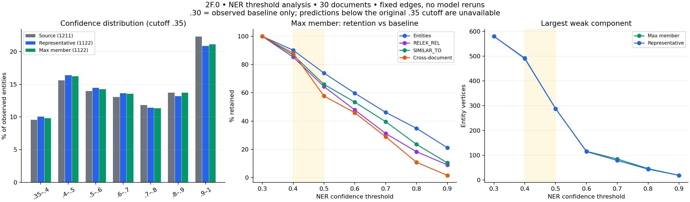

# Этап 2F.0 — NER Entity Confidence Threshold Analysis

Дата анализа: 11 ноября 2026, Europe/Moscow. Ветка: `design-v2-sequential-kg`. Только локальный анализ зафиксированного baseline; фильтр в рабочий граф не применён.

## Результат и выбор кандидатов

**Перспективные пороги: 0.40 и 0.50, основная стратегия — max member confidence.** 0.40 — предпочтительный осторожный кандидат: удаляет 110 вершин (9.80%), сохраняя 88.14% междокументных связей. 0.50 — более агрессивный кандидат: удаляет 292 вершины (26.02%), но сохраняет только 57.73% междокументных связей. Это кандидаты по компромиссу объёма, контекстных потерь и связности, а не доказанные оптимумы качества.

Порог 0.60 исключён из короткого списка: крупнейшая компонента уменьшается с 580 вершин / 23 документов до 116 / 6, остаётся 47.84% фактических рёбер; исчезают `synapomorphy` и `clericalism`. При 0.70–0.90 потери ещё сильнее; 0.90 оставляет лишь 3 из 194 междокументных связей и полностью опустошает документ W4381572413. Целевого числа вершин при выборе не использовано.

**Повышение confidence не отделяет надёжно бесполезные извлечения от научных терминов.** Уже при 0.40 исчезают полные названия OB-NLM, Internal Family Systems и `magnetic field shear`, тогда как общие `results` имеют score до 0.892064, а `article` — max member 0.967406. Уменьшение графа и сохранение его связности не равны улучшению precision или Graph-RAG.

## Данные, происхождение threshold и определения

- Вход: `../semantic_resolution/input/canonical_entities.jsonl`, 1122 канонические записи; `members.source_entity` точно восстанавливает все 1211 исходных сущностей и 1327 типизированных source mentions. 1211 — число исходных spans/entities, а не число независимых mention scores.
- У исходной сущности `confidence = max(source_mentions[].score)`: типы одного span уже агрегированы максимумом. Это проверено для всех записей. Здесь распределение 1211 confidence рассчитано по исходным сущностям; 1327 scores повторно не смешиваются с ними.
- `reports/re_v2/relex_comparison/threshold035/e3_base/experiment_config.json` указывает SHA-256 именно `reports/ner_v2/research_run2/E3/mentions_035.jsonl`; хеш проверен. `scripts/build_relex_graphs.py:97–126` читает этот файл и группирует упоминания по span. **Применённый к baseline NER cutoff — 0.35, включительная граница E3.** `entity_threshold: null` означает внешние E3-сущности, а не отсутствие NER-отсечения.
- В `E3/config.json` historical `minimum_inference_threshold=0.15`. Это минимальный порог исторического инференса, а не cutoff текущего baseline. Нижние historical выгрузки не читались и не добавлялись. Строка 0.30 — тождественный baseline виртуальный подграф на наблюдаемом наборе, с эффективным нижним отсечением 0.35; оценить настоящий NER@0.30 по этим данным нельзя.
- Representative confidence — `confidence` того `members.source_entity`, чей `entity_id == canonical_entity_id`. Проверено совпадение с `context_source_entity_id`; это текущий представитель и плоский confidence в импорте 2E. Max member confidence — максимум `confidence` среди всех участников уже существующей канонической группы. Группы и представители не меняются.
- Из 1122 групп 62 содержат больше одного member; у 38 max member строго выше representative. Max member не является калиброванной вероятностью истинности: максимум может поддерживать и общий/ошибочно ограниченный span.
- Исходные 1760 RELEX_REL взяты из `relation_remapping/canonical_relations.jsonl`. Только готовые 685 SIMILAR_TO конфигурации `intfloat/e5-small-v2 / text_name / 0.95` выбраны из `semantic_links.csv`: 194 междокументных и 491 внутридокументное. Другие конфигурации исключены. Пороги ReLEx и embeddings не исследовались.

Для стратегии s и порога t: `V(s,t)={v: confidence_s(v)>=t}`, `E(s,t)={e∈E_baseline: head(e)∈V(s,t) и tail(e)∈V(s,t)}`. Удаление касается только вершин; все выжившие фактические и семантические отношения сохраняются с исходными ID и свойствами. Не проверяется confidence каждого member, создавшего исходное ребро: здесь фильтруется каноническая вершина целиком. Сохранившийся member не переносит score или тип на другие spans.

Связность рассчитана только на entity-вершинах и RELEX_REL/SIMILAR_TO: направления игнорируются для слабых компонент; документы и RELEX_MENTIONS не участвуют. SIMILAR_TO считается один раз на пару, параллельные фактические отношения считаются раздельно. Исходные 13 фактических петель сохраняются, пока жива вершина; вершина с петлёй не изолирована (степень > 0), хотя остаётся одноэлементной компонентой. Изолированная вершина — без единого инцидентного ребра. При равенстве размеров крупнейшей компоненты используется минимальный canonical ID.

Среднее число сущностей — на все 30 документов, включая опустевшие. В многотипной сущности каждый исходный тип учитывается по одному разу; поэтому суммы по типам могут превышать число вершин. Междокументные фактические отношения в baseline отсутствуют: соответствующий счётчик во всех вариантах равен 0, все междокументные связи здесь — SIMILAR_TO.

Исторический NER checkpoint E3: `fastino/gliner2.5-base-v1`, revision `54785d51df8d86a0d8f2eb212fec15871aad2c4d` (из сохранённого `E3/config.json`). Его загрузка и выполнение в этом этапе не выполнялись. Текущее состояние Neo4j не запрашивалось: baseline воспроизведён по локальным артефактам 2E и проверен по всем указанным размерам и метрикам связности.

## Распределение confidence

| Набор | N | min | p10 | p25 | median | mean | p75 | p90 | max |
|---|---|---|---|---|---|---|---|---|---|
| source_entities | 1211 | 0.350089 | 0.403203 | 0.497670 | 0.682278 | 0.687228 | 0.883497 | 0.965354 | 0.999476 |
| canonical_representative | 1122 | 0.350089 | 0.399682 | 0.490654 | 0.664861 | 0.677589 | 0.873520 | 0.958381 | 0.999476 |
| canonical_max_member | 1122 | 0.350089 | 0.400475 | 0.493110 | 0.668826 | 0.681165 | 0.877617 | 0.961262 | 0.999476 |

| Интервал | Исходные (1211) | Canonical representative (1122) | Canonical max member (1122) |
|---|---|---|---|
| [0; 0.3) | 0 | 0 | 0 |
| [0.3; 0.35) | 0 | 0 | 0 |
| [0.35; 0.4) | 116 | 113 | 110 |
| [0.4; 0.5) | 189 | 184 | 182 |
| [0.5; 0.6) | 169 | 162 | 160 |
| [0.6; 0.7) | 158 | 153 | 152 |
| [0.7; 0.8) | 143 | 128 | 127 |
| [0.8; 0.9) | 166 | 148 | 154 |
| [0.9; 1.0] | 270 | 234 | 237 |

Нули ниже 0.35 означают отсутствие записей в отсечённом baseline, а не отсутствие предсказаний модели в этих интервалах. Гистограммы, среднее и квантили по **каждому типу и каждому документу** для всех трёх наборов сохранены в `confidence_histogram.csv` и `distribution_summary.csv`. Квантили используют линейную интерполяцию по позиции `(n−1)p`.

### По типам: число / среднее / медиана

| Тип | source_entities | canonical_representative | canonical_max_member |
|---|---|---|---|
| ACTOR | 137 / 0.7431 / 0.7610 | 122 / 0.7332 / 0.7540 | 122 / 0.7386 / 0.7672 |
| ATTRIBUTE | 199 / 0.6371 / 0.6090 | 196 / 0.6352 / 0.6085 | 196 / 0.6353 / 0.6085 |
| CONCEPT | 117 / 0.6225 / 0.5884 | 112 / 0.6199 / 0.5853 | 112 / 0.6211 / 0.5853 |
| CONDITION | 94 / 0.7878 / 0.8601 | 88 / 0.7820 / 0.8499 | 88 / 0.7843 / 0.8499 |
| DATA_RESOURCE | 67 / 0.7126 / 0.7461 | 61 / 0.6950 / 0.6887 | 61 / 0.7136 / 0.7010 |
| MECHANISM | 77 / 0.6507 / 0.6460 | 73 / 0.6468 / 0.6381 | 73 / 0.6468 / 0.6381 |
| METHOD | 80 / 0.6514 / 0.6350 | 78 / 0.6463 / 0.6307 | 78 / 0.6468 / 0.6307 |
| OBJECT | 315 / 0.7672 / 0.8178 | 275 / 0.7611 / 0.8104 | 275 / 0.7663 / 0.8135 |
| PROCESS | 132 / 0.6171 / 0.5829 | 126 / 0.6057 / 0.5796 | 126 / 0.6073 / 0.5796 |
| RESULT | 57 / 0.6157 / 0.6211 | 57 / 0.6157 / 0.6211 | 57 / 0.6157 / 0.6211 |
| TASK | 52 / 0.6052 / 0.5771 | 50 / 0.6044 / 0.5771 | 50 / 0.6081 / 0.5840 |

### По документам: исходный / канонический набор и основная стратегия

В колонках mean/median: source entities → canonical max member. Все representative-квантили также доступны в CSV.

| Документ | Дисциплина | Source N | Canon N | Mean | Median | ≥.4 | ≥.5 | ≥.6 | ≥.7 | ≥.8 | ≥.9 |
|---|---|---|---|---|---|---|---|---|---|---|---|
| W1979727947 | Medicine | 44 | 37 | 0.740 → 0.711 | 0.786 → 0.730 | 35 | 28 | 23 | 20 | 14 | 10 |
| W1995028339 | Biology | 68 | 60 | 0.692 → 0.672 | 0.683 → 0.651 | 53 | 42 | 34 | 27 | 20 | 14 |
| W2039836112 | Biology | 63 | 59 | 0.632 → 0.638 | 0.603 → 0.619 | 56 | 42 | 31 | 16 | 13 | 10 |
| W2076293586 | Biology | 48 | 47 | 0.705 → 0.711 | 0.706 → 0.730 | 44 | 34 | 30 | 24 | 20 | 13 |
| W2078771716 | Economics | 38 | 37 | 0.813 → 0.809 | 0.899 → 0.890 | 36 | 33 | 30 | 27 | 24 | 18 |
| W2084709926 | Physics | 39 | 36 | 0.734 → 0.739 | 0.762 → 0.789 | 32 | 30 | 28 | 24 | 17 | 8 |
| W2096307598 | Physics | 40 | 37 | 0.694 → 0.686 | 0.684 → 0.663 | 35 | 29 | 22 | 18 | 12 | 7 |
| W2130236240 | Economics | 13 | 13 | 0.591 → 0.591 | 0.533 → 0.533 | 9 | 7 | 5 | 4 | 3 | 2 |
| W2317432785 | Physics | 45 | 45 | 0.683 → 0.683 | 0.661 → 0.661 | 41 | 38 | 28 | 20 | 14 | 9 |
| W2326480042 | History | 10 | 10 | 0.748 → 0.748 | 0.735 → 0.735 | 10 | 10 | 9 | 6 | 3 | 2 |
| W2364973104 | Physics | 42 | 40 | 0.741 → 0.733 | 0.793 → 0.766 | 38 | 30 | 28 | 22 | 19 | 13 |
| W2394633461 | History | 37 | 37 | 0.657 → 0.657 | 0.603 → 0.603 | 34 | 28 | 20 | 14 | 12 | 5 |
| W2761455282 | Medicine | 77 | 70 | 0.700 → 0.701 | 0.745 → 0.743 | 64 | 56 | 45 | 38 | 25 | 11 |
| W2791492120 | Medicine | 45 | 40 | 0.733 → 0.746 | 0.753 → 0.761 | 40 | 34 | 31 | 27 | 15 | 9 |
| W2906067930 | Economics | 46 | 40 | 0.660 → 0.666 | 0.675 → 0.675 | 36 | 30 | 24 | 16 | 11 | 7 |
| W2991563224 | Computer Science / Machine Learning | 18 | 18 | 0.655 → 0.655 | 0.639 → 0.639 | 15 | 12 | 11 | 7 | 6 | 4 |
| W3027457624 | Computer Science / Machine Learning | 30 | 29 | 0.752 → 0.744 | 0.805 → 0.798 | 27 | 26 | 21 | 19 | 14 | 6 |
| W3081936674 | Physics | 26 | 26 | 0.624 → 0.624 | 0.588 → 0.588 | 24 | 16 | 12 | 9 | 7 | 4 |
| W3101922761 | Medicine | 59 | 55 | 0.763 → 0.764 | 0.846 → 0.846 | 51 | 47 | 40 | 35 | 32 | 21 |
| W3123056951 | Biology | 42 | 38 | 0.699 → 0.715 | 0.665 → 0.708 | 37 | 30 | 24 | 19 | 17 | 9 |
| W3138328568 | Biology | 66 | 55 | 0.700 → 0.672 | 0.704 → 0.628 | 49 | 38 | 29 | 26 | 21 | 11 |
| W4230116451 | Computer Science / Machine Learning | 24 | 24 | 0.642 → 0.642 | 0.583 → 0.583 | 23 | 16 | 10 | 9 | 6 | 5 |
| W4234628002 | Computer Science / Machine Learning | 34 | 32 | 0.665 → 0.648 | 0.611 → 0.599 | 27 | 25 | 16 | 12 | 9 | 7 |
| W4285525942 | Economics | 62 | 54 | 0.674 → 0.654 | 0.656 → 0.631 | 49 | 38 | 29 | 20 | 17 | 10 |
| W4309030044 | Economics | 29 | 27 | 0.665 → 0.648 | 0.662 → 0.599 | 22 | 17 | 13 | 11 | 9 | 4 |
| W4312422299 | History | 27 | 23 | 0.610 → 0.584 | 0.553 → 0.513 | 18 | 12 | 7 | 6 | 5 | 3 |
| W4381572413 | History | 21 | 21 | 0.623 → 0.623 | 0.656 → 0.656 | 20 | 16 | 12 | 7 | 2 | 0 |
| W4389076493 | Computer Science / Machine Learning | 52 | 51 | 0.582 → 0.578 | 0.583 → 0.576 | 37 | 27 | 23 | 13 | 8 | 4 |
| W4391351014 | Medicine | 41 | 36 | 0.663 → 0.640 | 0.658 → 0.612 | 32 | 21 | 19 | 12 | 10 | 8 |
| W7215137876 | History | 25 | 25 | 0.636 → 0.636 | 0.646 → 0.646 | 18 | 18 | 16 | 10 | 6 | 3 |

## Сравнение всех виртуальных подграфов

Полная машиночитаемая таблица: [comparison.csv](comparison.csv). В ней также есть проценты сохранения, петли, число непустых документов, охват междокументными связями и типы. Строка 0.30 помечена `below_original_cutoff=True`.

### max_member — основная стратегия

| t | Вершин | На док. | Удалено | RELEX_REL | SIMILAR_TO | Междок. | Изоляты (%) | WCC | Max WCC | Док. в max |
|---|---|---|---|---|---|---|---|---|---|---|
| 0.30 | 1122 | 37.40 | 0 | 1760 | 685 | 194 | 200 (17.83%) | 258 | 580 | 23 |
| 0.40 | 1012 | 33.73 | 110 | 1502 | 595 | 171 | 196 (19.37%) | 247 | 492 | 20 |
| 0.50 | 830 | 27.67 | 292 | 1134 | 452 | 112 | 171 (20.60%) | 223 | 288 | 13 |
| 0.60 | 670 | 22.33 | 452 | 842 | 366 | 89 | 153 (22.84%) | 202 | 116 | 6 |
| 0.70 | 518 | 17.27 | 604 | 549 | 271 | 56 | 129 (24.90%) | 177 | 85 | 6 |
| 0.80 | 391 | 13.03 | 731 | 322 | 161 | 21 | 114 (29.16%) | 159 | 46 | 4 |
| 0.90 | 237 | 7.90 | 885 | 158 | 71 | 3 | 89 (37.55%) | 123 | 19 | 1 |

Распределение оставшихся сущностей по типам:

| Тип | 0.30 | 0.40 | 0.50 | 0.60 | 0.70 | 0.80 | 0.90 |
|---|---|---|---|---|---|---|---|
| ACTOR | 122 | 114 | 105 | 93 | 70 | 52 | 32 |
| ATTRIBUTE | 196 | 167 | 139 | 101 | 66 | 53 | 28 |
| CONCEPT | 112 | 98 | 71 | 51 | 38 | 23 | 13 |
| CONDITION | 88 | 85 | 74 | 69 | 60 | 49 | 36 |
| DATA_RESOURCE | 61 | 58 | 48 | 39 | 31 | 25 | 15 |
| MECHANISM | 73 | 67 | 54 | 41 | 26 | 14 | 9 |
| METHOD | 78 | 66 | 51 | 42 | 31 | 25 | 15 |
| OBJECT | 275 | 266 | 238 | 212 | 183 | 144 | 90 |
| PROCESS | 126 | 111 | 84 | 56 | 40 | 21 | 11 |
| RESULT | 57 | 50 | 38 | 30 | 19 | 11 | 4 |
| TASK | 50 | 45 | 29 | 22 | 15 | 10 | 5 |

### representative

| t | Вершин | На док. | Удалено | RELEX_REL | SIMILAR_TO | Междок. | Изоляты (%) | WCC | Max WCC | Док. в max |
|---|---|---|---|---|---|---|---|---|---|---|
| 0.30 | 1122 | 37.40 | 0 | 1760 | 685 | 194 | 200 (17.83%) | 258 | 580 | 23 |
| 0.40 | 1009 | 33.63 | 113 | 1500 | 594 | 171 | 195 (19.33%) | 246 | 490 | 20 |
| 0.50 | 825 | 27.50 | 297 | 1123 | 450 | 112 | 169 (20.48%) | 222 | 288 | 13 |
| 0.60 | 663 | 22.10 | 459 | 826 | 363 | 87 | 153 (23.08%) | 202 | 115 | 6 |
| 0.70 | 510 | 17.00 | 612 | 524 | 249 | 40 | 130 (25.49%) | 181 | 79 | 4 |
| 0.80 | 382 | 12.73 | 740 | 313 | 150 | 12 | 112 (29.32%) | 158 | 44 | 3 |
| 0.90 | 234 | 7.80 | 888 | 145 | 68 | 2 | 89 (38.03%) | 122 | 19 | 1 |

Распределение оставшихся сущностей по типам:

| Тип | 0.30 | 0.40 | 0.50 | 0.60 | 0.70 | 0.80 | 0.90 |
|---|---|---|---|---|---|---|---|
| ACTOR | 122 | 114 | 105 | 93 | 68 | 49 | 31 |
| ATTRIBUTE | 196 | 167 | 139 | 101 | 66 | 53 | 28 |
| CONCEPT | 112 | 98 | 71 | 51 | 37 | 22 | 13 |
| CONDITION | 88 | 84 | 74 | 69 | 60 | 49 | 36 |
| DATA_RESOURCE | 61 | 57 | 46 | 37 | 29 | 22 | 14 |
| MECHANISM | 73 | 67 | 54 | 41 | 26 | 14 | 9 |
| METHOD | 78 | 66 | 51 | 42 | 31 | 25 | 15 |
| OBJECT | 275 | 265 | 235 | 208 | 181 | 143 | 89 |
| PROCESS | 126 | 111 | 84 | 56 | 40 | 20 | 11 |
| RESULT | 57 | 50 | 38 | 30 | 19 | 11 | 4 |
| TASK | 50 | 45 | 29 | 21 | 14 | 10 | 5 |

Абсолютное число WCC и изолятов часто уменьшается вслед за удалением вершин, но это не улучшение связности: доля изолятов у max member возрастает с 17.83% до 37.55% при 0.90. Крупнейшая компонента может смениться; её размер и документы пересчитаны, не перенесены из baseline.

### Разница стратегий при одном пороге

| t | Доп. вершины max | Доп. RELEX_REL | Доп. SIMILAR_TO | Доп. междок. |
|---|---|---|---|---|
| 0.3 | 0 | 0 | 0 | 0 |
| 0.4 | 3 | 2 | 1 | 0 |
| 0.5 | 5 | 11 | 2 | 0 |
| 0.6 | 7 | 16 | 3 | 2 |
| 0.7 | 8 | 25 | 22 | 16 |
| 0.8 | 9 | 9 | 11 | 9 |
| 0.9 | 3 | 13 | 3 | 1 |

Max member сохраняет `ATP` (representative 0.435676 → max 0.899140), но также `article` (0.404989 → 0.967406) и фрагмент названия шкалы `Western Ontario` (0.360369 → 0.890749). При 0.70 всего 8 дополнительных вершин поддерживают 16 дополнительных междокументных связей; их наличие само по себе не доказывает полезность. Все расхождения, обе оценки и оба контекста — в `strategy_disagreements.csv`.

### Смещение по дисциплинам

| Дисциплина | Baseline | 0.40 осталось (%) | 0.50 осталось (%) | 0.60 осталось (%) |
|---|---|---|---|---|
| Biology | 259 | 239 (92.28%) | 186 (71.81%) | 148 (57.14%) |
| Computer Science / Machine Learning | 154 | 129 (83.77%) | 106 (68.83%) | 81 (52.60%) |
| Economics | 171 | 152 (88.89%) | 125 (73.10%) | 101 (59.06%) |
| History | 116 | 100 (86.21%) | 84 (72.41%) | 64 (55.17%) |
| Medicine | 238 | 222 (93.28%) | 186 (78.15%) | 158 (66.39%) |
| Physics | 184 | 170 (92.39%) | 143 (77.72%) | 118 (64.13%) |

Уже при 0.40 сохраняется 83.77% сущностей CS/ML против 93.28% Medicine. На уровне документов разброс ещё сильнее: W2130236240 сохраняет 9/13 (69.23%), W7215137876 — 18/25 (72.00%). При 0.50 W4312422299 сохраняет 12/23 (52.17%), W4389076493 — 27/51 (52.94%). Это наблюдаемая неоднородность score, а не доказательство худшего качества извлечений в этих дисциплинах.

## Контекстная проверка качества

Это целевой иллюстративный разбор локальных контекстов, выполненный при подготовке отчёта, без отдельного запуска LLM или любой модели. Он не является случайной выборкой, экспертной gold-разметкой или оценкой precision/recall. Низкий confidence, общий термин и сомнительный тип — разные свойства. Все разобранные canonical IDs, причины и контексты сохранены в [qualitative_review.csv](qualitative_review.csv).

### patients и results

`patients`: 16 канонических вершин из 24 исходных сущностей. Это могут быть реальные участники или подмножества когорт; generic surface name не делает узел бесполезным. В W2761455282 низкий span `dialysis patients` представлен извлечением `patients` с 0.368889 и исчезает при 0.40, но другие пациенты с 0.754086–0.898713 остаются. В W4391351014 группа пациентов имеет representative 0.657950 и max 0.931172; max member сохраняет её даже при 0.90. Контекст «sixteen patients with esophageal cancer» несёт клиническую информацию.

`results` (casefold): 8 канонических/исходных вершин — 3 заголовка `RESULTS` и 5 общих ссылок `results`. Заголовки со score 0.446378 и 0.449832 удаляются при 0.50, но заголовок 0.564522 — лишь при 0.60. Общие ссылки в содержательных предложениях имеют 0.707956, 0.765157, 0.784150, 0.892064 и переживают 0.70. Порог 0.40 не удаляет ни одной из восьми. Для заголовка есть явное структурное основание считать вершину малоценной; для анафорического слова это оценка самостоятельной информативности, а не ошибка распознавания.

| t | patients max / rep | results casefold max / rep |
|---|---|---|
| 0.30 | 16 / 16 | 8 / 8 |
| 0.40 | 15 / 15 | 8 / 8 |
| 0.50 | 14 / 14 | 6 / 6 |
| 0.60 | 13 / 13 | 4 / 4 |
| 0.70 | 12 / 10 | 4 / 4 |
| 0.80 | 7 / 5 | 1 / 1 |
| 0.90 | 2 / 1 | 0 / 0 |

### Редкие и специфические понятия из разных дисциплин

«Редкий в корпусе» здесь означает document frequency exact casefold-названия = 1 из 30, без синонимического объединения. Это не оценка мировой редкости или научной корректности термина. Для перечисленных ниже названий DF=1; дисциплины перенесены из метаданных корпуса (например, статья про IFS находится в History). Потеря конкретного span/названия не обязательно означает исчезновение всего понятия: другие формулировки, аббревиатуры и типы не объединялись.

- **optimised blockwise non-local means (OB-NLM)** — Computer Science / Machine Learning, `W4230116451`, confidence **0.379960**, впервые удаляется при **0.40**. Конкретный алгоритм GPU-denoising. Полное название теряется уже при 0.40; сокращённые варианты могут оставаться.
  Контекст: «the quality of denoising and helping the real-time diagnosis, we have implemented a GPU parallel algorithm based on the optimised blockwise non-local means (OB-NLM) method. Experimental results have shown a significant improvement of healthcare processing practice in terms of executi»

- **region proposal network** — Computer Science / Machine Learning, `W4389076493`, confidence **0.361345**, впервые удаляется при **0.40**. Прямое название RPN в object detection. Удаляется этот span, а не доказанно весь концепт во всех других формулировках.
  Контекст: «ture fusion strategies within the feature pyramid network (FPN), few studies elaborated on improving the performance of region proposal network (RPN). Conventional RPNs exhibit two key weaknesses in the majority of existing two-stage object detection approaches. »

- **magnetic field shear** — Physics, `W2084709926`, confidence **0.378022**, впервые удаляется при **0.40**. Физическая величина/концепт, связанный с асимметрией турбулентности; низкий score не означает шум.
  Контекст: «Strong magnetic field shear around the divertor x-point is numerically predicted to lead to strong spatial asymmetries in turbulence driven particl»

- **Internal Family Systems** — History, `W7215137876`, confidence **0.352350**, впервые удаляется при **0.40**. В контексте прямо назван терапевтический подход IFS; содержательная потеря уже при 0.40.
  Контекст: «efrain from succumbing to clericalism, it is essential to address attachment wounds first. The author proposes that the Internal Family Systems (IFS) therapy approach can help heal relational wounds through inner work. This can have positive repercussions with th»

- **advance notification** — Economics, `W2130236240`, confidence **0.377509**, впервые удаляется при **0.40**. Конкретное предварительное уведомление о закрытии предприятий; содержательное экономическое понятие, потеря при 0.40.
  Контекст: «In their analysis of the effects of advance notification of plant closings, Nord and Ting (ILR Review, July 1991) claim that much can be expected of current legislation that ma»

- **green banking** — Economics, `W4285525942`, confidence **0.371192**, впервые удаляется при **0.40**. Тема статьи и перечня финансовых инструментов; потеря этого span при 0.40.
  Контекст: «n, and increases the transparency of green banking institutions. The article analyzes the main financial instruments of green banking: green bank lending, green mortgages, green bonds, co-investment of green banks, securitization of green bank assets. T»

- **P2X(7) receptor antagonists** — Biology, `W2039836112`, confidence **0.428229**, впервые удаляется при **0.50**. Конкретные антагонисты рецептора, использованные в эксперименте; потеря при 0.50.
  Контекст: «iRNA and by use of astrocytes from Cx43 knockout mice. Permeabilization was reduced by apyrase (APY), an ATPase, and by P2X(7) receptor antagonists, implicating secretion of ATP and autocrine and/or paracrine action. Increased permeability of cells exposed to FGF-1 o»

- **immunogenic hotspots** — Biology, `W3123056951`, confidence **0.436594**, впервые удаляется при **0.50**. Области, распознаваемые HLA-DRB1*09, непосредственно исследуются в работе; потеря при 0.50.
  Контекст: «e, which is reported to be entrenched in the Thai population. In this study, we used computational design to screen for immunogenic hotspots recognized by HLA-DRB1*09, and predicted seventeen mutants having anywhere between one through four mutations that redu»

- **Pearson product-moment correlation coefficient** — Medicine, `W1979727947`, confidence **0.464365**, впервые удаляется при **0.50**. Назван конкретный коэффициент сравнения MD measurements; потеря полного названия при 0.50.
  Контекст: «ing set for model building (733 cases, 748 controls) and a test set for model assessment (765 cases, 747 controls). The Pearson product-moment correlation coefficient (r) was used to compare the MD measurements by Cumulus and our automated measure, which mimics Cumulus. The likelihood »

- **cardiac implantable electronic device (CIED)** — Medicine, `W4391351014`, confidence **0.497576**, впервые удаляется при **0.50**. Центральное устройство исследования; полное название теряется при 0.50. Отдельные CIED/CIEDs имеют другие scores.
  Контекст: «(1) Background: The prevalence of cancer patients relying on cardiac implantable electronic device (CIED) is steadily rising. The aim of this study was to evaluate RT-related malfunctions of CIEDs. (2) Methods: We retrospecti»

- **co-investment** — Economics, `W4285525942`, confidence **0.478441**, впервые удаляется при **0.50**. В контексте конкретный финансовый инструмент; сомнения в OBJECT не делают PROCESS бессодержательным. Потеря при 0.50.
  Контекст: «The article analyzes the main financial instruments of green banking: green bank lending, green mortgages, green bonds, co-investment of green banks, securitization of green bank assets. The analysis of characteristic features and peculiarities of appli»

- **symmetrical Lucas sine** — Physics, `W3081936674`, confidence **0.433088**, впервые удаляется при **0.50**. Источник явно перечисляет эту форму решений; оценка математической корректности статьи не выполнялась. Потеря при 0.50.
  Контекст: «f the reduced ordinary differential equation. The obtained solutions are in the form of dark soliton, combined soliton, symmetrical Lucas sine, Lucas cosine functions, and periodic wave solutions. We present also some graphical simulations of the solutions corre»

- **synapomorphy** — Biology, `W1995028339`, confidence **0.553260**, впервые удаляется при **0.60**. Точный эволюционный термин в выводе о потере acpP1; сохраняется при 0.50, исчезает при 0.60.
  Контекст: «in of these genes in this species. The acpP1 gene is missing in all Thalassiosirales, suggesting that its loss may be a synapomorphy for the order and this gene may have been functionally transferred to the nucleus. Three genes involved in photosynthes»

- **clericalism** — History, `W7215137876`, confidence **0.522421**, впервые удаляется при **0.60**. Конкретный термин в обсуждении церковного лидерства; сохраняется при 0.50, исчезает при 0.60.
  Контекст: «o genuinely consider differing viewpoints, collaborate with the laity on an equal basis, and refrain from succumbing to clericalism, it is essential to address attachment wounds first. The author proposes that the Internal Family Systems (IFS) therapy»

- **X-ray magnetic circular dichroism (XMCD)** — Physics, `W2317432785`, confidence **0.610512**, впервые удаляется при **0.70**. Название измерительного метода; сохраняется при 0.60, исчезает при 0.70.
  Контекст: «), structure sensitive low-angle X-ray reflectivity method, element-selective X-ray absorption spectroscopy (XANES) and X-ray magnetic circular dichroism (XMCD) at the Zr L2� 3 and K absorption edges of Fe and Co. The local probes of electronic and magnetic properties are fully c»

- **securitization** — Economics, `W4285525942`, confidence **0.627014**, впервые удаляется при **0.70**. Конкретный финансовый процесс; сохраняется при 0.60 и теряется при 0.70.
  Контекст: «financial instruments of green banking: green bank lending, green mortgages, green bonds, co-investment of green banks, securitization of green bank assets. The analysis of characteristic features and peculiarities of application of these financial instr»

Полезные удаления также есть: `approach` (0.353786) — общее обозначение подхода; `accurate` (0.363876) — одиночный модификатор; `top-to-bottom back` (0.359056) — неполный span перед `attention modules`. Все исчезают при 0.40. Однако `clear` (0.362754/0.490462) описывает прозрачность corneal grafts: слабое самостоятельное название не означает отсутствия клинического смысла. Высокий score тоже не гарантирует хорошую границу span (`Western Ontario`). Поэтому утверждение «удалённые вершины — шум» данными опровергается.

## Примеры для каждого варианта

Ниже по два ближайших к границе удалённых и сохранённых примера. Выбор детерминированный, не случайный; при t=0.30 удалённых в доступном baseline нет. `examples.csv` дополнительно содержит крайние scores. Confidence указан по текущей стратегии, контекст — от member, задающего этот score. Полные ID в CSV разрешают одинаковые названия; в отчёте дан короткий префикс ID.

### max_member, t=0.30

Удалённых нет: доступный набор уже отсечён при 0.35.

- Сохранена: **deuterium emission fluctuation**, confidence **0.350089**, `W2084709926`, `e:e87e0599ba6c…`; rep=0.350089, max=0.350089.
  Контекст: «ce in the region near the x-point. Edge fluid and turbulent codes UEDGE and BOUT will be used to interpret impurity and deuterium emission fluctuation measurements in the divertor.»

- Сохранена: **one-step protocol**, confidence **0.350962**, `W3027457624`, `e:159c7df3dcba…`; rep=0.350962, max=0.350962.
  Контекст: «leading to embedded nanoparticles with controlled morphologies. This simple, cost-effective, mild, surfactant-free, and one-step protocol for the fabrication of embedded platinum nanostructures leads to morphology-based barcodes for polymeric composites. We»

### max_member, t=0.40

- Удалена: **EMTDC power simulation software**, confidence **0.399642**, `W2364973104`, `e:93a82df2d81a…`; rep=0.399642, max=0.399642.
  Контекст: « transient model containing key parts in the lighting protection,such as generator,control unit,and cables by the PSCAD/EMTDC power simulation software.The action mechanism and influence laws of indirect lighting over-voltage in the military power supply are discussed,an»

- Удалена: **total degree of polarization**, confidence **0.399369**, `W2096307598`, `e:b491ca4d94f5…`; rep=0.399369, max=0.399369.
  Контекст: « west. The total uncertainty is about 5% due to the absolute accuracy of the fluxes of the primary calibrators; (2) the total degree of polarization is about 6%. Both polarization intensity and degree of polarization increase from the disk's center to the limb, and th»

- Сохранена: **fluorescent tracers**, confidence **0.400043**, `W2039836112`, `e:94a907d94678…`; rep=0.400043, max=0.400043.
  Контекст: «rd injury, activated spinal astrocytes in culture, induced secretion of ATP, and permeabilized them to relatively large fluorescent tracers [ethidium (Etd) and lucifer yellow (LY)] through "hemichannels" (HCs). HCs can be formed by connexins or pannexins; the»

- Сохранена: **deuterium**, confidence **0.400193**, `W2084709926`, `e:b1582ec9b25f…`; rep=0.400193, max=0.400193.
  Контекст: «ce in the region near the x-point. Edge fluid and turbulent codes UEDGE and BOUT will be used to interpret impurity and deuterium emission fluctuation measurements in the divertor.»

### max_member, t=0.50

- Удалена: **food problems**, confidence **0.499482**, `W2906067930`, `e:75e2175ca10c…`; rep=0.499482, max=0.499482.
  Контекст: «g of the condition and mechanism for the Harvest Paradox, but also maybe offers some little reference values in solving food problems of China. Following the methods of Samuelson and Nordhaus, this paper utilizes the supply and demand theorem to study t»

- Удалена: **tendency to increase**, confidence **0.497763**, `W4285525942`, `e:4d561107e82f…`; rep=0.497763, max=0.497763.
  Контекст: « these financial instruments has been carried out. Different estimates of the total value of green bank loans and their tendency to increase and against the background of still low share in total lending have been compared. The article evaluates the structure »

- Сохранена: **composite part**, confidence **0.500281**, `W3027457624`, `e:ac5045ca7350…`; rep=0.500281, max=0.500281.
  Контекст: «unts of counterfeit composite parts showing up in the complex aerospace supply chain, it is absolutely vital to track a composite part throughout its lifecycle-from production to usage and to disposal. Existing barcoding methods are invasive, affect the »

- Сохранена: **ethidium**, confidence **0.500734**, `W2039836112`, `e:fbfa33eb42b0…`; rep=0.500734, max=0.500734.
  Контекст: «spinal astrocytes in culture, induced secretion of ATP, and permeabilized them to relatively large fluorescent tracers [ethidium (Etd) and lucifer yellow (LY)] through "hemichannels" (HCs). HCs can be formed by connexins or pannexins; they can open»

### max_member, t=0.60

- Удалена: **Nephite people**, confidence **0.599818**, `W4312422299`, `e:91817fd77a9f…`; rep=0.599818, max=0.599818.
  Контекст: «salem, stitched together through a variety of narrators. As the title page claims, this book contains the record of the Nephite people, descendants of Lehi, who was commanded by God to leave Jerusalem in order to save his family from destruction. From th»

- Удалена: **EMU**, confidence **0.599520**, `W2078771716`, `e:01c718d0f970…`; rep=0.599520, max=0.599520.
  Контекст: «The sustainability of the ERM and the feasibility of EMU is dependent upon the economies of the EC achieving the appropriate degree of economic convergence. One of the difficul»

- Сохранена: **China**, confidence **0.600818**, `W2906067930`, `e:53ef43bc03a3…`; rep=0.600818, max=0.600818.
  Контекст: «The phenomenon that China's increase of grain production didn’t cause the Harvest Paradox from 2003 to 2014 occurred in the context of significan»

- Сохранена: **commemorative medals**, confidence **0.601771**, `W2394633461`, `e:2983107324a9…`; rep=0.601771, max=0.601771.
  Контекст: «al medals (sede vacante produced generic annual medals in 1667 and 1691). Annual medals are a unique iteration of papal commemorative medals and they celebrate an important papal achievement from the preceding year. The production of annual medals was an exerc»

### max_member, t=0.70

- Удалена: **usage**, confidence **0.699720**, `W3027457624`, `e:a8f58aea1f01…`; rep=0.699720, max=0.699720.
  Контекст: «ex aerospace supply chain, it is absolutely vital to track a composite part throughout its lifecycle-from production to usage and to disposal. Existing barcoding methods are invasive, affect the structural properties of composites, and/or are vu»

- Удалена: **T cell activity**, confidence **0.699340**, `W2791492120`, `e:70949917de13…`; rep=0.699340, max=0.699340.
  Контекст: «polyposis (CRSwNP) still are discussed controversially.Regulatory B cells (Breg) are responsible for the suppression of T cell activity: deficiencies for Breg have been demonstrated to contribute to autoimmune disorders, e.g., systemic lupus erythematosus»

- Сохранена: **essay**, confidence **0.701013**, `W4381572413`, `e:2faa20b2436c…`; rep=0.701013, max=0.701013.
  Контекст: «e any guarantees of preservation and accessibility to these unique sources. The bibliographic selection offered by this essay well illuminates how this approach can be employed to study in an innovative way the most various historical phenomena:»

- Сохранена: **global capital**, confidence **0.703153**, `W4285525942`, `e:d93ffdb680f5…`; rep=0.703153, max=0.703153.
  Контекст: «inates is a network-organized green banking system. This network not only significantly accelerates the accumulation of global capital in green infrastructure, but also significantly facilitates the process of cooperation between private investors and de»

### max_member, t=0.80

- Удалена: **ARPN**, confidence **0.798847**, `W4389076493`, `e:71228efadee6…`; rep=0.768926, max=0.798847.
  Контекст: «particularly compact yet accurate proposal boxes. On one hand, a progressive attention mechanism is devised to make the ARPN focus more on prospective object regions, where a series of multi-scale front attention modules (FAM) are applied to co»

- Удалена: **intractable glaucoma**, confidence **0.798424**, `W3101922761`, `e:147e51f81c81…`; rep=0.727582, max=0.798424.
  Контекст: «spectively. Only 7 corneal grafts (17.5%) remained clear at last follow-up. CONCLUSIONS: A GDD can successfully control intractable glaucoma even after a very long period of time also after PK. However, the survival of the corneal grafts is low.»

- Сохранена: **income**, confidence **0.800631**, `W2906067930`, `e:93a034d1bf19…`; rep=0.800631, max=0.800631.
  Контекст: « supply and demand theorem to study the phenomenon. The phenomenon was found it didn’t cause the loss of farmers' total income that the grain production in China had increased for 11 years from 2003 to 2014, which was inconsistent with the Harves»

- Сохранена: **CIO organizing drives**, confidence **0.800662**, `W2326480042`, `e:c39e410c73ef…`; rep=0.800662, max=0.800662.
  Контекст: «k socialists and communists who lived with such nostalgic exhilaration in the era climaxed by the Spanish Civil War and CIO organizing drives seem utterly estranged and uncomprehending in their attitudes toward the new left and counterculture. By the same token»

### max_member, t=0.90

- Удалена: **plant closing literature**, confidence **0.899776**, `W2130236240`, `e:a6f0956a6abf…`; rep=0.899776, max=0.899776.
  Контекст: «months' warning of their impending layoff. They also suggest that many of the disparate results reported in the earlier plant closing literature reflect the inability to distinguish between formal and informal notice on the basis of the 1984 and 1986 Displaced Wor»

- Удалена: **ATP**, confidence **0.899140**, `W2039836112`, `e:7b9c8188b695…`; rep=0.435676, max=0.899140.
  Контекст: « reduced permeabilization when given 30 min before FGF-1 application, but not when given 1 h after FGF-1. We infer that ATP is initially released from vesicles and then it mediates continued release by action on P2X(7) receptors and opening of»

- Сохранена: **Polypoid tissue**, confidence **0.900950**, `W2791492120`, `e:03d199f9e12c…`; rep=0.900950, max=0.900950.
  Контекст: «s disease, the aim of this study was to characterize subpopulations of peripheral and edaphic B cells in CRSwNP.Methods.Polypoid tissue and blood samples were collected from 10 patients undergoing paranasal sinus surgery and lymphocytes were analyzed by m»

- Сохранена: **finite series expansion**, confidence **0.901111**, `W3081936674`, `e:0d691cb1e6e4…`; rep=0.901111, max=0.901111.
  Контекст: «s in optical fibers. We attain certain special type traveling wave solutions of the under investigated model by help of finite series expansion and auxiliary differential equations. In this manner, we exploit exp (− ϕ ( ε )) and modified Kudryashov approaches as »

### representative, t=0.30

Удалённых нет: доступный набор уже отсечён при 0.35.

- Сохранена: **deuterium emission fluctuation**, confidence **0.350089**, `W2084709926`, `e:e87e0599ba6c…`; rep=0.350089, max=0.350089.
  Контекст: «ce in the region near the x-point. Edge fluid and turbulent codes UEDGE and BOUT will be used to interpret impurity and deuterium emission fluctuation measurements in the divertor.»

- Сохранена: **one-step protocol**, confidence **0.350962**, `W3027457624`, `e:159c7df3dcba…`; rep=0.350962, max=0.350962.
  Контекст: «leading to embedded nanoparticles with controlled morphologies. This simple, cost-effective, mild, surfactant-free, and one-step protocol for the fabrication of embedded platinum nanostructures leads to morphology-based barcodes for polymeric composites. We»

### representative, t=0.40

- Удалена: **EMTDC power simulation software**, confidence **0.399642**, `W2364973104`, `e:93a82df2d81a…`; rep=0.399642, max=0.399642.
  Контекст: « transient model containing key parts in the lighting protection,such as generator,control unit,and cables by the PSCAD/EMTDC power simulation software.The action mechanism and influence laws of indirect lighting over-voltage in the military power supply are discussed,an»

- Удалена: **total degree of polarization**, confidence **0.399369**, `W2096307598`, `e:b491ca4d94f5…`; rep=0.399369, max=0.399369.
  Контекст: « west. The total uncertainty is about 5% due to the absolute accuracy of the fluxes of the primary calibrators; (2) the total degree of polarization is about 6%. Both polarization intensity and degree of polarization increase from the disk's center to the limb, and th»

- Сохранена: **fluorescent tracers**, confidence **0.400043**, `W2039836112`, `e:94a907d94678…`; rep=0.400043, max=0.400043.
  Контекст: «rd injury, activated spinal astrocytes in culture, induced secretion of ATP, and permeabilized them to relatively large fluorescent tracers [ethidium (Etd) and lucifer yellow (LY)] through "hemichannels" (HCs). HCs can be formed by connexins or pannexins; the»

- Сохранена: **deuterium**, confidence **0.400193**, `W2084709926`, `e:b1582ec9b25f…`; rep=0.400193, max=0.400193.
  Контекст: «ce in the region near the x-point. Edge fluid and turbulent codes UEDGE and BOUT will be used to interpret impurity and deuterium emission fluctuation measurements in the divertor.»

### representative, t=0.50

- Удалена: **food problems**, confidence **0.499482**, `W2906067930`, `e:75e2175ca10c…`; rep=0.499482, max=0.499482.
  Контекст: «g of the condition and mechanism for the Harvest Paradox, but also maybe offers some little reference values in solving food problems of China. Following the methods of Samuelson and Nordhaus, this paper utilizes the supply and demand theorem to study t»

- Удалена: **tendency to increase**, confidence **0.497763**, `W4285525942`, `e:4d561107e82f…`; rep=0.497763, max=0.497763.
  Контекст: « these financial instruments has been carried out. Different estimates of the total value of green bank loans and their tendency to increase and against the background of still low share in total lending have been compared. The article evaluates the structure »

- Сохранена: **composite part**, confidence **0.500281**, `W3027457624`, `e:ac5045ca7350…`; rep=0.500281, max=0.500281.
  Контекст: «unts of counterfeit composite parts showing up in the complex aerospace supply chain, it is absolutely vital to track a composite part throughout its lifecycle-from production to usage and to disposal. Existing barcoding methods are invasive, affect the »

- Сохранена: **ethidium**, confidence **0.500734**, `W2039836112`, `e:fbfa33eb42b0…`; rep=0.500734, max=0.500734.
  Контекст: «spinal astrocytes in culture, induced secretion of ATP, and permeabilized them to relatively large fluorescent tracers [ethidium (Etd) and lucifer yellow (LY)] through "hemichannels" (HCs). HCs can be formed by connexins or pannexins; they can open»

### representative, t=0.60

- Удалена: **Nephite people**, confidence **0.599818**, `W4312422299`, `e:91817fd77a9f…`; rep=0.599818, max=0.599818.
  Контекст: «salem, stitched together through a variety of narrators. As the title page claims, this book contains the record of the Nephite people, descendants of Lehi, who was commanded by God to leave Jerusalem in order to save his family from destruction. From th»

- Удалена: **EMU**, confidence **0.599520**, `W2078771716`, `e:01c718d0f970…`; rep=0.599520, max=0.599520.
  Контекст: «The sustainability of the ERM and the feasibility of EMU is dependent upon the economies of the EC achieving the appropriate degree of economic convergence. One of the difficul»

- Сохранена: **China**, confidence **0.600818**, `W2906067930`, `e:53ef43bc03a3…`; rep=0.600818, max=0.600818.
  Контекст: «The phenomenon that China's increase of grain production didn’t cause the Harvest Paradox from 2003 to 2014 occurred in the context of significan»

- Сохранена: **commemorative medals**, confidence **0.601771**, `W2394633461`, `e:2983107324a9…`; rep=0.601771, max=0.601771.
  Контекст: «al medals (sede vacante produced generic annual medals in 1667 and 1691). Annual medals are a unique iteration of papal commemorative medals and they celebrate an important papal achievement from the preceding year. The production of annual medals was an exerc»

### representative, t=0.70

- Удалена: **usage**, confidence **0.699720**, `W3027457624`, `e:a8f58aea1f01…`; rep=0.699720, max=0.699720.
  Контекст: «ex aerospace supply chain, it is absolutely vital to track a composite part throughout its lifecycle-from production to usage and to disposal. Existing barcoding methods are invasive, affect the structural properties of composites, and/or are vu»

- Удалена: **T cell activity**, confidence **0.699340**, `W2791492120`, `e:70949917de13…`; rep=0.699340, max=0.699340.
  Контекст: «polyposis (CRSwNP) still are discussed controversially.Regulatory B cells (Breg) are responsible for the suppression of T cell activity: deficiencies for Breg have been demonstrated to contribute to autoimmune disorders, e.g., systemic lupus erythematosus»

- Сохранена: **essay**, confidence **0.701013**, `W4381572413`, `e:2faa20b2436c…`; rep=0.701013, max=0.701013.
  Контекст: «e any guarantees of preservation and accessibility to these unique sources. The bibliographic selection offered by this essay well illuminates how this approach can be employed to study in an innovative way the most various historical phenomena:»

- Сохранена: **global capital**, confidence **0.703153**, `W4285525942`, `e:d93ffdb680f5…`; rep=0.703153, max=0.703153.
  Контекст: «inates is a network-organized green banking system. This network not only significantly accelerates the accumulation of global capital in green infrastructure, but also significantly facilitates the process of cooperation between private investors and de»

### representative, t=0.80

- Удалена: **moveable in-vessel mirror**, confidence **0.798101**, `W2084709926`, `e:ecd0ce7e3db1…`; rep=0.798101, max=0.798101.
  Контекст: «point region, a new tangential observation port has been recently installed on NSTX. A reentrant sapphire window with a moveable in-vessel mirror images the divertor region from the center stack out to R∼80 cm and views the x-point for most plasma configurations. A»

- Удалена: **nanoparticles**, confidence **0.798048**, `W3027457624`, `e:345934b54b61…`; rep=0.798048, max=0.798048.
  Контекст: «l method to store information in fiber-reinforced composites based on solid-state in situ reduction leading to embedded nanoparticles with controlled morphologies. This simple, cost-effective, mild, surfactant-free, and one-step protocol for the fabrica»

- Сохранена: **income**, confidence **0.800631**, `W2906067930`, `e:93a034d1bf19…`; rep=0.800631, max=0.800631.
  Контекст: « supply and demand theorem to study the phenomenon. The phenomenon was found it didn’t cause the loss of farmers' total income that the grain production in China had increased for 11 years from 2003 to 2014, which was inconsistent with the Harves»

- Сохранена: **CIO organizing drives**, confidence **0.800662**, `W2326480042`, `e:c39e410c73ef…`; rep=0.800662, max=0.800662.
  Контекст: «k socialists and communists who lived with such nostalgic exhilaration in the era climaxed by the Spanish Civil War and CIO organizing drives seem utterly estranged and uncomprehending in their attitudes toward the new left and counterculture. By the same token»

### representative, t=0.90

- Удалена: **plant closing literature**, confidence **0.899776**, `W2130236240`, `e:a6f0956a6abf…`; rep=0.899776, max=0.899776.
  Контекст: «months' warning of their impending layoff. They also suggest that many of the disparate results reported in the earlier plant closing literature reflect the inability to distinguish between formal and informal notice on the basis of the 1984 and 1986 Displaced Wor»

- Удалена: **rHuEPO**, confidence **0.898395**, `W3123056951`, `e:065dc7cf9a84…`; rep=0.898395, max=0.898395.
  Контекст: «ve out of seventeen mutants were less immunogenic in vitro while retaining similar or slightly reduced bioactivity than rHuEPO. These engineered proteins could be the potential candidates to treat patients who are rHuEpo-dependent and express the»

- Сохранена: **Polypoid tissue**, confidence **0.900950**, `W2791492120`, `e:03d199f9e12c…`; rep=0.900950, max=0.900950.
  Контекст: «s disease, the aim of this study was to characterize subpopulations of peripheral and edaphic B cells in CRSwNP.Methods.Polypoid tissue and blood samples were collected from 10 patients undergoing paranasal sinus surgery and lymphocytes were analyzed by m»

- Сохранена: **finite series expansion**, confidence **0.901111**, `W3081936674`, `e:0d691cb1e6e4…`; rep=0.901111, max=0.901111.
  Контекст: «s in optical fibers. We attain certain special type traveling wave solutions of the under investigated model by help of finite series expansion and auxiliary differential equations. In this manner, we exploit exp (− ϕ ( ε )) and modified Kudryashov approaches as »

## Ограничения и воспроизводимость

Это ретроспективные индуцированные подграфы зафиксированного снимка, не результат повторного NER. Confidence не откалиброван под качество/полезность; не оценены retrieval/answer quality, научная корректность публикаций и абсолютный recall. Утрата междокументной связи может удалять как полезный мост, так и связь общих слов; все рёбра оставлялись строго по наличию концов.

Проверены: точное восстановление 1211 source entities и 1327 mentions; происхождение mentions_035 по SHA-256; границы confidence и исходное отсечение; все offsets и контексты; существование концов рёбер; исходные петли; 1122/1760/685/194 и связность 200 изолятов / 258 WCC / 580 вершин / 23 документа; вложенность наборов при росте порога; включение representative-набора в max member-набор. Полный перечень проверок и SHA-256 входов/защищённых предыдущих артефактов — [validation.json](validation.json).

Команды из корня репозитория:

```powershell
.venv/Scripts/python.exe reports/entity_resolution/relex_base_t035/ner_threshold_analysis/analyze.py
.venv/Scripts/python.exe reports/entity_resolution/relex_base_t035/ner_threshold_analysis/write_report.py
```

Оба скрипта пишут только в текущий каталог отчёта. `analyze.py` использует стандартную библиотеку и не импортирует проектный код; `write_report.py` использует matplotlib только для рисунка. Ни NER, ни ReLEx, ни embeddings/LLM, ни cosine similarity не запускались. Entity Merge не выполнялся. Neo4j не открывался. Исходные данные и предыдущие отчёты не изменены; хеши защищённых файлов сверены до и после анализа.

### Артефакты

- `comparison.csv`, `metrics.json` — все 14 вариантов и baseline.
- `source_entity_confidences.csv` (1211), `entity_confidences.csv` (1122) — все оценки и контексты.
- `distribution_summary.csv`, `confidence_histogram.csv` — распределения overall / type / document / discipline для source, canonical representative и canonical max member.
- `retention_by_type.csv`, `retention_by_document.csv`, `retention_by_discipline.csv` — полные разрезы для всех вариантов.
- `virtual_subgraphs.jsonl` — точные сохранённые vertex IDs и два набора edge IDs по каждому варианту; исходные записи и свойства доступны в неизменённых входах.
- `components.csv` — все слабые компоненты каждого варианта с составом вершин и документов.
- `strategy_disagreements.csv`, `examples.csv`, `qualitative_review.csv` — расхождения и контекстные примеры.
- `analysis.png`, `analysis.svg` — распределения, сохранение рёбер и размер крупнейшей компоненты.



**Этап 2F.0 завершён только анализом NER thresholds. Изменения KG или дальнейшие эксперименты не выполнялись.**
