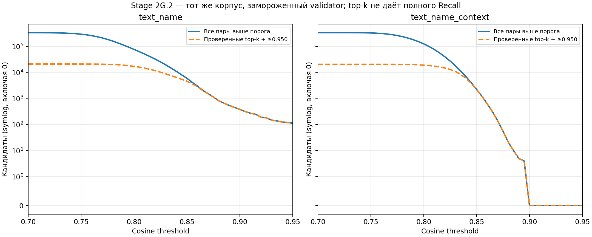
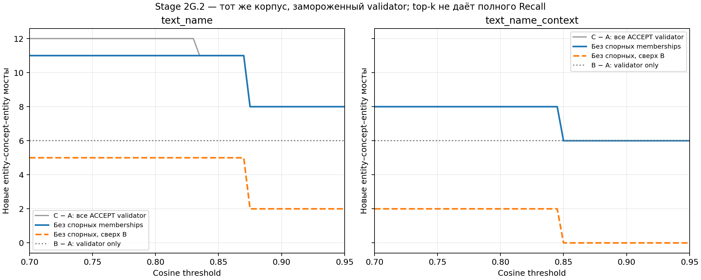

# Stage 2G.2 — Extended Semantic Concept Threshold Sweep

102 виртуальные конфигурации на прежних 30 документах. Neo4j не изменён; нового импорта и push нет.

Validator и его словари заморожены в версии Stage 2G.1. Новый диапазон — Decimal 0.700–0.950, шаг 0.005. Embeddings/cosine cache предыдущего эксперимента проверен по hashes, input ordering, модели и рецепту; E5 не запускалась повторно.

## Полный подсчёт и ограниченная содержательная проверка

Все 315954 cross-document EE и 27444 nonmember EC пары на режим участвуют в полном векторизованном подсчёте. Для проверки смысла выбираются top-20 cross-document соседей каждой entity (симметричное объединение) и top-10 concepts каждой entity; дополнительно сохраняются все кандидаты с cosine ≥0.950. Tie-break: стабильный ID. Решение вычисляется один раз для уникального candidate/reference и переиспользуется при всех порогах/режимах. Отсечённые пары не объявляются REJECT; их смысл не проверялся. **Полный Recall не измеряется.**

| Режим | Порог | Все кандидаты | Проверены | Отсечены | C memberships Δ | C concepts Δ | C bridges Δ | Bridges без спорных | C−B bridges | WCC | Largest | Suspicious ACCEPT |
|---|---:|---:|---:|---:|---:|---:|---:|---:|---:|---:|---:|---:|
| text_name | 0.700 | 343174 | 21321 | 321853 | 8 | 2 | 12 | 11 | 6 | 222 | 374 | 2 |
| text_name | 0.750 | 299359 | 21286 | 278073 | 8 | 2 | 12 | 11 | 6 | 222 | 374 | 2 |
| text_name | 0.800 | 77762 | 17393 | 60369 | 8 | 2 | 12 | 11 | 6 | 222 | 374 | 2 |
| text_name | 0.825 | 25805 | 10368 | 15437 | 8 | 2 | 12 | 11 | 6 | 222 | 374 | 2 |
| text_name | 0.830 | 19829 | 8955 | 10874 | 8 | 2 | 12 | 11 | 6 | 222 | 374 | 2 |
| text_name | 0.845 | 8209 | 5543 | 2666 | 6 | 1 | 11 | 11 | 5 | 223 | 372 | 0 |
| text_name | 0.850 | 6045 | 4659 | 1386 | 6 | 1 | 11 | 11 | 5 | 223 | 372 | 0 |
| text_name | 0.870 | 1559 | 1549 | 10 | 6 | 1 | 11 | 11 | 5 | 223 | 372 | 0 |
| text_name | 0.875 | 1150 | 1150 | 0 | 5 | 1 | 8 | 8 | 2 | 223 | 372 | 0 |
| text_name | 0.900 | 386 | 386 | 0 | 5 | 1 | 8 | 8 | 2 | 223 | 372 | 0 |
| text_name | 0.925 | 183 | 183 | 0 | 5 | 1 | 8 | 8 | 2 | 223 | 372 | 0 |
| text_name | 0.950 | 114 | 114 | 0 | 5 | 1 | 8 | 8 | 2 | 223 | 372 | 0 |
| text_name_context | 0.700 | 343398 | 20910 | 322488 | 5 | 1 | 8 | 8 | 2 | 223 | 372 | 0 |
| text_name_context | 0.750 | 334744 | 20910 | 313834 | 5 | 1 | 8 | 8 | 2 | 223 | 372 | 0 |
| text_name_context | 0.800 | 127466 | 19333 | 108133 | 5 | 1 | 8 | 8 | 2 | 223 | 372 | 0 |
| text_name_context | 0.825 | 27795 | 13250 | 14545 | 5 | 1 | 8 | 8 | 2 | 223 | 372 | 0 |
| text_name_context | 0.830 | 18193 | 11036 | 7157 | 5 | 1 | 8 | 8 | 2 | 223 | 372 | 0 |
| text_name_context | 0.845 | 4043 | 3856 | 187 | 5 | 1 | 8 | 8 | 2 | 223 | 372 | 0 |
| text_name_context | 0.850 | 2265 | 2241 | 24 | 2 | 0 | 6 | 6 | 0 | 223 | 371 | 0 |
| text_name_context | 0.870 | 139 | 139 | 0 | 2 | 0 | 6 | 6 | 0 | 223 | 371 | 0 |
| text_name_context | 0.875 | 56 | 56 | 0 | 2 | 0 | 6 | 6 | 0 | 223 | 371 | 0 |
| text_name_context | 0.900 | 0 | 0 | 0 | 2 | 0 | 6 | 6 | 0 | 223 | 371 | 0 |
| text_name_context | 0.925 | 0 | 0 | 0 | 2 | 0 | 6 | 6 | 0 | 223 | 371 | 0 |
| text_name_context | 0.950 | 0 | 0 | 0 | 2 | 0 | 6 | 6 | 0 | 223 | 371 | 0 |

Полные 102 строки: threshold_comparison.csv и candidate_distribution.csv. Доля ACCEPT среди проверенных кандидатов — acceptance_fraction_checked_candidates; это **не Precision**. Она включает уже подтверждённые общие concepts, поэтому отдельно показаны new_accept_candidates и новые memberships.

## Ablation: одинаковый validator, разные кандидаты

| Вариант | Concepts | HAS_SHARED_CONCEPT | Междокументные мосты | WCC | Largest |
|---|---:|---:|---:|---:|---:|
| A: неизменный Stage 2G | 34 | 130 | 92 | 223 | 371 |
| B: improved validator, lexical candidates only | 34 | 132 | 98 | 223 | 371 |

B использует исторические lexical candidates Stage 2G и повторный candidate generation неизменного lexical resolver на существующем каталоге. Embedding scores в B не участвуют. C — объединение B и принятых semantic memberships; поэтому улучшение validator остаётся в C при любом пороге. Это явное уточнение относительно таблицы threshold-gated deltas Stage 2G.1, где lexical control показывался отдельно. Колонки semantic_accepted_memberships и memberships_beyond_validator_only отделяют эти вклады. Полное сравнение A/B/C для каждого режима/порога — ablation_comparison.csv.

B добавляет 2 memberships. Unique semantic-only memberships, недоступных lexical candidate universe и отсутствующих в B: 1. Их исходные evidence и IDs — semantic_only_discoveries.jsonl. Высокий cosine или отсутствие общего слова сами по себе не означают правильность.

## Ответы на вопросы эксперимента

1. При движении вниз по порогу Surgery уже доступен при name 0.950 (в 2G.1 он появлялся и при 0.955). Новый квалифицированный member paranasal sinus surgery→surgery появляется на grid 0.870, cosine 0.873386. Новый concept cell появляется на 0.830, cosine 0.833477; он отмечен для review как чрезмерно широкая biological category. Без этой спорной категории иных новых concepts на проверенной selection ниже порога не найдено.

2. Name обнаруживает клиническую Surgery и её дополнительный sinus-surgery member. Name+context воспроизводит Surgery на 0.845 и ниже, но дополнительных подтверждённых classes/members сверх name здесь не даёт. Это сравнение конкретного source-context recipe с leave-one-document-out и top-k, не универсальная победа одного режима. При ≥0.900 у context нет semantic candidates; C всё равно содержит 2 lexical validator-only links B.

3. При снижении 0.850→0.825 full candidates растут с 6045 до 25805 для name и с 2265 до 27795 для context; на 0.800 их уже 77762/127466. Это резкий рост retrieval workload. Большинство проверенных низкосходных кандидатов не проходят научную validation, но отброшенные top-k пары не размечались и не называются ложными. При 0.700 проверены 21321 из 343174 (name) и 20910 из 343398 (context), около 6% universe выше gate; полнота содержательного поиска неизвестна.

4. Строго semantic-only membership без пересечения нормализованных слов/aliases и без lexical_match — Surgical procedures→surgery. Она отсутствует в lexical candidate universe и B. Paranasal sinus surgery→surgery найдена через низкопороговый EE proposal, но имеет буквальный общий термин surgery и не выдаётся за совпадение без лексики. Cells/cell — регулярное число; это также не semantic-only. raw-token flag 2G.1 сохранён отдельно для сопоставимости.

5. Возможные false negatives замороженного validator: pathological stress reactivity→Stress reactivity и HLA-DRB1*09 gene→Genes. Второй source прямо называет gene, однако строгие context witnesses не подтверждают общую область с reference. Они вынесены в quality_audit.csv; решение осталось REJECT. Это content-review hypotheses, не независимый Gold. Словари и ACCEPT rules для исправления этих случаев в ходе sweep не менялись.

6. A: 34 concepts/130 memberships/92 bridges, WCC 223/largest 371. B: 34/132/98, WCC 223/largest 371. C name 0.870: 35/136/103, WCC 223/largest 372; context 0.845: 35/135/100, WCC 223/largest 372. C name ≤0.830 даёт raw 36/138/104, WCC 222/largest 374 и 17 новых reachable document pairs, но 2 новых memberships Cell спорны. Именно общий Cell подключает ранее недостижимый документ W2039836112 через W2791492120 к большому компоненту. Без них остаются 35/136/103, WCC 223/largest 372 и 0 новых reachable pairs. Два direct document pairs Cancer связаны с B; третий raw direct pair и все 17 first-reachability pairs возникают через спорный Cell. Увеличение связности само по себе не доказывает качество.

7. Для следующей отдельной проверки разумны name 0.870 (добавляет sinus-surgery member), более консервативный name 0.900–0.950 и context 0.840–0.845. Это кандидаты диапазонов, не оптимумы: Gold нет, selection ограничена и source-rule validator исследован на этом же корпусе. Ниже примерно 0.825 workload резко увеличивается без новых неоспоренных gains в рассмотренной selection. Cell требует отдельного решения о полезности общего hub до какого-либо импорта.

## Качество и границы вывода

Все уникальные новые ACCEPT проходят отдельный аудит ролей, qualifiers, generic scope и source contexts; stratified REJECT sample берётся по каждому reason и режиму. Suspicious ACCEPT помечаются в quality_audit.csv и считаются отдельно, но результаты замороженного validator во время sweep не исправляются. Audit не является независимым Gold; отсутствие флага не доказывает правильность. Свойства cohorts, экземпляров и результатов не наследуются.

Правильные примеры: breast cancer→Cancer (disease category), Surgical procedures→surgery (clinical class), paranasal sinus surgery→surgery (конкретный вид клинического вмешательства). Исходный текст сообщает о 10 пациентах, проходивших paranasal sinus surgery; их факты не переносятся на knee/eye cohorts. Cell и peripheral blood mononuclear cells действительно обозначают биологические клетки, но общая категория слишком широка для автоматического вывода о полезном междокументном scientific bridge. Две такие memberships остаются raw ACCEPT и отдельно помечаются SUSPICIOUS; график показывает и raw ACCEPT, и вариант без них.

Ошибочные/неподтверждённые кандидаты: limonene↔limonene synthase gene (product vs gene), genetics→Genes (область vs объект), hip→knee arthroplasty (разные anatomical qualifiers), Study/Results (универсальные слова). Cosine не исправляет эти различия и не доказывает membership. Независимая Precision не измерялась.

Снижение порога увеличивает число тематически близких пар, а не автоматически число корректных научных связей. Полные counts отражают весь universe, а ACCEPT/REJECT и graph metrics — только проверенную selection плюс B. Для анализа роста неподтверждённых кандидатов сравниваются raw/full curves и reviewed REJECT; непроверенные отсечённые пары нельзя считать ложными. Нельзя выбирать оптимальный порог по максимальному числу рёбер.

WCC/reachability включают все 492 исходные SIMILAR_TO, в том числе с историческими REJECT/REVIEW annotations. Semantic graph path — маршрут поиска между независимыми исследованиями; он не является новой фактической зависимостью. Документы, 811 entities, 1307 facts, 492 SIMILAR_TO, 34 concepts и 130 исходных memberships во всех virtual payloads сохранены точно.

## Воспроизведение

`.venv/Scripts/python.exe scripts/sweep_semantic_concepts.py --extended --neo4j-env <existing-file>`

Кэш embeddings и полной memoized проверки — вне Git в .cache/semantic_concept_sweep/. Полные выбранные candidates/decisions/proposals сохранены как детерминированные .jsonl.gz; entity_evidence.jsonl позволяет восстановить исходные контексты без их многократного дублирования. Новые mappings или модели не добавлялись. Manifest фиксирует selection limits, hashes, версию validator, counts отсечённых пар, memoization statistics и тесты.
