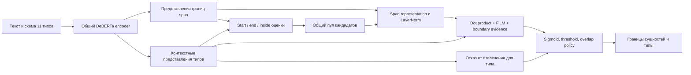

# Полный разбор GLiNER и Weight Surgery v2

Проверены все **193 581 591 параметр** checkpoint `fastino/gliner2.5-base-v1`
revision `54785d51df8d86a0d8f2eb212fec15871aad2c4d`: **334 тензора**, в том числе
**134 матрицы и 200 векторов**. По результатам сохранена отдельная модель
[`models/gliner_weight_surgery_v2/`](../../models/gliner_weight_surgery_v2/).
Она получена из оригинала; изменения v1 не накапливаются.

Обучение, вычисление градиентов, loss, optimizer, LoRA/PEFT и inference не
выполнялись. По указанию пользователя тестирование исключено. Корпус, gold,
предсказания и метрики не использовались для выбора преобразования.

## Покрытие анализа

Это полный численный анализ checkpoint, а не утверждение о понимании
семантического значения каждого отдельного числа. Все значения вошли в
статистики: finite/zero count, min/max, mean/std, L1/Frobenius norm, SHA256.
Для каждой матрицы сохранены все сингулярные значения, condition number,
stable/effective rank, доля энергии верхней компоненты и ранги для 90/95/99%
энергии; также исследованы нормы строк и столбцов.

| Блок | Тензоров | Матриц | Параметров |
|---|---:|---:|---:|
| Encoder: embeddings, relative positions, 12 transformer layers | 198 | 74 | 183 763 200 |
| Активные boundary/span/query/pool/scoring блоки NER | 68 | 27 | 1 154 625 |
| Альтернативный proposer/scorer, candidate features, null/count | 34 | 16 | 465 361 |
| Отдельные classification, record, relation heads | 34 | 17 | 8 198 405 |
| Всего | 334 | 134 | 193 581 591 |

NaN и Inf не обнаружены. Эти проверки исключают такую численную порчу,
но сами по себе не доказывают качество или отсутствие семантических ошибок.

Для обычных матриц использован полный float64 SVD. Для таблицы embeddings
128011×768 вычислен полный спектр через накопление `WᵀW` по всем строкам и
eigendecomposition; это не truncated/randomized SVD. У метода Gram хуже
точность на самых малых сингулярных значениях из-за возведения condition
number в квадрат. Энергия каждого спектра сверена с нормой исходной матрицы.

Дополнительно рассмотрены связанные проекции: start/end/inside affine kernels,
pool compatibility и все 144 attention heads. Для Q/K анализируется
content-content часть; relative p2c/c2p, softmax и LayerNorm не сводятся к
этой единственной матрице. Для FFN нельзя считать `W_out W_in` точным
отображением, поскольку между ними стоит GELU.

## Как здесь устроены извлечение и классификация сущностей

Используется GLiNER2.5 **boundary architecture**, а не классическая
архитектура GLiNER с отдельным SpanRepLayer. Encoder — DeBERTa-v3-base,
hidden size 768, 12 слоёв, 12 attention heads, FFN width 3072.

Для span `(s,e)` и запроса типа `q` сначала строится

`z = W_start b_s + W_end b_e + W_length f_len + W_prior prior + W_content content + biases`,

`c = LayerNorm(z)`, `r_q = W_query h_q + bias_query`.

Итоговая оценка содержит `cᵀ r_q / sqrt(128)`, FiLM-conditioned MLP,
start/end logits и inside evidence. Поэтому изменения span representation
влияют и на прохождение порога извлечения, и на относительные оценки типов.
Точное направление этого изменения для конкретного примера по одним
спектрам установить нельзя.

Отдельный `classifier.0/3` относится к schema/text classification. Он не
является фиксированным 11-классовым NER classifier. Типы OBJECT, ACTOR,
CONCEPT, METHOD, PROCESS, DATA_RESOURCE, ATTRIBUTE, RESULT, CONDITION, TASK,
MECHANISM приходят через схему и контекстные представления маркеров типов.
В checkpoint нет строки весов, которую можно отождествить с METHOD и
аналитически «усилить METHOD» только по её номеру.

Конфигурация использует `candidate_pool=shared`. Поэтому legacy
`boundary_proposer` и `pair_scorer` не являются основным scoring path;
их спектральная правка в обычном режиме не решит текущую задачу.
`record_decoder`, `relation_scorer` и `candidate_encoder` также не определяют
обычные entity pair logits в этой схеме.

Важное исключение — `null_projection`: при `sigmoid(wᵀh_q+b)>0.5`
decoder отбрасывает **все** сущности соответствующего запроса типа.
`count_head` вычисляется, но `adaptive_threshold=false`, поэтому его
изменение не добавляет span в выбранной конфигурации.

## Что найдено в спектрах

| Матрица | σ₁/σ₂ | Энергия первой компоненты |
|---|---:|---:|
| Encoder layer 3 FFN output | 6.69860 | 25.22% |
| Encoder layer 4 FFN output | 5.89984 | 22.31% |
| Word embeddings | 4.85245 | 35.95% |
| Relative position embeddings | 3.17804 | 74.24% |
| Shared scorer start projection | 1.98908 | 16.61% |
| Shared scorer end projection | 1.96191 | 17.08% |

Это измеренная анизотропия, а не доказательство вредных выбросов. У FFN
layer 3 после удаления направления, невидимого следующей LayerNorm,
отношение σ₁/σ₂ остаётся **6.69809**. Пик не объясняется только сдвигом
общего среднего, но это всё ещё не делает его ошибкой: он может кодировать
полезное представление, сформированное исходным обучением.

Именно поэтому v2 не подавляет самые большие пики глобально. Массовое
изменение embeddings, Q/K или FFN затронуло бы общий язык, относительные
позиции и представления всех типов сразу без основания считать их неверными.

## Почему учитывается LayerNorm

Пусть `H = I − 11ᵀ/d`, здесь `d=128`. LayerNorm зависит от `Hz` и
не меняется при добавлении к `z` произвольного общего сдвига `a·1`.
Следовательно, для проекции непосредственно перед LayerNorm функционально
существенна центрированная часть `HW`, а не весь спектр `W`.

У start projection только 0.4210% энергии весов лежит в этом невидимом
направлении. В изменении v1 невидимо около 0.2906% энергии ΔW.
Таким образом, v1 действительно меняет представление, а не только
избыточную параметризацию, но оно остаётся одиночным спектральным опытом,
не адаптацией к семантике онтологии.

У совместного центрированного отображения концов span

`A = [H W_start, H W_end]`

размер 128×256, σ₁=**4.17111310784**, σ₂=**2.02038681096**,
σ₁/σ₂=**2.06451**. Существует единое доминирующее направление совместного
отображения, к которому можно применить согласованную коррекцию двух сторон.
Нулевое 128-е сингулярное значение здесь является следствием `rank(H)=127`,
а не найденной неисправностью. Малые значения не обнуляются.

## Применённая операция v2

Изменены ровно два тензора одного активного NER scoring head:

- `boundary_head.shared_pool_scorer.start_projection.weight`, 128×128;
- `boundary_head.shared_pool_scorer.end_projection.weight`, 128×128.

Для `A=UΣVᵀ` вычислено

`A′ = U diag(min(σᵢ,τ)) Vᵀ`,

где τ — минимальный порог в `[0.99σ₁, σ₁]`, удовлетворяющий
`||max(σ−τ,0)||₂ ≤ 0.001 ||A||F`.

Это ближайшая по Фробениусу матрица в шаре spectral norm `≤τ`.
Она остаётся в центрированном выходном подпространстве. Обновление
`ΔA=A′−A` разделено на два блока и прибавлено к исходным W_start и W_end;
их нецентрированные средние и все biases аналитически сохранены.
Для записи float32 присутствует небольшая погрешность округления,
измеренная и записанная в manifest.

Заранее заданные бюджеты совпадают с консервативными ограничениями v1:
не более 1% изменения верхнего значения и около 0.1% относительной
совместной нормы. Их не подбирали по текстам, меткам или метрикам.
Порог вычисляется как решение скалярного ограничения, без loss, optimizer
или обновлений по градиентам. В этом checkpoint изменена одна совместная
сингулярная компонента, а не весь спектр или все слои.

| Измерение | Результат |
|---|---:|
| Совместная σ₁ | 4.17111310784 → 4.16078577650 |
| Совместная относительная норма ΔA | 0.1000000081% с округлением F32 |
| Относительная норма ΔW_start | 0.0988771503% |
| Относительная норма ΔW_end | 0.1006687134% |
| Остальные тензоры | 332 побитово совпадают |
| Исходная модель и v1 | Сохранены без изменений |

Ограничение относится к **совместной** центрированной матрице A; отдельный
end tensor может иметь относительную норму чуть больше 0.1%.
Для фиксированных входных boundary states гарантирована локальная оценка
`||Δz_centered||₂ ≤ ||ΔA||₂ · ||concat(b_s,b_e)||₂`.
Из неё не следует улучшение классификации или гарантия неизменности
предсказаний после LayerNorm, FiLM, sigmoid и дискретных порогов.

Исследовательская гипотеза: слабое ослабление доминирующего совместного
направления span geometry может уменьшить его избыточное влияние относительно
query-conditioned различения типов. **Гипотеза не подтверждена**; возможны
улучшение, отсутствие изменений и ухудшение. Выбор пути модели обоснован
исходным кодом, а полезность для NER пока неизвестна.

## Как изменения весов связаны с задачей

| Цель | Соответствующие веса | Что можно обосновать аналитически |
|---|---|---|
| Согласованная коррекция span representation | Совместные start/end проекции scorer | Применённый v2: минимальная ограниченная спектральная коррекция с учётом LayerNorm |
| Границы сущностей и попадание в candidate pool | Boundary query projections и shared pool builder | Анализировать совместный affine kernel `AᵀB`, включая bias, а не независимо «выравнивать» множители |
| Относительные оценки типов для одного span | Shared query projection и FiLM | Это нужный активный путь; нельзя по спектру установить, какое направление соответствует ошибке METHOD/PROCESS |
| Уменьшение отказов от извлечения | Null projection bias | `b′=b−δ` при δ>0 монотонно снимает часть отказов при фиксированных query states; может добавить false positives |
| Общее изменение порога уверенности | Последний scalar bias FiLM MLP | Сдвигает logits всех типов одинаково при фиксированном pool; не исправляет их взаимное ранжирование |
| Text classification | Отдельный classifier | Не решает текущую задачу entity typing в extraction schema |
| Количество span | Count head | При текущем `adaptive_threshold=false` не управляет выдачей |

В v2 остальные перечисленные вмешательства не применялись. Одновременная
коррекция границ, отказов и query ranking не позволила бы отделить причины
изменения поведения и не имела бы основания в одних весах.

Определения 11 классов хранятся в онтологии, но существующий E3 вызов
использует сокращённые описания из `SHORT`. Например, полное определение
METHOD явно отделяет способ действия от PROCESS, а сокращённое описание
содержит `algorithm or research method`. Это свойство задания схемы,
которое не следует ошибочно считать найденным дефектом конкретной строки
весов. Конфигурация и schema prompts не менялись.

## Артефакты и проверка целостности

- [`all_tensors.csv`](all_tensors.csv) — полный список для просмотра.
- [`all_tensor_statistics.json`](all_tensor_statistics.json) — все параметры и их роль.
- [`all_matrix_spectra.json`](all_matrix_spectra.json) — все 134 спектра.
- [`coupled_projections.json`](coupled_projections.json) — связанные kernels и 144 attention heads.
- [`layernorm_and_task_analysis.json`](layernorm_and_task_analysis.json) — анализ LayerNorm и путей задачи до создания v2.
- [`manifest.json`](manifest.json) — покрытие анализа, версии и hashes исходников.
- [`surgery_v2/weight_surgery_manifest.json`](surgery_v2/weight_surgery_manifest.json) — преобразование, нормы и полные спектры v2.
- [`surgery_v2/tensor_integrity.json`](surgery_v2/tensor_integrity.json) — hashes всех тензоров до/после v2.

Новый safetensors прочитан настоящим safetensors reader. Вся архитектурная
конфигурация и tokenizer скопированы без изменений; shapes, dtype и header
сохранены. Это проверка сериализации и численных ограничений; работоспособность
полного forward отдельно не проверялась по указанию не запускать тесты.

SHA256 исходного checkpoint:
`7274094de2e0c2a37a386f55fc4e23061a954da5bd7a335e7dfe56f2743c277a`.

SHA256 checkpoint v2:
`c1d2bdf9e04f4be7695cf64f27049d01c7fe6accbc92fd08c938f414d5e5869c`.

Скрипты воспроизведения: [`audit_gliner_all_weights.py`](../../scripts/audit_gliner_all_weights.py),
[`analyze_gliner_surgery_targets.py`](../../scripts/analyze_gliner_surgery_targets.py),
[`gliner_weight_surgery_v2.py`](../../scripts/gliner_weight_surgery_v2.py).
Последний скрипт отказывается перезаписывать существующую v2.

Первичные локальные источники: `gliner2/models/boundary/model.py`
(`BoundaryHead.forward`, `_encode_core`), `heads.py`, `pool.py`
(`SharedPoolScorer.forward`), `encoding.py`, `engine.py`
(`_extract_from_batch`, `_decode_entities`) в установленном `.venv-ner-v2`,
конфигурация исходного checkpoint, `src/cgraph/entity_typing_v2/dataset.py`
и `contracts/ner_v2/ontology.v2.json`. Текущий тестовый процесс не
останавливался; код его стенда не менялся.

Качество извлечения и классификации остаётся **неизмеренным**. Результат
этой работы — полный анализ параметров и сохранённый, математически
ограниченный NER-path Weight Surgery checkpoint, а не доказанное
улучшение точности или адаптация к классам онтологии.
