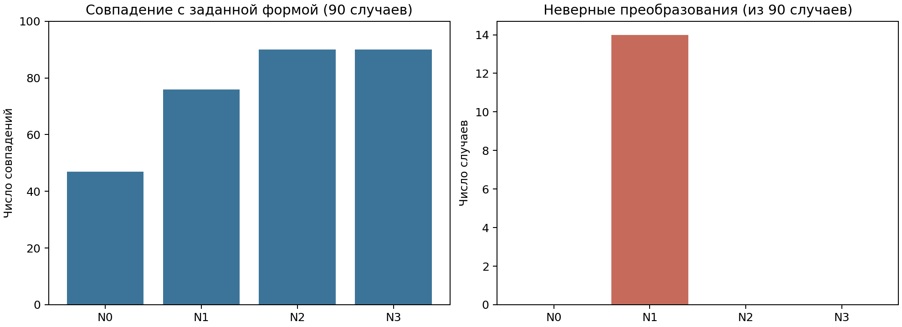
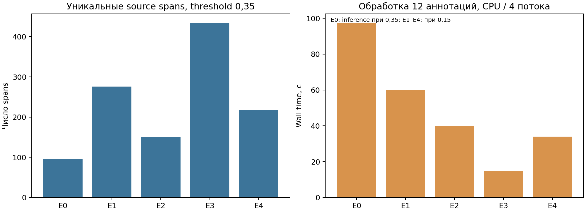
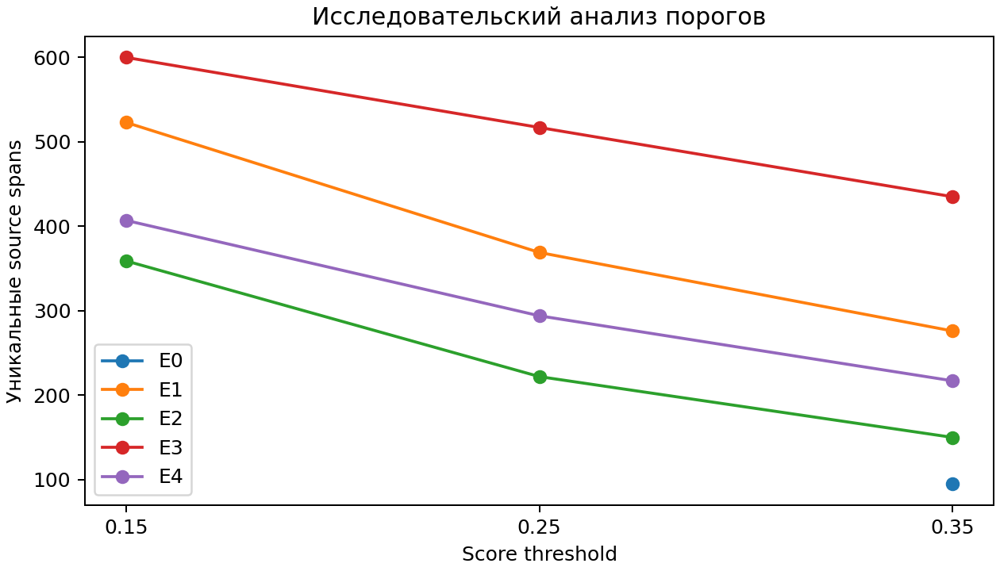
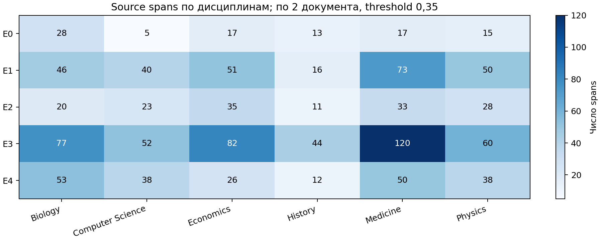

# NER-V2-002 + NORM-V2-001: исследование извлечения и нормализации научных упоминаний

Дата исследования: **31 октября 2026 года (Europe/Moscow)**. Ветка: `design-v2-sequential-kg`.
Исходный commit: `9a8556772a0c24ce80b61e8704683037bcdf150f`.
Статус результатов: реальные CPU-запуски; независимая человеческая разметка отсутствует.

## 1. Цель и постановка задачи

Исследуется начальный участок последовательной архитектуры: обнаружение упоминаний → лингвистическая нормализация.
Цель — выбрать перспективную конфигурацию генерации кандидатов для будущего Qwen Entity Typing 4B,
сохраняя исходный научный смысл, точные границы и происхождение каждого упоминания.
Qwen, извлечение отношений, семантическая верификация, разрешение идентичности, вычисление embeddings,
построение графа и обучение не выполнялись. Утверждённые 11 типов и 20 отношений Ontology v2 сохранены.

Объём извлечённых spans характеризует выход модели, но не Recall. Без проверенной разметки невозможно
установить истинные Precision, Recall и F1 либо статистически обосновать преимущество одной конфигурации.
В работе используются описательные показатели и явно маркированные семантические гипотезы.

## 2. Обоснование выбранных моделей и методов

GLiNER — модель обнаружения сущностей с текстовыми описаниями классов и двунаправленным encoder
([Zaratiana et al., 2023](https://arxiv.org/abs/2311.08526)). Для E1/E2 применяется тот же pinned
GLiNER Large v2.1, что и в историческом E0. Это позволяет исследовать изменение label input и окон
без замены весов. Medium и Small используются только для повторной нормализации сохранённых предсказаний.

E3 использует `fastino/gliner2.5-base-v1`: boundary architecture с отдельным schema API.
Согласно [официальной карточке](https://huggingface.co/fastino/gliner2.5-base-v1), checkpoint следует загружать
через `AutoExtractor`; он возвращает `BoundaryExtractor`. Интеграция использует именно этот интерфейс,
а не legacy `GLiNER2.from_pretrained`. Научная работа о семействе GLiNER2:
[Zaratiana et al., 2025](https://arxiv.org/abs/2507.18546). Она не является самостоятельной публикацией
с результатами именно этого исследования GLiNER2.5.

Нормализация основана на spaCy POS/morphology и леммах
([официальное описание](https://spacy.io/usage/linguistic-features)). Исторический N1 не изменён.
N2 использует ограничение на конечное лексическое существительное во множественном числе:
полный lowercase ASCII token, POS `NOUN`, tag `NNS`, `Number=Plur`, допустимая lowercase-лемма,
без присоединённых знаков формулы или идентификатора. Остальные модификаторы сохраняются.
Удаление possessive возможно только при теге `POS` с защитой парных кавычек.
Это поверхностная эвристика головного существительного, а не синтаксический разбор noun phrase;
она намеренно может оставить внутренние формы множественного числа неизменными.

N3 добавляет сохранение локальных определений сокращений на уровне документа. Алгоритм существовал
в историческом коде и основан на ограниченном обратном выравнивании символов по принципу
[Schwartz & Hearst, 2003](https://psb.stanford.edu/psb-online/proceedings/psb03/schwartz.pdf).
Полная эквивалентность опубликованному алгоритму не заявляется. Словарь научных терминов не вводился.
Короткая и длинная формы не заменяют друг друга; canonical IDs и Entity Resolution отсутствуют.

## 3. Описание экспериментального корпуса OpenAlex

Использован неизменённый snapshot **12 аннотаций, 6 дисциплин, по 2 документа** из `benchmark_run1`.
Тексты не скачивались повторно и не заменялись после просмотра предсказаний. Manifest и SHA-256
зафиксированы до новых запусков в [research_input_lock.json](../../contracts/ner_v2/research_input_lock.json).
Исходный JSONL: [input_abstracts.jsonl](benchmark_run1/input_abstracts.jsonl).
В тексты не добавлялись заголовки. Все offsets — полуинтервалы Unicode codepoints исходной аннотации.
Объём корпуса: 2057 whitespace-слов.

| OpenAlex ID | Область | Год | Слов | Название и DOI |
| --- | --- | --- | --- | --- |
| [W3195791401](https://openalex.org/W3195791401) | Computer Science / Machine Learning | 2021 | 128 | Hand Gesture Recognition Based on sEMG Signal and Convolutional Neural Network — https://doi.org/10.1142/s0218001421510125 |
| [W4312890372](https://openalex.org/W4312890372) | Computer Science / Machine Learning | 2022 | 104 | On the Size of Balls and Anticodes of Small Diameter Under the Fixed-Length Levenshtein Metric — https://doi.org/10.1109/tit.2022.3227128 |
| [W4387756919](https://openalex.org/W4387756919) | Medicine | 2023 | 493 | Luteal Phase Stimulation in the Same Cycle Is an Effective Strategy to Rescue POSEIDON Poor Responders with No Embryos after the First Follicular Stimulation — https://doi.org/10.4103/jhrs.jhrs_76_23 |
| [W2092571965](https://openalex.org/W2092571965) | Medicine | 2013 | 97 | Multidisciplinary Department of “Return to Work After a Cancer”: A French Experience of Support Groups for Vocational Rehabilitation — https://doi.org/10.1080/07347332.2013.855961 |
| [W7130738450](https://openalex.org/W7130738450) | Physics | 2026 | 163 | Steady‐State Spread Bounds for Graph Diffusion via Laplacian Regularisation in Networked Systems — https://doi.org/10.1049/ntw2.70026 |
| [W2020268674](https://openalex.org/W2020268674) | Physics | 2004 | 132 | Molecular-dynamic calculation of the inverse-bremsstrahlung heating of non-weakly-coupled plasmas — https://doi.org/10.1103/physreve.70.056411 |
| [W3182220660](https://openalex.org/W3182220660) | Biology | 2021 | 177 | A test of the photoprotection hypothesis for the evolution of autumn colours: Chlorophyll resorption, not anthocyanin production, is correlated with nitrogen translocation — https://doi.org/10.1111/jeb.13903 |
| [W2355493570](https://openalex.org/W2355493570) | Biology | 2011 | 94 | Optimization of Peanut Protein Enzymolysis Technology by Flavourzyme — DOI отсутствует |
| [W7220014427](https://openalex.org/W7220014427) | Economics | 2025 | 246 | Ripple Effects of War on the Indian Economy — DOI отсутствует |
| [W2130076420](https://openalex.org/W2130076420) | Economics | 2001 | 129 | Permanent and Transitory Components of Business Cycles: Their Relative Importance and Dynamic Relationship — https://doi.org/10.17016/ifdp.2001.703 |
| [W2057261224](https://openalex.org/W2057261224) | History | 2011 | 180 | Heads and Tails – Minds and Bodies: Reconsidering the Late Bronze Age Vestby Hoard in Light of Symbolist and Body Perspectives — https://doi.org/10.1179/146195711798356692 |
| [W2073881503](https://openalex.org/W2073881503) | History | 2003 | 114 | Holistic obstetrics: the origins of “natural childbirth” in Britain — https://doi.org/10.1136/pmj.79.929.168 |

Первоначальный отбор использовал seed 42 и сохранён в `contracts/ner_v2/openalex_snapshot.json`;
подробная процедура описана в `docs/NER_V2_PREP.md`. Дисциплины определены по metadata OpenAlex,
что не заменяет экспертную проверку предметной принадлежности. Например, запись Economics
`W7220014427` описывает topical imprint с несколькими статьями; это ограничивает однородность выборки.
Источник о структуре API: [OpenAlex documentation](https://docs.openalex.org/).
Дополнительная выборка до 36 работ в данном запуске не собиралась: приоритет отдан полному сравнению
на фиксированных 12 документах. Независимая проверка переносимости остаётся необходимой.
Узкий исторический корпус газовых сенсоров не использован как основание выводов.

## 4. Аппаратная и программная конфигурация

CPU: AMD Ryzen 7 8845HS, 8 физических / 16 логических ядер; CPU inference float32, 4 torch threads,
seed 42, deterministic torch algorithms. GPU не использовался. Сведения о CPU дополнительно
проверены через Win32_Processor. Измерения относятся к одному локальному компьютеру.

ОС: `Windows-10-10.0.26200-SP0`; Python 3.11.9; RAM 31.31 GiB.

| Библиотека | Версия |
| --- | --- |
| torch | 2.11.0 |
| gliner | 0.2.26 |
| gliner2 | 2.1.0 |
| transformers | 5.1.0 |
| spacy | 3.8.18 |
| en-core-web-sm | 3.8.0 |
| numpy | 2.4.1 |
| psutil | 7.2.2 |
| huggingface-hub | 1.28.0 |
| tokenizers | 0.22.2 |
| peft | 0.21.2 |
| matplotlib | 3.10.8 |

Исторические версии torch, GLiNER, transformers, spaCy и NLP-модели сохранены. Для исследования
добавлены GLiNER2, PEFT и matplotlib с зависимостями. Полный snapshot пакетов —
[requirements_research.txt](research_run1/requirements_research.txt).
Время загрузки измеряется отдельно от inference. Peak RAM — максимум абсолютного process RSS,
сэмплируемый каждые 10 мс; кратковременный пик между отсчётами может быть пропущен.
Это working set процесса Windows, включая библиотеки, а не объём одних tensors.
Техническая валидация: 72 теста пройдены; результаты pytest сохранены в
[technical_tests.xml](research_run1/technical_tests.xml). Аудит артефактов выполняется отдельно от tests.

| Модель | Checkpoint revision |
| --- | --- |
| GLiNER Large v2.1 | abd49a1f1ebc12af1be84d06f6848221cf96dcad |
| GLiNER Medium v2.1 | 40ec419335d09393f298636f471328b722c6da9e |
| GLiNER Small v2.1 | 4e091416cf7c3481db542c2a3d26156916f3a47f |
| GLiNER2.5 Base | 54785d51df8d86a0d8f2eb212fec15871aad2c4d |

Файлы GLiNER2.5 загружены по точному revision, размер и upstream SHA-256 весов проверены;
lock содержит хеши tokenizer/config. Перед загрузкой проверен запас диска.
GLiNER2.5 загружается offline из локальных файлов, encoder config и tokenizer берутся из checkpoint.
Файлы весов находятся в `artifacts/ner_v2/models/`, исключены из Git.
Исходные Large/Medium/Small и backbone revisions зафиксированы в `contracts/ner_v2/model_lock.json`.

## 5. Методика сравнения NER

E0 — сохранённый Large v2.1: окно 60 whitespace-слов, overlap 20, длинные описания, threshold 0,35.
E1 — те же веса, окно и overlap, короткие описания. E2 — короткие описания, окно 110, overlap 25.
E3 — GLiNER2.5 с окном 110/25 и теми же смысловыми описаниями через schema dictionary.
E4 — дополнительный исследовательский Large v2.1 110/25 с пятью широкими категориями кандидатов.
E4 не изменяет онтологию; `CANDIDATE_0…4` — диагностические hint-коды, не новые ontology types.
Присвоение окончательных типов отложено.

Точный набор коротких описаний:

| Hint | Description |
| --- | --- |
| OBJECT | physical, biological or digital object |
| ACTOR | person or organization |
| CONCEPT | scientific concept or theory |
| METHOD | algorithm or research method |
| PROCESS | event or scientific process |
| DATA_RESOURCE | dataset or research corpus |
| ATTRIBUTE | property, parameter or metric |
| RESULT | measured or observed result |
| CONDITION | experimental or contextual condition |
| TASK | research task or application |
| MECHANISM | mechanism explaining a phenomenon |

У GLiNER v2.1 текст описания сам является label input; GLiNER2.5 получает пары имя класса → описание.
Различие API неизбежно, поэтому E3 не изолирует только размер модели. E2 меняет одновременно окно
и overlap; нельзя приписать весь эффект исключительно длине контекста.

Порог основного сравнения — 0,35. Новые запуски выполнялись один раз при 0,15; результаты 0,25/0,35
получены постфильтрацией. У v2.1 threshold применяется как `score > threshold`, у boundary decoder
используется включительная граница. Значений, точно равных 0,15/0,25/0,35, в сохранённых predictions
не обнаружено; это проверяется отдельным аудитом.
В v2.1 greedy decoder идёт по убыванию score: удаление низких scores не меняет выбор более высоких.
В GLiNER2.5 явно задано `overlap_policy="allow"`, `adaptive_threshold=false` в checkpoint;
abstention не зависит от выбранного span threshold. Поэтому постфильтрация сохраняет результат
этой конфигурации. Дополнительно выполнены два native threshold вызова на первом окне каждого запуска;
сравнивались exact spans и labels. Эти вызовы учтены отдельно в performance artifacts.
Scores разных семейств моделей не считаются одинаково калиброванными вероятностями ошибки.

Для v2.1 заданы `flat_ner=False`, `multi_label=True`. Этот decoder сохраняет вложенные spans и
альтернативные labels одного span, но подавляет часть перекрёстных пересечений внутри одного окна.
На объединении окон такие пересечения могут появиться. Исторический E0 имеет ту же политику.
GLiNER2.5 сохраняет все допустимые пересечения. Это дополнительное ограничение сравнимости.
Дедупликация удаляет только идентичные `(document, start, end, hint)`, выбирая максимальный score;
одинаковые spans с разными hints сохраняются. Нормализованные формы не используются для слияния.

Перед каждым forward проверяется реальное число prompt + text subword tokens, предел 512.
Для GLiNER2.5 используется `processor.transform_record(..., max_len=None)`;
фактическая длина encoder input проверяется hook. При превышении запланировано безопасное
деление у границы предложения и overlapping word fallback, а не скрытая усечённая обработка.
Фактические значения и случаи subdivision находятся в `E*/token_budgets.json`.

Обозначим M множество mention-записей и S множество троек `(document, start, end)`.
Тогда N_mentions = |M|, N_spans = |S|. Exact-span agreement измеряется Jaccard:
J(A,B) = |S_A ∩ S_B| / |S_A ∪ S_B|. Это сходство outputs, не качество относительно разметки.
Число документов с упоминаниями = |{{document(m): m ∈ M}}|.
Overlapping pairs считаются по уникальным source spans, отдельно для вложенности и пересечения без вложенности.
Throughput документов = D / t_processing; throughput слов = W / t_processing.

## 6. Методика сравнения нормализации

Новые NER-вызовы для NORM-V2-001 не выполнялись. Повторно обработаны все 178 исторических
mention-записей: Large 99, Medium 54, Small 25. N1 измерен до выполнения N2/N3 и сохранён отдельно.
Исходный `normalization.py` остался побайтово неизменным относительно исходного commit.

До измерений сохранено 90 случаев: 66 технических контролей и 24 точных выражения из аннотаций
(по 2 на документ), плюс 14 abbreviation-сценариев с 13 положительными определениями и отрицательными
контролями. Представлены ML, медицина, биология, физика, экономика, история; Unicode, формулы,
регистр, proper names, possessives, compound terms, единицы и неоднозначное сокращение PCA.
Все ожидания написаны ассистентом: технические случаи задают спецификацию, а примеры публикаций
имеют статус `UNREVIEWED`. Это development/regression suite, не независимый holdout и не Gold.
Совпадение на нём не доказывает универсальное качество нормализации.

N0 выполняет только NFC и whitespace normalization. N1 — неизменённый historical spaCy normalizer.
N2 — conservative noun-head form без abbreviations. N3 — та же форма плюс document-level definitions.
В N1 алгоритм детектирования сокращений уже есть: при проверке detector API он получает те же
определения, что N3. Различие N3 — явное сохранение независимого от NER списка определений,
а не приписываемое новому алгоритму улучшение распознавания.

Пусть n число случаев, c число точных совпадений с ожидаемой формой, e число неверных изменений,
u число пропущенных необходимых изменений. Correct transformation rate = c/n (включает корректное
сохранение исходной формы). Incorrect transformation rate = e/n; если actual = NFC(surface), но
expected отличается, ошибка относится к u. Ошибка с изменением, не совпавшим с expected, относится к e.
Следовательно, c + e + u = n. False collision rate = C/P_distinct на 5 заранее заданных парах
разных понятий; variant unification rate = V/P_equivalent на 5 парах грамматических вариантов.
Это парные контроли, а не оценка частоты коллизий во всём научном языке.
Abbreviation coverage = matched_expected / expected; matching correctness = matched_expected / predicted.
Если predicted=0, correctness не определена. Source span preservation = valid_source_records / checked_records.

## 7. Эксперимент NORM-V2-001

**Таблица 1. Совпадение с зафиксированной спецификацией и предварительными ожиданиями.**

| Вариант | Технические, из 66 | Публикации, из 24 (UNREVIEWED) | Всего, из 90 | Неверное изменение | Пропущенное изменение | Коллизии, из 5 | Унификация, из 5 |
| --- | --- | --- | --- | --- | --- | --- | --- |
| N0 | 36 | 11 | 47 | 0 | 43 | 0 | 0 |
| N1 | 55 | 21 | 76 | 14 | 0 | 1 | 5 |
| N2 | 66 | 24 | 90 | 0 | 0 | 0 | 5 |
| N3 | 66 | 24 | 90 | 0 | 0 | 0 | 5 |

| Вариант | c/n, % | e/n, % | Abbrev matched/expected | Matching correctness | Document definitions persisted | Offsets |
| --- | --- | --- | --- | --- | --- | --- |
| N0 | 52.22 | 0.00 | 0/13 | не определено | 0 | 178/178 |
| N1 | 84.44 | 15.56 | 13/13 | 100% | 0 | 178/178 |
| N2 | 100.00 | 0.00 | 0/13 | не определено | 0 | 178/178 |
| N3 | 100.00 | 0.00 | 13/13 | 100% | 5 | 178/178 |

**Рисунок 1. Результаты нормализации на development/regression suite.**



Ни одно из 90 ожиданий N2/N3 не нарушено. Этот результат ограничен выбранной спецификацией:
он не является независимой оценкой сохранения смысла на всех научных текстах. N0 не вносит неверных
лексических изменений, но не унифицирует необходимые формы. N1 унифицирует варианты ценой
неверной лемматизации модификаторов; коллизия `odds ratio` / `odd ratio` наблюдается в парном контроле.

| Case | Тип | Исходная форма | Ожидается | N1 | Причина на уровне токенов |
| --- | --- | --- | --- | --- | --- |
| T010 | technical_control | graph-based models | graph-based model | graph-base model | based→base (VERB/VBN); models→model (NOUN/NNS) |
| T012 | technical_control | odds ratio | odds ratio | odd ratio | odds→odd (NOUN/NNS) |
| T016 | technical_control | randomized controlled trials | randomized controlled trial | randomize control trial | randomized→randomize (VERB/VBD); controlled→control (VERB/VBN); trials→trial (NOUN/NNS) |
| T020 | technical_control | diabetes mellitus | diabetes mellitus | diabete mellitus | diabetes→diabete (VERB/VBZ) |
| T022 | technical_control | reduced mortality | reduced mortality | reduce mortality | reduced→reduce (VERB/VBN) |
| T034 | technical_control | weakly coupled plasmas | weakly coupled plasma | weakly couple plasma | coupled→couple (VERB/VBN); plasmas→plasma (NOUN/NNS) |
| T036 | technical_control | reduced graphene oxide | reduced graphene oxide | reduce graphene oxide | reduced→reduce (VERB/VBN) |
| T044 | technical_control | coupled plasma | coupled plasma | couple plasma | coupled→couple (VERB/VBN) |
| T051 | technical_control | fixed effects | fixed effect | fix effect | fixed→fix (VERB/VBN); effects→effect (NOUN/NNS) |
| T053 | technical_control | increased taxation | increased taxation | increase taxation | increased→increase (VERB/VBN) |
| T066 | technical_control | 'quoted terms' | 'quoted term' | 'quote term' | quoted→quote (VERB/VBN); terms→term (NOUN/NNS) |
| R005 | publication_assisted | odds ratio | odds ratio | odd ratio | odds→odd (NOUN/NNS) |
| R011 | publication_assisted | weakly coupled plasmas | weakly coupled plasma | weakly couple plasma | coupled→couple (VERB/VBN); plasmas→plasma (NOUN/NNS) |
| R018 | publication_assisted | increased taxation | increased taxation | increase taxation | increased→increase (VERB/VBN) |

Полный список ошибок N0–N3 с input, expected, actual, типом и причиной:
[errors.jsonl](research_run1/normalization/errors.jsonl). Для N2/N3 отсутствие ошибок означает
отсутствие расхождений только на этих случаях. Результаты всех вариантов по трём моделям:
`research_run1/normalization/N{0,1,2,3}_{large,medium,small}.jsonl`.

Document-level N3 сохранил пять определений из реальных текстов: sEMG, CNN, CIs, MD и IB.
Spans длинной и короткой формы, document_id и revision_id сохранены в
[N3_document_abbreviations.jsonl](research_run1/normalization/N3_document_abbreviations.jsonl).
Все 13 ожидаемых определений в контролях обнаружены, включая PCA с двумя значениями;
две расшифровки сосуществуют. Отрицательные контроли не создали ложных определений.
Эти показатели относятся к ограниченному набору, а не к полноте abbreviations произвольного корпуса.

## 8. Эксперимент NER-V2-002

**Таблица 2. Основное сравнение при score threshold 0,35.**

| Вариант | Mentions (span + hint) | Уникальные spans | Документы, из 12 | Вложенные пары | Пересекающиеся без вложенности | Обработка, с |
| --- | --- | --- | --- | --- | --- | --- |
| E0 | 99 | 95 | 12 | 5 | 0 | 97.648 |
| E1 | 299 | 276 | 12 | 55 | 1 | 60.080 |
| E2 | 158 | 150 | 12 | 19 | 0 | 39.803 |
| E3 | 465 | 435 | 12 | 101 | 2 | 14.947 |
| E4 | 236 | 217 | 12 | 36 | 0 | 33.974 |

Время E0 — историческое detection + normalization при 0,35. Время E1–E4 относится к обработке
при 0,15 с последующим фильтром. Оно включает preflight и normalization, исключает загрузку и
отдельные native threshold checks. Это измеренные затраты получения трёх порогов, а не время
самостоятельного inference при 0,35. Исторические forward count и peak RAM не были измерены.

**Рисунок 2. Число spans и wall time.**



| Вариант | Порог | Mentions | Spans | Документы |
| --- | --- | --- | --- | --- |
| E0 | 0.35 | 99 | 95 | 12 |
| E1 | 0.15 | 653 | 523 | 12 |
| E1 | 0.25 | 416 | 369 | 12 |
| E1 | 0.35 | 299 | 276 | 12 |
| E2 | 0.15 | 429 | 359 | 12 |
| E2 | 0.25 | 243 | 222 | 12 |
| E2 | 0.35 | 158 | 150 | 12 |
| E3 | 0.15 | 732 | 600 | 12 |
| E3 | 0.25 | 577 | 517 | 12 |
| E3 | 0.35 | 465 | 435 | 12 |
| E4 | 0.15 | 541 | 407 | 12 |
| E4 | 0.25 | 355 | 294 | 12 |
| E4 | 0.35 | 236 | 217 | 12 |

**Рисунок 3. Зависимость числа spans от score threshold.**



Низкий порог увеличивает число кандидатов и вычислительную нагрузку следующего этапа.
Он не выбран как основной результат по максимальному числу извлечений; без аудита false candidates
оптимальный threshold установить нельзя. Для E0 значения при 0,15 и 0,25 недоступны:
они отсутствовали в историческом файле, поэтому не реконструировались искусственно.

## 9. Сравнение NER-моделей и параметров

| Пара | Пересечение | Объединение | Jaccard | Только слева | Только справа |
| --- | --- | --- | --- | --- | --- |
| E0/E1 | 82 | 289 | 0.284 | 13 | 194 |
| E0/E2 | 58 | 187 | 0.310 | 37 | 92 |
| E0/E3 | 62 | 468 | 0.132 | 33 | 373 |
| E0/E4 | 54 | 258 | 0.209 | 41 | 163 |
| E1/E2 | 136 | 290 | 0.469 | 140 | 14 |
| E1/E3 | 157 | 554 | 0.283 | 119 | 278 |
| E1/E4 | 134 | 359 | 0.373 | 142 | 83 |
| E2/E3 | 102 | 483 | 0.211 | 48 | 333 |
| E2/E4 | 94 | 273 | 0.344 | 56 | 123 |
| E3/E4 | 158 | 494 | 0.320 | 277 | 59 |

Новые и потерянные относительно E0 spans сохранены полностью в `E*/additional_vs_E0.jsonl`
и `E*/lost_vs_E0.jsonl`. Слово «дополнительный» означает отличие множеств выходов;
оно не означает доказанно корректную находку. Ни Jaccard, ни согласие моделей не заменяют Gold.

**Таблица 3. Уникальные spans по дисциплинам при 0,35.**

| Дисциплина | E0 | E1 | E2 | E3 | E4 |
| --- | --- | --- | --- | --- | --- |
| Biology | 28 | 46 | 20 | 77 | 53 |
| Computer Science / Machine Learning | 5 | 40 | 23 | 52 | 38 |
| Economics | 17 | 51 | 35 | 82 | 26 |
| History | 13 | 16 | 11 | 44 | 12 |
| Medicine | 17 | 73 | 33 | 120 | 50 |
| Physics | 15 | 50 | 28 | 60 | 38 |

**Рисунок 4. Распределение по дисциплинам.**



| Hint | E0 | E1 | E2 | E3 |
| --- | --- | --- | --- | --- |
| OBJECT | 16 | 32 | 23 | 69 |
| ACTOR | 27 | 49 | 25 | 34 |
| CONCEPT | 15 | 18 | 8 | 30 |
| METHOD | 0 | 25 | 11 | 44 |
| PROCESS | 2 | 69 | 39 | 86 |
| DATA_RESOURCE | 0 | 3 | 3 | 13 |
| ATTRIBUTE | 19 | 56 | 26 | 92 |
| RESULT | 12 | 27 | 11 | 32 |
| CONDITION | 6 | 12 | 8 | 27 |
| TASK | 1 | 5 | 2 | 14 |
| MECHANISM | 1 | 3 | 2 | 24 |

Редкие и отсутствующие hints — наблюдаемое распределение, не доказательство отсутствия таких
сущностей в текстах. RESULT и MECHANISM требуют контекстной интерпретации; их низкий выход
сам по себе не доказывает худшее качество именно этих классов.
E4 проверяет пять широких категорий отдельным запуском и имеет собственную стоимость.
Он не принимается как лучший по числу spans: дополнительно появляются общие и дискурсивные кандидаты.

## 10. Анализ ошибок на реальных примерах

Диагностический набор содержит 48 исходных фрагментов. Каждая запись содержит точный span,
контекст, наблюдаемые exact/overlap outputs E0–E4 и предполагаемую интерпретацию.
Набор имеет статус **UNREVIEWED**, составлен ассистентом, не является независимой человеческой разметкой:
[diagnostics_UNREVIEWED.jsonl](research_run1/diagnostics_UNREVIEWED.jsonl).
Отсутствие exact span не равнозначно полному пропуску: более длинный или вложенный кандидат
может пересекать выражение. В таблице `∅` означает отсутствие exact совпадения; пересечения
проверяются в полном artifact.

| Document / фрагмент | Предполагаемый hint | E0 | E1 | E2 | E3 | E4 |
| --- | --- | --- | --- | --- | --- | --- |
| W3195791401 / CNN | METHOD | ∅ | METHOD | ∅ | ∅ | ∅ |
| W3195791401 / sEMG | OBJECT | ∅ | ∅ | ∅ | ∅ | ∅ |
| W3195791401 / feature extraction | PROCESS | ∅ | PROCESS | PROCESS | PROCESS | CANDIDATE_3 |
| W4387756919 / odds ratio | ATTRIBUTE | RESULT | ATTRIBUTE, RESULT | RESULT | ATTRIBUTE | CANDIDATE_4 |
| W2020268674 / weakly coupled plasmas | OBJECT | ∅ | ∅ | ∅ | OBJECT | ∅ |
| W3182220660 / temperature | ATTRIBUTE | ∅ | ∅ | ∅ | ∅ | ∅ |
| W2355493570 / pH | ATTRIBUTE | ATTRIBUTE | ATTRIBUTE | ATTRIBUTE | ATTRIBUTE | CANDIDATE_4 |
| W2355493570 / temperature | ATTRIBUTE | ATTRIBUTE | ATTRIBUTE | OBJECT | ATTRIBUTE | CANDIDATE_4 |
| W2057261224 / lunar calendar | OBJECT | CONCEPT | ∅ | ∅ | MECHANISM, OBJECT | ∅ |
| W2073881503 / natural childbirth | METHOD | ∅ | PROCESS | ∅ | CONCEPT | CANDIDATE_2 |
| W7130738450 / ABSTRACT | проверить NON_ENTITY | CONCEPT | ∅ | ∅ | ∅ | ∅ |
| W7130738450 / scenario | проверить NON_ENTITY | CONDITION, TASK | CONDITION | CONDITION, TASK | ∅ | ∅ |
| W3182220660 / we | проверить NON_ENTITY | ACTOR | ACTOR | ∅ | ∅ | ∅ |
| W3182220660 / We | проверить NON_ENTITY | ACTOR | ACTOR | ∅ | ∅ | ∅ |
| W3182220660 / We | проверить NON_ENTITY | ACTOR | ACTOR | ∅ | ∅ | ∅ |
| W2057261224 / we | проверить NON_ENTITY | ACTOR | ACTOR | ACTOR | ∅ | ∅ |
| W2057261224 / We | проверить NON_ENTITY | ACTOR | ACTOR | ACTOR | ∅ | ∅ |
| W3195791401 / we | проверить NON_ENTITY | ∅ | ACTOR | ∅ | ∅ | ∅ |

Короткие фрагменты исходных текстов (выделен диагностический span):

> much useful information during **feature extraction** . CNNs provide an

Источник: [W3195791401](https://openalex.org/W3195791401); offsets [433, 451).

> 57.7%, P = 0.012, **odds ratio** : 2.286 [95% CI:

Источник: [W4387756919](https://openalex.org/W4387756919); offsets [2490, 2500).

> photooxidative stress at low **temperature** s, allowing a better

Источник: [W3182220660](https://openalex.org/W3182220660); offsets [183, 194).

> we interpret as a **lunar calendar** . By combining a

Источник: [W2057261224](https://openalex.org/W2057261224); offsets [529, 543).

Постфактум дополнительно проверен короткий watchlist дискурсивных слов; это диагностический фильтр, не оценка Precision и не полный подсчёт false positives.

| Вариант | Совпавшие mentions | Уникальные spans | Поверхностные формы |
| --- | --- | --- | --- |
| E0 | 12 | 11 | ABSTRACT; Results; We; results; scenario; we |
| E1 | 16 | 16 | Results; We; results; scenario; we |
| E2 | 7 | 6 | Results; We; results; scenario; we |
| E3 | 7 | 7 | paper; results; study |
| E4 | 5 | 5 | Results; results |

Причины и интерпретация:

1. Длинные descriptions E0 занимают больше prompt budget и дают иной semantic query.
   E1 меняет outputs при неизменных весах и окнах; это наблюдаемый эффект label wording,
   но механизм улучшения качества без человеческого аудита не доказан.
2. `temperature` обозначает параметр в соответствующих фрагментах, однако OBJECT может иметь
   высокий score. Альтернативный ATTRIBUTE иногда сосуществует с ним. Это гипотеза ошибки
   предварительной типизации, которую будущий Qwen должен проверять по контексту.
3. `we`/`We` получает ACTOR; это может быть связано с формулировкой person/organization и ролью автора в предложении.
   Для графа научных объектов такое упоминание предположительно неинформативно. Автоматический
   словарный фильтр по итогам test outputs не вводился, чтобы не скрыть ошибку модели.
   У E3, несмотря на отсутствие этих местоимений, есть другие сомнительные hints: `paper` как DATA_RESOURCE,
   `surface electromyography` как DATA_RESOURCE и `feedforward neural networks` как MECHANISM.
   Это дополнительные гипотезы ошибок, а не подтверждённые независимым экспертом false positives.
4. `scenario` и заголовки требуют ручного решения о границах онтологии. Generic output может быть
   языково правдоподобным, но малополезным для научного графа.
5. Пустые historical `abbreviation_candidates` не означают неисправность abbreviation detector.
   Исторический pipeline прикрепляет определения только при exact long span или совпадении surface
   с short form. Если обе формы не стали NER-упоминаниями, отдельного document artifact не было.
   N3 устраняет потерю определения, но не создаёт пропущенные NER spans искусственно.
6. N1 меняет `odds` на `odd` и `coupled` на `couple`, потому что разрешает лемматизацию lowercase
   токенов независимо от роли модификатора. N2/N3 сохраняют такие токены и изменяют только
   допустимое конечное существительное. Source surface и offsets остаются исходными.

## 11. Анализ скорости и вычислительных ресурсов

**Таблица 4. Разделение времени и потребления памяти новых запусков.**

| Вариант | Model load, с | NLP load, с | NER, с | Preflight, с | NORM, с | Processing, с | Total, с | Doc/s | Word/s | Peak RSS, GiB | Файлы модели, GiB | Encoder calls |
| --- | --- | --- | --- | --- | --- | --- | --- | --- | --- | --- | --- | --- |
| E1 | 15.481 | 1.831 | 59.229 | 0.092 | 0.754 | 60.080 | 77.392 | 0.200 | 34.238 | 3.821 | 1.662 | 49 |
| E2 | 15.833 | 1.808 | 39.065 | 0.063 | 0.671 | 39.803 | 57.444 | 0.301 | 51.680 | 3.821 | 1.662 | 26 |
| E3 | 24.864 | 1.755 | 14.077 | 0.090 | 0.775 | 14.947 | 41.566 | 0.803 | 137.617 | 1.968 | 0.729 | 26 |
| E4 | 15.630 | 1.864 | 33.210 | 0.060 | 0.699 | 33.974 | 51.468 | 0.353 | 60.547 | 3.821 | 1.662 | 26 |

| Вариант | NLP load, с | 90 cases, с | Вся NORM-процедура без load, с | Peak RSS, MiB |
| --- | --- | --- | --- | --- |
| N0 | 0.000 | 0.000 | 0.017 | 192.8 |
| N1 | 2.341 | 1.247 | 1.791 | 286.1 |
| N2 | 0.382 | 1.218 | 1.772 | 317.7 |
| N3 | 0.365 | 1.230 | 1.759 | 341.3 |

NORM-процедура включает cases, парные контроли, abbreviation checks, анализ 12 исходных документов,
нормализацию 178 исторических records и запись JSONL. NLP-анализ корпуса выполняется один раз
на документ/вариант; тестовые cases анализируются раздельно в полном контексте.
N0 не загружает NLP-модель. N1–N3 измерялись последовательно в одном процессе: page cache,
импорты и allocator сохранялись, поэтому более быстрое последующее NLP load не является свойством
алгоритма. Их абсолютный peak RSS также зависит от состояния процесса; он не равен дополнительной
памяти варианта. В artifact сохранён baseline RSS. NER-конфигурации запускались отдельными процессами.

Для E0 сохранены load 14,866 с и обработка 97,648 с; split NER/NORM, peak RAM и encoder count
исторически не измерены. Их нельзя восстановить из одного общего wall time.
Измерения новые и исторические относятся к одному компьютеру и версиям основных библиотек,
но не к одновременному paired timing-протоколу. Warm-up не выполнялся, поэтому первый forward
входит в inference time; каждый вариант запускался один успешный раз. Разброс и значимость не оценивались.
Два дополнительных encoder calls на вариант проверяли native thresholds и не входят в throughput;
их время и количество явно сохранены в `threshold_equivalence_check`.
Total в таблице — сумма model load, NLP load и processing; финальная сериализация выходов,
хеширование файлов модели и построение отчёта не входят в эту сумму. Полное время с загрузкой
данных из сети не измерялось как единая end-to-end величина.
Неуспешная первая попытка E1 завершилась ошибкой сериализации после inference первого документа
(3 рабочих окна + 2 threshold checks); она не входит в таблицы, но сохранена как
`E1_failed_attempt1/failure.json`. Её точные time/RSS не измерены и не реконструировались.

## 12. Обсуждение ограничений исследования

Выборка мала и содержит только англоязычные abstracts. Два документа на дисциплину не позволяют
оценить переносимость внутри всей области. Распределение длин и терминов несбалансированно;
metadata OpenAlex не гарантирует однородную научную жанровую принадлежность.
Дополнительный независимый corpus до 36 публикаций и экспорт базы данных не использованы.
Проверки NORM созданы тем же ассистентом, который разработал эвристику; они подтверждают
выполнение ограниченной спецификации и известные регрессии, но подвержены selection bias.

N2/N3 могут недонормализовать термины с внутренними plurals, неверным POS и нерегулярной
предметной морфологией. Сохранение формы снижает риск потери смысла, но не даёт гарантии
отсутствия false collisions вне пяти контролей. Детектор сокращений ограничен локальными
скобочными определениями, uppercase/mixed-case short form и длиной выравнивания.
Он не разрешает многозначность между документами и не доказывает семантическую эквивалентность.

NER scores не калиброваны между моделями; overlap policies и schema serialization различаются.
E2 одновременно меняет overlap и окно. Peak RSS измерен сэмплированием. Timing выполнен один раз;
системный фон, page cache и импорт библиотек могут влиять на него. Результаты E0 сохранены
из прошлого запуска и доступны только при 0,35. Новые timings получены при 0,15.
Статистическая значимость, доверительные интервалы и истинные P/R/F1 не вычислялись.

## 13. Выбор рекомендуемой конфигурации

Для лингвистической нормализации рекомендуется **N3**: conservative noun-head form N2 с
явным независимым document-level abbreviation artifact. На текущей спецификации N2/N3
сохраняют научные модификаторы, не дают проверенных ложных коллизий и унифицируют заданные
грамматические варианты. N3 сохраняет локальные определения даже при отсутствии NER-кандидатов.
N0 следует оставить как безопасный fallback для неоднозначных форм.

Окончательный NER-победитель по качеству не установлен. Практическая рекомендация ниже
опирается на наблюдаемую скорость, выход и конкретные диагностические примеры;
она является выбором кандидата для следующего исследования, а не доказательством превосходства.

**E3 + N3** предлагается как основной перспективный вариант для последующего ручного аудита
и проверки входа Qwen: E3 дал 435 spans при 0,35 и затратил
14.947 с на фактическую обработку при 0,15.
Контрольным вариантом следует оставить **E2 + N3**: 150 spans,
39.803 с. Короткие descriptions следует сохранить.
Выбор E3 необходимо пересмотреть, если независимый аудит покажет неприемлемую долю ложных
кандидатов или пропуски научно значимых выражений. E1 полезен как более широкий выход
того же Large checkpoint; E4 остаётся исследовательским, поскольку упрощение типов
не обеспечивает автоматически нужной точности генерации кандидатов.

## 14. Выводы и дальнейшие исследования

Исторический baseline повторно не запускался. На сохранённых предсказаниях выполнено сравнение
четырёх вариантов нормализации; затем проведены новые inference E1–E3 и дополнительный E4.
Ограничение лемматизации уменьшило наблюдаемые регрессии научных модификаторов.
Независимое сохранение document-level definitions устранило потерю локальных сокращений
на границе между NLP-анализом и сериализацией NER-упоминаний.
Изменение descriptions и длины окон существенно изменяет выход; считать это измеренным
ростом Recall оснований нет. Следующий необходимый этап оценки — независимая разметка
границ и допустимых типов, согласование расхождений экспертами, затем сравнение кандидатной
полноты и доли ложных срабатываний. Дополнительно нужны отдельный междисциплинарный holdout,
повторные timings и проверка noun-head эвристики на более сложных синтаксических конструкциях.
Запуск последующих архитектурных этапов не входит в данное исследование.

## 15. Список использованных источников

1. Zaratiana U., Tomeh N., Holat P., Charnois T. GLiNER: Generalist Model for Named Entity Recognition
   using Bidirectional Transformer. 2023. [arXiv:2311.08526](https://arxiv.org/abs/2311.08526).
2. Zaratiana U., Pasternak G., Boyd O., Hurn-Maloney G., Lewis A. GLiNER2: An Efficient Multi-Task
   Information Extraction System with Schema-Driven Interface. 2025.
   [arXiv:2507.18546](https://arxiv.org/abs/2507.18546).
3. Schwartz A. S., Hearst M. A. A Simple Algorithm for Identifying Abbreviation Definitions in
   Biomedical Text. Pacific Symposium on Biocomputing 8:451–462, 2003.
   [Авторский PDF](https://psb.stanford.edu/psb-online/proceedings/psb03/schwartz.pdf).
4. [GLiNER2.5 Base model card](https://huggingface.co/fastino/gliner2.5-base-v1),
   [pinned revision](https://huggingface.co/fastino/gliner2.5-base-v1/tree/54785d51df8d86a0d8f2eb212fec15871aad2c4d).
5. [Официальный GLiNER2 repository](https://github.com/fastino-ai/GLiNER2).
   Установленная реализация gliner2 2.1.0 дополнительно зафиксирована file hashes.
6. [GLiNER Large v2.1](https://huggingface.co/urchade/gliner_large-v2.1/tree/abd49a1f1ebc12af1be84d06f6848221cf96dcad).
7. [spaCy Linguistic Features](https://spacy.io/usage/linguistic-features).
8. [OpenAlex API documentation](https://docs.openalex.org/); 12 конкретных публикаций и DOI — таблица корпуса.

Источники 1–7 проверены по официальным страницам/репозиториям; библиографические названия и
идентификаторы не синтезировались. Для аннотаций использован исходный замороженный OpenAlex snapshot.
Числовые результаты чужих benchmark не переносятся на текущую задачу.

## Воспроизводимость и карта артефактов

- [Общий протокол](../../config/ner_v2_research.json), [input lock](../../contracts/ner_v2/research_input_lock.json),
  [ожидания NORM](../../contracts/ner_v2/research_cases.json), [checkpoint E3 lock](../../contracts/ner_v2/gliner25_research_lock.json).
- [NER metrics CSV](research_run1/ner_metrics.csv), [NORM metrics CSV](research_run1/normalization_metrics.csv),
  [disciplines](research_run1/discipline_metrics.csv), [labels](research_run1/label_metrics.csv),
  [agreement](research_run1/agreement.json), [offset checks](research_run1/offset_validation.json).
- Raw predictions: `research_run1/E*/raw_windows.jsonl`; deduplicated mentions при всех порогах:
  `E*/mentions_015.jsonl`, `mentions_025.jsonl`, `mentions_035.jsonl`.
- Все normalizer outputs, token/POS/morphology и ошибки: `research_run1/normalization/`.
- Performance, actual encoder lengths, source file hashes: `E*/performance.json`.
- Графики PNG и SVG: `research_run1/figures/`; исходные машиночитаемые данные — CSV выше.
- [Сводный integrity audit](research_run1/integrity_audit.json),
  [SHA-256 manifest](research_run1/sha256_manifest.json).
- [Скрипт анализа](../../scripts/analyze_ner_v2_research.py),
  [генератор отчёта](../../scripts/write_ner_v2_research_report.py),
  [CLI исследования](../../src/cgraph/ner_v2/research.py).

Повторное выполнение inference следует сохранять в новом output root, без перезаписи текущего.
Исторические результаты C, B-001, `benchmark_run1` и Ontology v2 не изменялись.
Команды для чистого checkout (PowerShell):

```powershell
$env:UV_PROJECT_ENVIRONMENT = '.venv-ner-v2'
uv sync --locked --extra ner-v2 --extra test --extra research
$py = '.\.venv-ner-v2\Scripts\python.exe'
& $py -m cgraph.ner_v2.cli prepare-models
& $py scripts/prepare_gliner25_research.py
# Frozen cases/input lock уже находятся в Git; не переотбирать документы.
# Для повторного запуска выбрать свободный root через --output-root.
& $py -m cgraph.ner_v2.research norm --output-root reports/ner_v2/research_replay
foreach ($name in @('E1','E2','E3','E4')) {
    & $py -m cgraph.ner_v2.research ner --config $name --output-root reports/ner_v2/research_replay
}
& $py scripts/analyze_ner_v2_research.py --output-root reports/ner_v2/research_replay
& $py -m pytest tests/test_ner_v2_research.py tests/test_ner_v2.py tests/test_contracts.py -q
```

## Готовый фрагмент для дипломной работы

В рамках разработки последовательной архитектуры построения графа знаний выполнено исследование
двух начальных процедур: обнаружения научных упоминаний и лингвистической нормализации их
поверхностных форм. Такое разделение обусловлено тем, что источник содержит конкретные
употребления терминов, а тождество понятий и окончательный онтологический тип требуют отдельного
контекстного решения. Поэтому нормализованная строка рассматривается как вспомогательная
поисковая форма. Она не заменяет оригинальный фрагмент текста и не служит достаточным
основанием для объединения сущностей. Для каждого упоминания сохраняются документ, редакция,
полуинтервал символов и исходная строка; соблюдается инвариант равенства этой строки срезу источника.

Экспериментальная база включает двенадцать ранее сохранённых аннотаций OpenAlex, по две работы
из информатики, медицины, физики, биологии, экономики и истории. Выборка зафиксирована до новых
запусков, а содержимое документов контролируется SHA-256. Заголовки не добавлялись в аннотации,
неудобные для извлечения документы не исключались. Малая численность и разнородность научных
жанров позволяют рассматривать выборку как междисциплинарный пилот, но ограничивают
обобщение результатов. Для всех новых inference использовались CPU, четыре вычислительных
потока и seed 42. Веса моделей не обучались и закреплены точными revisions.

Сравнение нормализации проведено без повторного обнаружения сущностей, на 178 сохранённых
mention-записях GLiNER Large, Medium и Small. Рассматривались минимальная обработка Unicode NFC
и пробелов N0, исходная контекстная лемматизация spaCy N1, ограниченная научная нормализация N2
и её расширение N3 с документным хранением определений сокращений. Для технического контроля
составлены девяносто случаев: шестьдесят шесть заданных проверок поведения и двадцать четыре
выражения из исходных аннотаций. Ожидаемые формы созданы ассистентом и не являются
независимой человеческой разметкой. Дополнительные парные контроли проверяют нежелательное
совпадение различных понятий и унификацию грамматических вариантов.

Как показывает таблица 1 и рисунок 1, минимальная обработка совпала с заданной формой в
47 случаях из 90. Остальные случаи требуют морфологической унификации, которую N0 намеренно
не выполняет. Исходная реализация N1 дала 76 совпадений и четырнадцать неверных преобразований.
В частности, словосочетание odds ratio преобразуется в odd ratio, а weakly coupled plasmas —
в weakly couple plasma. Анализ token metadata показывает, что причиной является применение
лемматизации к модификаторам научного термина. Такая обработка грамматически допустима для
отдельной словоформы, но может изменять специальное значение целого выражения. В контроле
различных понятий также наблюдалась ложная коллизия odds ratio и odd ratio.

В N2 изменение ограничено конечным существительным с подтверждённым множественным числом.
При этом сохраняются модификаторы, собственные имена, регистр, обозначения и формулы.
На зафиксированных случаях N2 и N3 дали 90 совпадений из 90; проверенные пары разных понятий
не слились, а пять пар грамматических вариантов получили одинаковые формы. Такой результат
свидетельствует о выполнении выбранной спецификации и устранении известных регрессий.
Он не доказывает отсутствие ошибок на независимой выборке: существительные внутри составных
терминов могут оставаться во множественном числе, а ошибки POS-tagging могут препятствовать
даже безопасному преобразованию. Поэтому сохранение исходного surface является обязательным.

Сравнение N3 с N1 выявило отдельную проблему передачи информации между компонентами.
Алгоритм локального выравнивания уже распознавал определения сокращений, однако исторический
pipeline прикреплял их только к NER-упоминаниям с подходящими границами. Если детектор сущностей
не находил длинную или короткую форму, определение не попадало в сохранённый результат.
N3 сохраняет отдельный список определений на уровне документа независимо от NER. В корпусе
таким способом сохранены пять определений, включая CNN, sEMG, MD и IB. В технических
сценариях обнаружены все тринадцать заданных определений с точными spans. Два значения PCA
сохраняются одновременно; выбор между ними и объединение сущностей не выполняются.

Для обнаружения упоминаний исторический E0 сопоставлен с тремя новыми конфигурациями.
E1 использует тот же GLiNER Large v2.1 с короткими описаниями одиннадцати категорий при окне
60 слов и overlap 20. E2 расширяет окно до 110 слов и overlap до 25. В E3 применяется
GLiNER2.5 Base с boundary architecture и schema-based интерфейсом. Нормативная онтология
при этом остаётся неизменной. Фактический токенный бюджет проверяется до вычислений,
а исходные границы проверяются после преобразования результатов в координаты документа.
Дополнительный E4 исследует пять широких категорий генерации кандидатов, не вводя новые
окончательные типы. Его вычислительная стоимость учитывается отдельно.

Основное сравнение проводится при score threshold 0,35, результаты приведены в таблице 2.
E0 содержит 95 уникальных spans, E1 — 276; E2 и E3 дают соответственно 150 и
435 spans. Уже различие E0 и E1 показывает чувствительность outputs к тексту
описания категорий при неизменных весах. Однако число spans нельзя трактовать как полноту
распознавания: среди новых кандидатов встречаются как научные выражения, так и местоимения
и общие дискурсивные слова. Exact-span agreement характеризует сходство множеств выходов,
а не правильность сущностей. Распределение результатов по областям представлено в таблице 3
и на рисунке 4; по два документа на область недостаточно для дисциплинарного ранжирования моделей.

Понижение threshold исследовано как отдельный exploratory analysis (рисунок 3). Новые модели
вычислялись при 0,15, после чего scores фильтровались для 0,25 и 0,35. Допустимость такой
процедуры проверена по реализации decoder и отдельными native вызовами на первом окне.
У GLiNER2.5 явно разрешены overlapping spans, а adaptive threshold отключён в checkpoint.
Одинаковые численные scores разных семейств моделей не считаются одинаковыми вероятностями
ошибки. Исторический E0 доступен только при 0,35, поэтому отсутствующие результаты низких
порогов для него не восстанавливались. Временные показатели новых запусков относятся к
получению outputs при 0,15 и должны интерпретироваться с учётом этого различия протоколов.

Качественный анализ представлен в отдельном наборе исходных фрагментов со статусом UNREVIEWED.
Он позволяет проверить, какие scientific expressions обнаружены точно, какие только пересекаются
с более длинными spans, а какие отсутствуют. В E1 появились точные упоминания CNN и feature
extraction, однако остаются неоднозначные либо неинформативные кандидаты. В частности,
temperature может получать OBJECT с высоким score, хотя в рассматриваемых фрагментах
предположительно обозначает параметр. Такой пример подтверждает необходимость отделять
генерацию кандидатов от будущей окончательной типизации. Автоматически предложенные
семантические интерпретации не использованы для вычисления истинных Precision, Recall или F1.

Вычислительные показатели разделены на загрузку весов, непосредственный inference, подготовку
токенов и нормализацию (таблица 4). Для E2 фактическая обработка заняла 39.803 с,
для E3 — 14.947 с. Графическое сопоставление числа spans и времени дано
на рисунке 2. Peak RAM измерен сэмплированием рабочего набора процесса, число encoder calls
получено инструментированием forward. Один успешный запуск каждого варианта не позволяет
оценить устойчивость времени или статистическую значимость различий. Исторические значения
RAM и разделённого времени NER/NORM для E0 отсутствуют и не подменяются оценочными числами.

Полученные результаты обосновывают использование N3 как перспективной лингвистической
обработки: она сохраняет модификаторы, выполняет ограниченную морфологическую унификацию
и не теряет локальные определения из-за пропуска NER. Для следующего исследования предлагается
E3 в сочетании с N3 с сохранением E2 в качестве контроля. Такая рекомендация предварительна
и относится к сочетанию наблюдаемого выхода и вычислительных затрат, а не к доказанному
превосходству качества. До окончательного выбора требуется независимая разметка научных
упоминаний, ручная проверка ложных кандидатов, отдельная междисциплинарная выборка и
повторные измерения. Таким образом, исследование формирует воспроизводимую основу для
последующего этапа типизации, сохраняя различие между наблюдаемыми фактами и гипотезами.
