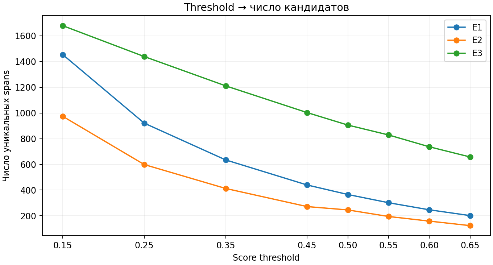
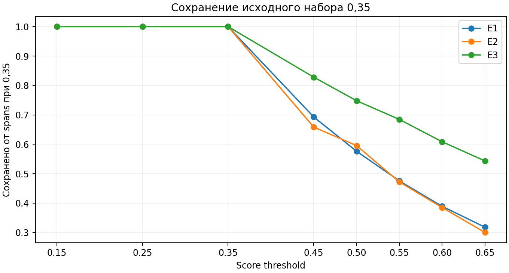
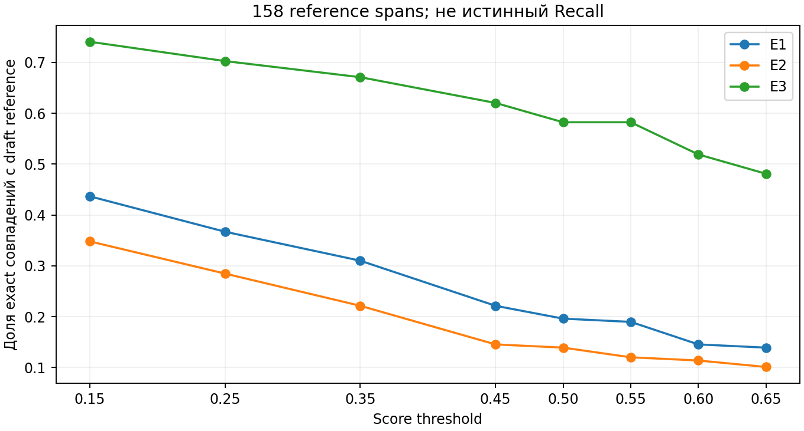
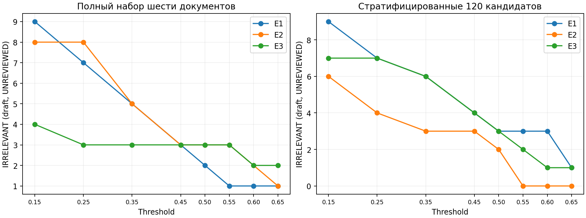
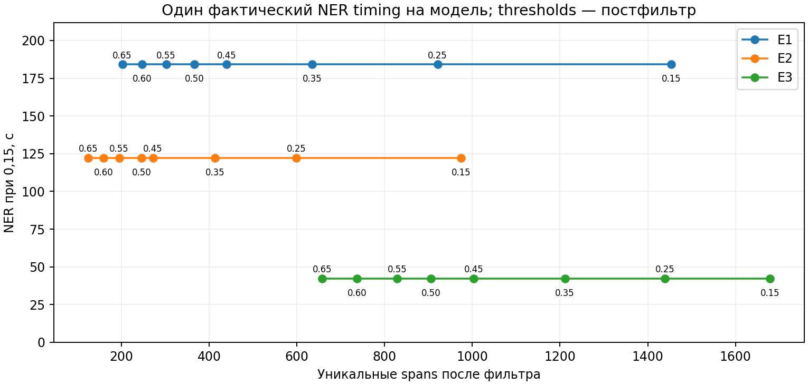
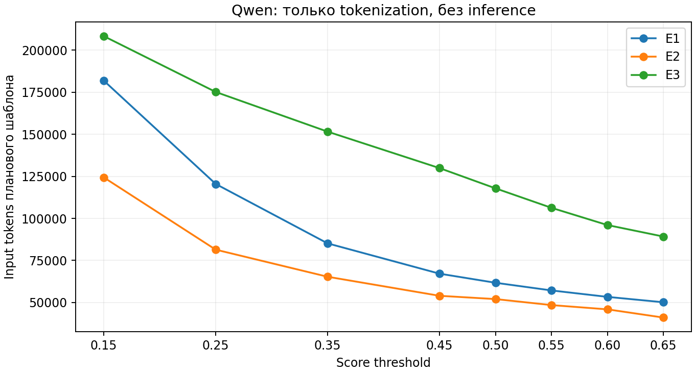

# NER-V2-003: Candidate Quality Audit + Threshold Optimization

Период исследования: **31 октября — 1 ноября 2026 года, Europe/Moscow**. Ветка: `design-v2-sequential-kg`.
Исходный commit: `0366724d620d076adc8035114424cb06a57ff5d1`.
Статус: фактические CPU-измерения; semantic audit имеет статус **UNREVIEWED**, independent Human Gold отсутствует.

Отдельный [готовый фрагмент для дипломной работы](NER_V2_003_THESIS_FRAGMENT.md).

## 1. Постановка задачи

Исследование продолжает NER-V2-002 и NORM-V2-001 и рассматривает генерацию source-exact кандидатов
для будущей Qwen Entity Typing 4B. Требуется сопоставить модели и пороги по выходу, потерям предполагаемо
значимых терминов, предварительно выявленному шуму, времени CPU и объёму планового входа LLM.
Число spans не трактуется как Recall; совпадение с assisted reference не является истинным Recall или F1.
Научная цель — обоснованный рабочий вариант для следующего этапа, а не доказательство оптимальности
на всей совокупности научных публикаций.

Исходные отчёты, raw results NER-V2-002/NORM-V2-001, normalizer N3 и Ontology v2 сохранены.
Набор типов содержит 11 категорий, отношений — 20; изменения схемы не проводились.
Qwen inference, RE, Semantic Verification, embeddings, Entity Resolution, fine-tuning и построение графа
не выполнялись. Использование tokenizer для подсчёта входа не требует загрузки весов Qwen.

## 2. Научная мотивация выбора confidence thresholds

Score threshold управляет решением decoder о сохранении кандидата. Повышение порога уменьшает выход,
но может одновременно удалить шум, термины с редкой формой, короткие сокращения и полезные альтернативные
подсказки типов. Высокий score не доказывает корректность: модель может уверенно присвоить неподходящий hint.
Scores GLiNER v2.1 и GLiNER2.5 не считаются одинаково калиброванными вероятностями правильного извлечения.
Порог следует оценивать отдельно для каждой архитектуры и относительно явных требований к потерям.

До сравнения зафиксирована прозрачная условная политика: рассмотреть пороги не ниже 0,35, сохранить
не менее 90% exact совпадений с assisted reference относительно 0,35 и не менее 80% в каждой дисциплине,
не уменьшать число совпадений в редких draft-type группах с 1–4 исходными совпадениями, не увеличивать
число draft-нерелевантных spans в полном наборе шести документов. Из допустимых точек выбирается
наибольший threshold. Это исследовательские требования к рабочей точке, а не статистически установленные
законы качества. Чувствительность к защите редких групп анализируется отдельно.

## 3. Описание экспериментального корпуса

Получено 30 новых аннотаций через официальный OpenAlex API: по пять публикаций на каждую из шести
дисциплин, 100–400 whitespace-слов на документ, пять разных primary topics в каждой дисциплине.
Корпус содержит **5744 слова**. Seed отбора — **4303**. Исключены совпадения с прежними 12 работами
по OpenAlex ID, DOI и SHA-256 текста; дубликатов внутри новой выборки также нет.

Использован существующий `OpenAlexClient`, строгая реконструкция inverted index и контракт source_record.
На дисциплину запрошен seeded sample 150 работ с `language:en`, `type:article`, `has_abstract:true`,
`is_retracted:false`; далее выполнены локальные проверки journal/conference, длины, тематики и уникальности.
Кандидаты сортируются по ID, перемешиваются `Random(4303)`; выбираются первые пять разных тем.
History отбирается по subfield History, остальные области — по соответствующим fields.

Проверка до NER выявила, что metadata `language=en` не гарантирует английский abstract, а article-type
не исключает книжную рецензию. Добавлены проверки доли Latin letters и английских служебных слов,
а также title/abstract markers рецензий и редакционных материалов. Первоначальный предварительный
отбор пересчитан **до любых новых предсказаний** с тем же seed и теми же сохранёнными candidate pools.
Причины и SHA исходного предварительного набора сохранены в `preflight_correction.json`.
После окончательной заморозки ни один документ не заменялся.
Фактически выполнены шесть успешных works API requests. Второй preflight использовал те же сохранённые
ответы, поэтому requests в финальном snapshot пуст; исходный acquisition log и совпадение response hashes
сохранены отдельно в [acquisition_provenance.json](acquisition_provenance.json).

Metadata и критерии не являются независимой экспертизой жанра. Например, History включает историко-
религиоведческий и устно-исторический материал; принадлежность к области взята из OpenAlex.
В одной физической аннотации присутствует U+FFFD в строках формул; исходный текст не исправлялся.
Все offsets отсчитываются по Unicode codepoints неизменённого abstract, без добавления title.

**Таблица 1. Замороженные публикации.**

| OpenAlex ID | Дисциплина | Год | Слов | Название / DOI |
| --- | --- | --- | --- | --- |
| [W2991563224](https://openalex.org/W2991563224) | Computer Science / Machine Learning | 2020 | 127 | Energy efficiency of organized cluster election method in wireless sensor networks / https://doi.org/10.11591/ijeecs.v18.i1.pp218-226 |
| [W4230116451](https://openalex.org/W4230116451) | Computer Science / Machine Learning | 2018 | 116 | A GPU parallel optimised blockwise NLM algorithm in a distributed computing system / https://doi.org/10.1504/ijhpcn.2018.093231 |
| [W4234628002](https://openalex.org/W4234628002) | Computer Science / Machine Learning | 2019 | 217 | Sistem Informasi Terintegrasi Evaluasi Kegiatan Mengajar Dosen Sebagai Implementasi Sistem Penjaminan Mutu Internal / https://doi.org/10.31940/matrix.v9i1.1243 |
| [W3027457624](https://openalex.org/W3027457624) | Computer Science / Machine Learning | 2020 | 148 | “Shape-Coding”: Morphology-Based Information System for Polymers and Composites / https://doi.org/10.1021/acsami.0c05314 |
| [W4389076493](https://openalex.org/W4389076493) | Computer Science / Machine Learning | 2023 | 286 | An Adaptive Region Proposal Network With Progressive Attention Propagation for Tiny Person Detection From UAV Images / https://doi.org/10.1109/tcsvt.2023.3335157 |
| [W3101922761](https://openalex.org/W3101922761) | Medicine | 2020 | 270 | Ten-Year Outcome of Glaucoma Drainage Device Surgery After Penetrating Keratoplasty / https://doi.org/10.1097/ijg.0000000000001741 |
| [W1979727947](https://openalex.org/W1979727947) | Medicine | 2012 | 245 | High-throughput mammographic-density measurement: a tool for risk prediction of breast cancer / https://doi.org/10.1186/bcr3238 |
| [W2791492120](https://openalex.org/W2791492120) | Medicine | 2018 | 202 | Impact and Modulations of Peripheral and Edaphic B Cell Subpopulations in Chronic Rhinosinusitis With Nasal Polyposis / https://doi.org/10.21053/ceo.2017.01389 |
| [W2761455282](https://openalex.org/W2761455282) | Medicine | 2017 | 288 | Perioperative Complications of Total Knee Arthroplasty in Dialysis Patients / https://doi.org/10.1016/j.arth.2017.09.058 |
| [W4391351014](https://openalex.org/W4391351014) | Medicine | 2024 | 190 | Effects of Ionizing Radiation on Cardiac Implantable Electronic Devices (CIEDs) in Patients with Esophageal Cancer Undergoing Radiotherapy: A Pilot Study / https://doi.org/10.3390/cancers16030555 |
| [W2084709926](https://openalex.org/W2084709926) | Physics | 2004 | 144 | NSTX tangential divertor camera / https://doi.org/10.1063/1.1789609 |
| [W2317432785](https://openalex.org/W2317432785) | Physics | 2012 | 154 | Structural and Magnetic Studies of [Co0.45Fe0.45Zr0.1/a-Si]N Multilayers / https://doi.org/10.1166/jsm.2012.1004 |
| [W2364973104](https://openalex.org/W2364973104) | Physics | 2012 | 155 | Research on the Influence Factors and Limiting Methods for Lighting Over-Voltage in Military Power Supply / DOI отсутствует |
| [W2096307598](https://openalex.org/W2096307598) | Physics | 2012 | 210 | New radio observations of the Moon atLband / https://doi.org/10.1088/1674-4527/12/9/010 |
| [W3081936674](https://openalex.org/W3081936674) | Physics | 2020 | 132 | Optical soliton solutions to a (2+1) dimensional Schrödinger equation using a couple of integration architectures / https://doi.org/10.2478/amns.2020.2.00010 |
| [W3123056951](https://openalex.org/W3123056951) | Biology | 2021 | 175 | Modified recombinant human erythropoietin with potentially reduced immunogenicity / https://doi.org/10.1038/s41598-020-80402-1 |
| [W1995028339](https://openalex.org/W1995028339) | Biology | 2014 | 279 | Conserved Gene Order and Expanded Inverted Repeats Characterize Plastid Genomes of Thalassiosirales / https://doi.org/10.1371/journal.pone.0107854 |
| [W2076293586](https://openalex.org/W2076293586) | Biology | 2011 | 213 | Copy number variants in two mouse models of affective disorders / https://doi.org/10.1055/s-0031-1292452 |
| [W3138328568](https://openalex.org/W3138328568) | Biology | 2021 | 239 | Simultaneous Improvement of Limonene Production and Tolerance in Yarrowia lipolytica through Tolerance Engineering and Evolutionary Engineering / https://doi.org/10.1021/acssynbio.1c00052 |
| [W2039836112](https://openalex.org/W2039836112) | Biology | 2010 | 254 | FGF-1 induces ATP release from spinal astrocytes in culture and opens pannexin and connexin hemichannels / https://doi.org/10.1073/pnas.1013793107 |
| [W2906067930](https://openalex.org/W2906067930) | Economics | 2018 | 198 | Research on the Phenomenon That the Increase of Grain Production Did Not Cause the Harvest Paradox in China from 2003 to 2014 / https://doi.org/10.11648/j.ijber.20180706.16 |
| [W2078771716](https://openalex.org/W2078771716) | Economics | 1997 | 228 | Measuring Economic Convergence / https://doi.org/10.1002/(sici)1099-1158(199704)2:2<131::aid-ijfe42>3.0.co;2-m |
| [W4309030044](https://openalex.org/W4309030044) | Economics | 2022 | 137 | Market competition oriented air-rail ticket fare optimization / https://doi.org/10.1016/j.multra.2022.100053 |
| [W4285525942](https://openalex.org/W4285525942) | Economics | 2021 | 336 | FEATURES OF FINANCIAL INSTRUMENTS OF GREEN BANKING IN THE GLOBAL MARKET OF BANKING SERVICES / https://doi.org/10.32782/2224-6282/176-4 |
| [W2130236240](https://openalex.org/W2130236240) | Economics | 1992 | 106 | The Impact of Advance Notice: A Comment on a Study by Nord and Ting / https://doi.org/10.1177/001979399204500403 |
| [W7215137876](https://openalex.org/W7215137876) | History | 2024 | 118 | Emotional Maturity in the Light of Synodality: Contributions from Internal Family System Therapy / DOI отсутствует |
| [W4312422299](https://openalex.org/W4312422299) | History | 2018 | 106 | Land as Regenerative Space in The Book of Mormon / https://doi.org/10.5406/jbookmormstud2.27.2018.0187 |
| [W2326480042](https://openalex.org/W2326480042) | History | 1984 | 129 | Between the 30s and the 60s / https://doi.org/10.2307/466552 |
| [W4381572413](https://openalex.org/W4381572413) | History | 2023 | 154 | “First of all, let’s go learn something” / https://doi.org/10.20318/hn.2023.7620 |
| [W2394633461](https://openalex.org/W2394633461) | History | 2016 | 188 | Pressing Metal, Pressing Politics: Papal Annual Medals, 1605–1700 / https://doi.org/10.3390/rel7050060 |

Исходные abstracts: [input_abstracts.jsonl](input_abstracts.jsonl).
Полные выбранные OpenAlex records/inverted indexes: [openalex_snapshot.json](openalex_snapshot.json).
Manifest включает title, year, DOI, scientific field, topic, source URL и SHA-256.
Полные ответные candidate pools сохранены локально в `artifacts/ner_v2/openalex_run2/`; параметры,
candidate IDs и response hashes включены в snapshot. Для воспроизведения выводов достаточно замороженного
snapshot и JSONL; новый запрос к живому API со временем может дать иной набор даже при том же seed.

Для подробного аудита выбран один документ на дисциплину: `Random(4303).choice` на отсортированных
пяти IDs каждой области, независимо от outputs моделей.
Генератор отдельно переинициализируется seed 4303 для каждой области, поэтому выбран одинаковый
порядковый индекс в отсортированных пятёрках; статистическая независимость выборов между областями не заявляется.

| Дисциплина | Документ аудита | Reference spans |
| --- | --- | --- |
| Computer Science / Machine Learning | W4230116451 | 15 |
| Medicine | W2791492120 | 43 |
| Physics | W2317432785 | 26 |
| Biology | W2076293586 | 32 |
| Economics | W2906067930 | 26 |
| History | W4312422299 | 16 |

## 4. Сравниваемые NER-модели

| Конфигурация | Checkpoint | Окно / overlap | Decoder |
| --- | --- | --- | --- |
| E1 | GLiNER Large v2.1 | 60 / 20 | flat_ner=False, multi_label=True |
| E2 | GLiNER Large v2.1 | 110 / 25 | flat_ner=False, multi_label=True |
| E3 | GLiNER2.5 Base | 110 / 25 | AutoExtractor → BoundaryExtractor, overlap_policy=allow |

Pinned Large revision: `abd49a1f1ebc12af1be84d06f6848221cf96dcad`.
Pinned GLiNER2.5 revision: `54785d51df8d86a0d8f2eb212fec15871aad2c4d`.
Модели обрабатывались последовательно, каждая в отдельном процессе; одновременно два NER-checkpoint
в память не загружались. CPU float32, четыре torch threads, seed 42, deterministic torch algorithms.
Все варианты используют неизменённую N3 и одинаковые короткие descriptions:

| Hint | Short description |
| --- | --- |
| OBJECT | physical, biological or digital object |
| ACTOR | person or organization |
| CONCEPT | scientific concept or theory |
| METHOD | algorithm or research method |
| PROCESS | event or scientific process |
| DATA_RESOURCE | dataset or research corpus |
| ATTRIBUTE | property, parameter or metric |
| RESULT | measured or observed result |
| CONDITION | experimental or contextual condition |
| TASK | research task or application |
| MECHANISM | mechanism explaining a phenomenon |

N3 сохраняет исходные surface и offsets, меняет только допустимое конечное plural noun, сохраняет
модификаторы и определения сокращений на уровне документа. Совпадение нормализованных строк не сливает
сущности. Для GLiNER2.5 сохранён официальный schema API: ключи labels и descriptions передаются отдельно;
для v2.1 descriptions являются label input. Это ограничивает изоляцию архитектурного фактора.

Nested mentions и альтернативные hints одного span сохраняются. Decoder v2.1 при `flat_ner=False`
разрешает вложенность, но может подавлять перекрёстные overlaps внутри окна; после объединения окон
перекрёстные пересечения возможны. В E3 явно разрешены overlaps. Эта разница не скрывается.
Дедупликация NER удаляет только одинаковые `(document, start, end, hint)` с сохранением максимального score.
Для Qwen выполняется безопасная группировка одинаковых source spans с сохранением всех альтернативных hints.

## 5. Методика оценки кандидатов

Assisted reference составлен непосредственно по шести текстам до запуска моделей. Зафиксировано
158 source spans: выбранные ассистентом научно значимые выражения и все их точные вхождения, включая
вложенные термины. Файл [assisted_reference_frozen.jsonl](assisted_reference_frozen.jsonl)
имеет статус **ASSISTED_REFERENCE_DRAFT**, review_status **UNREVIEWED**; SHA подтверждается в
конфигурации каждой модели. Это неполный список диагностических anchors, а не исчерпывающая разметка.
Отсутствие кандидата в этом списке не означает его нерелевантность.

Полный union предсказаний при 0,15 на шести документах содержит **433 уникальных source spans**.
Для каждого сохранены весь abstract, контекст, границы, scores, hints всех моделей и survival при восьми
thresholds. На этих 433 spans предложены осторожные правила: exact reference → VALID_SPAN,
ограниченный discourse/header watchlist → IRRELEVANT, очевидные нарушения границ → соответствующая
категория; остальные остаются AMBIGUOUS. Это предварительная разметка для последующей ручной проверки.

Из остальных 24 документов отобраны **120 уникальных кандидатов, по 20 на область**.
Воспроизводимое многомерное балансирование учитывает focal model, hint, confidence bin, соглашение моделей
и документ, с seeded tie order. Страты не образуют полный декартов набор: 120 случаев недостаточно для
всех сочетаний шести областей, трёх моделей, 11 типов и восьми confidence ranges. Реальная coverage:

| Измерение | Распределение |
| --- | --- |
| discipline | Biology: 20; Computer Science / Machine Learning: 20; Economics: 20; History: 20; Medicine: 20; Physics: 20 |
| focal_model | E1: 41; E3: 42; E2: 37 |
| focal_type | PROCESS: 13; OBJECT: 11; ACTOR: 14; CONCEPT: 10; ATTRIBUTE: 11; CONDITION: 9; TASK: 12; RESULT: 11; METHOD: 10; MECHANISM: 9; DATA_RESOURCE: 10 |
| confidence_stratum | 0.15-0.25: 21; 0.65-1.00: 16; 0.60-0.65: 13; 0.50-0.55: 12; 0.25-0.35: 17; 0.35-0.45: 15; 0.45-0.50: 14; 0.55-0.60: 12 |
| agreement_stratum | model_specific: 59; shared: 61 |

Ассистент дополнительно прочитал контекст всех 120 случаев и записал содержательные поправки в
[assistant_audit_amendments.json](assistant_audit_amendments.json). Все эти оценки также
остаются UNREVIEWED. Поля human reviewer, category и notes оставлены пустыми; человек ничего не подтверждал.
Исходный независимый от NER reference после этого не изменялся.

Категории границ: VALID_SPAN, PARTIAL_SPAN, WRONG_BOUNDARY, IRRELEVANT, AMBIGUOUS.
MISSED_ENTITY применяется к отдельному списку reference spans без соответствующих outputs.
Качество типа оценивается отдельно: TYPE_HINT_CORRECT, TYPE_HINT_INCORRECT, TYPE_HINT_AMBIGUOUS.
Если у draft-интерпретации несколько допустимых типов, совпавшая альтернатива остаётся типологически
неоднозначной. Типовые counts в таблицах ниже условны на VALID_SPAN, чтобы не смешивать границы и labels.

| Draft-категория | Из 120 |
| --- | --- |
| AMBIGUOUS | 8 |
| IRRELEVANT | 12 |
| PARTIAL_SPAN | 10 |
| VALID_SPAN | 83 |
| WRONG_BOUNDARY | 7 |

Файлы: [все 553 audit records](audit_candidates_UNREVIEWED.jsonl),
[стратифицированные 120](audit_stratified_120.jsonl),
[шесть полных документов с outputs](audit_full_documents.jsonl).
Полный census и дополнительные 120 анализируются раздельно. Отбор 120 не является простой случайной
выборкой всех predicted spans; доля ошибок на нём не экстраполируется на весь корпус.

## 6. Методика threshold optimization

Исследованы **0,15; 0,25; 0,35; 0,45; 0,50; 0,55; 0,60; 0,65**.
Основной inference каждой модели выполнен один раз при 0,15. На первом окне каждого из шести
аудитных документов проведены native checks при 0,35, 0,50 и 0,65: всего 18 на модель, 54 в серии.
Сравнивались exact spans, labels и scores с допуском 10⁻⁶; все проверки совпали.

Постфильтрация также проверена по decoder: у v2.1 применяется строгое `score > threshold`,
у E3 — включительное сравнение. При greedy декодировании по убывающему score низкопороговые
кандидаты не меняют решение для более высоких. У boundary checkpoint adaptive threshold=false,
abstention не зависит от span threshold, overlap_policy=allow. Код фильтра сохраняет различие
строгой/нестрогой границы. Если equivalence check не проходит, pipeline останавливается и требует
нового output root с native inference всех thresholds; дополнительные вызовы в таком режиме учитываются.
Native checks не являются доказательством для произвольной будущей конфигурации decoder.

Для модели m и порога t обозначим S_m(t) множество source spans, M_m(t) — records с hints.
N_spans=|S_m(t)|; spans/document=N_spans/30; spans/100 words=100·N_spans/5744.
Потери относительно 0,15: |S_m(0,15) \ S_m(t)|.
Доля сохранения baseline 0,35: |S_m(t) ∩ S_m(0,35)| / |S_m(0,35)|.
При t<0,35 эта доля равна единице; дополнительный count_ratio отдельно показывает рост числа кандидатов.
Model-specific spans отсутствуют у двух других моделей при том же численном t; это описание множеств,
а не сравнение вероятностей ошибки. Nested/crossing pairs считаются по уникальным spans; альтернативные
типы — дополнительные hint records относительно числа уникальных spans.

Exact assisted matching: число reference spans с идентичными document/start/end, делённое на 158.
Overlap matching требует только непустого пересечения в том же документе и поэтому является более
слабым диагностическим признаком. Длинный неверный span может пересекать несколько reference anchors;
overlap matching нельзя трактовать как полноту корректных границ.

## 7. Результаты E1/E2/E3

**Таблица 2. Все 24 комбинации model + threshold.** Время NER общее для восьми постфильтров одной модели.

| Модель | t | Mentions | Spans | Spans/doc | Spans/100 слов | Пустых документов | Exact draft /158 | Qwen tokens | Qwen calls |
| --- | --- | --- | --- | --- | --- | --- | --- | --- | --- |
| E1 | 0.15 | 1778 | 1454 | 48.47 | 25.31 | 0 | 69 | 181898 | 60 |
| E1 | 0.25 | 1033 | 921 | 30.70 | 16.03 | 0 | 58 | 120473 | 44 |
| E1 | 0.35 | 684 | 635 | 21.17 | 11.06 | 0 | 49 | 85155 | 33 |
| E1 | 0.45 | 464 | 440 | 14.67 | 7.66 | 0 | 35 | 67138 | 30 |
| E1 | 0.50 | 378 | 366 | 12.20 | 6.37 | 0 | 31 | 61733 | 30 |
| E1 | 0.55 | 309 | 302 | 10.07 | 5.26 | 0 | 30 | 57178 | 30 |
| E1 | 0.60 | 252 | 247 | 8.23 | 4.30 | 0 | 23 | 53353 | 30 |
| E1 | 0.65 | 204 | 202 | 6.73 | 3.52 | 0 | 22 | 50147 | 30 |
| E2 | 0.15 | 1140 | 974 | 32.47 | 16.96 | 0 | 55 | 124362 | 43 |
| E2 | 0.25 | 646 | 599 | 19.97 | 10.43 | 0 | 45 | 81425 | 32 |
| E2 | 0.35 | 434 | 413 | 13.77 | 7.19 | 0 | 35 | 65314 | 30 |
| E2 | 0.45 | 279 | 272 | 9.07 | 4.74 | 1 | 23 | 53990 | 29 |
| E2 | 0.50 | 249 | 246 | 8.20 | 4.28 | 1 | 22 | 52039 | 29 |
| E2 | 0.55 | 196 | 195 | 6.50 | 3.39 | 1 | 19 | 48465 | 29 |
| E2 | 0.60 | 159 | 159 | 5.30 | 2.77 | 1 | 18 | 45934 | 29 |
| E2 | 0.65 | 124 | 124 | 4.13 | 2.16 | 3 | 16 | 41047 | 27 |
| E3 | 0.15 | 2114 | 1679 | 55.97 | 29.23 | 0 | 117 | 208350 | 69 |
| E3 | 0.25 | 1660 | 1439 | 47.97 | 25.05 | 0 | 111 | 175165 | 58 |
| E3 | 0.35 | 1327 | 1211 | 40.37 | 21.08 | 0 | 106 | 151572 | 53 |
| E3 | 0.45 | 1063 | 1003 | 33.43 | 17.46 | 0 | 98 | 129895 | 48 |
| E3 | 0.50 | 950 | 906 | 30.20 | 15.77 | 0 | 92 | 117867 | 44 |
| E3 | 0.55 | 859 | 829 | 27.63 | 14.43 | 0 | 92 | 106289 | 39 |
| E3 | 0.60 | 759 | 737 | 24.57 | 12.83 | 0 | 82 | 96044 | 36 |
| E3 | 0.65 | 672 | 658 | 21.93 | 11.46 | 0 | 76 | 89207 | 35 |

E3 имеет больше exact совпадений с выбранным assisted reference на всех исследованных порогах,
но это не доказанное преимущество по истинному Recall. Reference мал, создан ассистентом и используется
при выборе рабочей точки. Истинный Precision не оценён: существенная часть census остаётся AMBIGUOUS.
Исторические 435 spans E3 при 0,35 относятся к прежним 12 документам; 1211 spans в новой серии
не являются улучшением или деградацией относительно того числа без учёта другого корпуса.

## 8. Влияние threshold на количество spans

**Рисунок 1. Количество уникальных spans.**



**Рисунок 2. Сохранение baseline 0,35.**



| Модель | t | Потеряно от 0,15 | Сохранено от 0,35, % | Nested pairs | Crossing pairs | Альтернативные hints | Model-specific |
| --- | --- | --- | --- | --- | --- | --- | --- |
| E1 | 0.15 | 0 | 100.0 | 777 | 9 | 324 | 425 |
| E1 | 0.25 | 533 | 100.0 | 276 | 3 | 112 | 249 |
| E1 | 0.35 | 819 | 100.0 | 119 | 0 | 49 | 166 |
| E1 | 0.45 | 1014 | 69.3 | 56 | 0 | 24 | 125 |
| E1 | 0.50 | 1088 | 57.6 | 43 | 0 | 12 | 95 |
| E1 | 0.55 | 1152 | 47.6 | 29 | 0 | 7 | 83 |
| E1 | 0.60 | 1207 | 38.9 | 17 | 0 | 5 | 76 |
| E1 | 0.65 | 1252 | 31.8 | 11 | 0 | 2 | 58 |
| E2 | 0.15 | 0 | 100.0 | 355 | 4 | 166 | 77 |
| E2 | 0.25 | 375 | 100.0 | 120 | 0 | 47 | 46 |
| E2 | 0.35 | 561 | 100.0 | 57 | 0 | 21 | 41 |
| E2 | 0.45 | 702 | 65.9 | 27 | 0 | 7 | 24 |
| E2 | 0.50 | 728 | 59.6 | 24 | 0 | 3 | 17 |
| E2 | 0.55 | 779 | 47.2 | 16 | 0 | 1 | 13 |
| E2 | 0.60 | 815 | 38.5 | 13 | 0 | 0 | 14 |
| E2 | 0.65 | 850 | 30.0 | 6 | 0 | 0 | 6 |
| E3 | 0.15 | 0 | 100.0 | 690 | 40 | 435 | 895 |
| E3 | 0.25 | 240 | 100.0 | 416 | 20 | 221 | 883 |
| E3 | 0.35 | 468 | 100.0 | 258 | 11 | 116 | 822 |
| E3 | 0.45 | 676 | 82.8 | 162 | 5 | 60 | 736 |
| E3 | 0.50 | 773 | 74.8 | 129 | 2 | 44 | 676 |
| E3 | 0.55 | 850 | 68.5 | 99 | 2 | 30 | 642 |
| E3 | 0.60 | 942 | 60.9 | 73 | 1 | 22 | 593 |
| E3 | 0.65 | 1021 | 54.3 | 55 | 1 | 14 | 539 |

E1/E2 теряют значительную часть spans уже при 0,45. E2 оставляет один физический документ
`W2317432785` без единого кандидата начиная с 0,45; при 0,65 пустыми становятся ещё
`W2084709926` и `W3138328568`. У E1/E3 ни один документ полностью не опустел на исследованных порогах.
Это не означает достаточную полноту: документ с одним оставшимся кандидатом может потерять почти
все содержательные термины. Все 720 document/model/threshold наблюдений доступны в
[document_metrics.csv](document_metrics.csv).

## 9. Анализ потери значимых научных сущностей

**Рисунок 3. Exact matching с assisted reference.** Это диагностическая доля совпадений, не кривая Recall.



| Модель | t | Exact | Overlap | Нет exact | Нет overlap | Exact retained vs 0,35, % |
| --- | --- | --- | --- | --- | --- | --- |
| E1 | 0.15 | 69 | 96 | 89 | 62 | 140.8 |
| E1 | 0.25 | 58 | 80 | 100 | 78 | 118.4 |
| E1 | 0.35 | 49 | 66 | 109 | 92 | 100.0 |
| E1 | 0.45 | 35 | 53 | 123 | 105 | 71.4 |
| E1 | 0.5 | 31 | 46 | 127 | 112 | 63.3 |
| E1 | 0.55 | 30 | 41 | 128 | 117 | 61.2 |
| E1 | 0.6 | 23 | 32 | 135 | 126 | 46.9 |
| E1 | 0.65 | 22 | 29 | 136 | 129 | 44.9 |
| E2 | 0.15 | 55 | 82 | 103 | 76 | 157.1 |
| E2 | 0.25 | 45 | 56 | 113 | 102 | 128.6 |
| E2 | 0.35 | 35 | 45 | 123 | 113 | 100.0 |
| E2 | 0.45 | 23 | 33 | 135 | 125 | 65.7 |
| E2 | 0.5 | 22 | 31 | 136 | 127 | 62.9 |
| E2 | 0.55 | 19 | 26 | 139 | 132 | 54.3 |
| E2 | 0.6 | 18 | 24 | 140 | 134 | 51.4 |
| E2 | 0.65 | 16 | 18 | 142 | 140 | 45.7 |
| E3 | 0.15 | 117 | 146 | 41 | 12 | 110.4 |
| E3 | 0.25 | 111 | 142 | 47 | 16 | 104.7 |
| E3 | 0.35 | 106 | 137 | 52 | 21 | 100.0 |
| E3 | 0.45 | 98 | 131 | 60 | 27 | 92.5 |
| E3 | 0.5 | 92 | 120 | 66 | 38 | 86.8 |
| E3 | 0.55 | 92 | 119 | 66 | 39 | 86.8 |
| E3 | 0.6 | 82 | 107 | 76 | 51 | 77.4 |
| E3 | 0.65 | 76 | 97 | 82 | 61 | 71.7 |

Гипотеза для E3 проверена непосредственно на последовательных шагах. Таблица показывает новые exact
потери относительно предыдущего исследованного threshold; разные вхождения одного surface считаются отдельно.
При 0,55 новых exact потерь на этих 158 anchors не было, но overlap уменьшился на единицу и полезные
кандидаты вне reference всё равно могли исчезнуть.

| Переход к t | Новые exact потери E3 | Примеры (draft) |
| --- | --- | --- |
| 0.15 | 0 | Новых exact потерь не наблюдалось |
| 0.25 | 6 | K absorption edges [CONCEPT, W2317432785]; CRSwNP [CONCEPT, W2791492120]; frequency of B cells [ATTRIBUTE, W2791492120]; farmers' total income [ATTRIBUTE, W2906067930]; grain price rose [RESULT, W2906067930]; Nephites [ACTOR, W4312422299] |
| 0.35 | 5 | B cells [OBJECT, W2791492120]; suppression of T cell activity [PROCESS, W2791492120]; China [ACTOR, W2906067930]; non-grain price factors [CONCEPT, W2906067930]; advanced computing systems [OBJECT, W4230116451] |
| 0.45 | 8 | animals [OBJECT, W2076293586]; magneto-optical TKE effect enhancement [RESULT, W2317432785]; Mature resting B cells [OBJECT, W2791492120]; grain purchase and sales [PROCESS, W2906067930]; Harvest Paradox [CONCEPT, W2906067930]; optimised blockwise non-local means [METHOD, W4230116451]; OB-NLM [METHOD, W4230116451]; biblical Jerusalem [OBJECT, W4312422299] |
| 0.50 | 6 | inbreeding protocol [METHOD, W2076293586]; CNVs [ATTRIBUTE, W2076293586]; endophenotypes [CONCEPT, W2076293586]; SNP-based invariant genomic probes [METHOD, W2076293586]; CNVs [ATTRIBUTE, W2076293586]; magnetic resonance imaging [METHOD, W4230116451] |
| 0.55 | 0 | Новых exact потерь не наблюдалось |
| 0.60 | 10 | sublayers [OBJECT, W2317432785]; repetition periods [ATTRIBUTE, W2317432785]; grain formation [PROCESS, W2317432785]; sublayers [OBJECT, W2317432785]; chronic rhinosinusitis with nasal polyposis [CONCEPT, W2791492120]; memory B cells [OBJECT, W2791492120]; mature B cells [OBJECT, W2791492120]; graphics processing units [OBJECT, W4230116451]; Nephite people [ACTOR, W4312422299]; Nephite race [ACTOR, W4312422299] |
| 0.65 | 6 | animals [OBJECT, W2076293586]; magnetic properties [ATTRIBUTE, W2317432785]; B cells [OBJECT, W2791492120]; China [ACTOR, W2906067930]; grain price [ATTRIBUTE, W2906067930]; denoising [PROCESS, W4230116451] |

Особенно существенны `optimised blockwise non-local means` и `OB-NLM`, удалённые при 0,45;
`magnetic resonance imaging`, `inbreeding protocol` и `SNP-based invariant genomic probes`, удалённые при 0,50.
Повышение до 0,60 дополнительно теряет `graphics processing units`, `grain formation` и отдельные B-cell terms;
при 0,65 исчезают `denoising`, `magnetic properties` и `grain price` в соответствующих вхождениях.
В дополнительной выборке есть важный низкопороговый артефакт `papal annual medals` со score E3 около 0,19:
его отсутствие уже при 0,35 подчёркивает, что baseline сам не обеспечивает полноту.

Для каждой комбинации сохранены пять категорий событий: полезный термин сохранился; draft-шум удалён;
значимый anchor потерян; неверная альтернативная метка удалена при сохранении подходящей; документ опустел.
Если событие не наблюдалось, оно явно отмечено `NO_OBSERVED_EVENT`, пример не выдумывался:
[threshold_examples.jsonl](threshold_examples.jsonl).
Списки предполагаемых пропусков и пересекающихся кандидатов:
[audit_missing_reference_UNREVIEWED.jsonl](audit_missing_reference_UNREVIEWED.jsonl).

**Таблица 3. E3: exact matching по предполагаемым типам reference.** Это группировка по draft-типам anchors,
не качество окончательной классификации NER.

| Draft-тип | Всего reference | 0.15 | 0.25 | 0.35 | 0.45 | 0.50 | 0.55 | 0.60 | 0.65 |
| --- | --- | --- | --- | --- | --- | --- | --- | --- | --- |
| OBJECT | 48 | 36 | 36 | 34 | 31 | 31 | 31 | 26 | 24 |
| ACTOR | 15 | 14 | 13 | 12 | 12 | 12 | 12 | 10 | 9 |
| CONCEPT | 23 | 22 | 20 | 19 | 18 | 17 | 17 | 16 | 16 |
| METHOD | 20 | 11 | 11 | 11 | 9 | 6 | 6 | 6 | 6 |
| PROCESS | 13 | 11 | 11 | 10 | 9 | 9 | 9 | 8 | 7 |
| DATA_RESOURCE | 3 | 2 | 2 | 2 | 2 | 2 | 2 | 2 | 2 |
| ATTRIBUTE | 21 | 17 | 15 | 15 | 15 | 13 | 13 | 12 | 10 |
| RESULT | 6 | 2 | 1 | 1 | 0 | 0 | 0 | 0 | 0 |
| CONDITION | 3 | 0 | 0 | 0 | 0 | 0 | 0 | 0 | 0 |
| TASK | 5 | 2 | 2 | 2 | 2 | 2 | 2 | 2 | 2 |
| MECHANISM | 1 | 0 | 0 | 0 | 0 | 0 | 0 | 0 | 0 |

При 0,45 теряется единственный exact совпавший RESULT anchor из baseline E3. CONDITION и MECHANISM
не имели exact совпадений уже при 0,35; порог не может исправить upstream отсутствие такого span.
Защита редких групп чувствительна к единичным ассистентским решениям о границах и типах;
на этой таблице нельзя устанавливать популяционную полноту или надёжное ранжирование классов.

## 10. Анализ нерелевантных кандидатов

**Рисунок 4. Предположительно нерелевантные кандидаты в двух отдельных audit partitions.**



| Модель | t | Census present | Census IRRELEVANT | 120-sample present | 120-sample IRRELEVANT | Sample AMBIGUOUS |
| --- | --- | --- | --- | --- | --- | --- |
| E1 | 0.15 | 209 | 9 | 78 | 9 | 4 |
| E1 | 0.25 | 135 | 7 | 61 | 7 | 4 |
| E1 | 0.35 | 107 | 5 | 51 | 6 | 3 |
| E1 | 0.45 | 71 | 3 | 40 | 4 | 1 |
| E1 | 0.50 | 58 | 2 | 35 | 3 | 1 |
| E1 | 0.55 | 52 | 1 | 31 | 3 | 1 |
| E1 | 0.60 | 39 | 1 | 24 | 3 | 0 |
| E1 | 0.65 | 35 | 1 | 17 | 1 | 0 |
| E2 | 0.15 | 155 | 8 | 61 | 6 | 1 |
| E2 | 0.25 | 95 | 8 | 52 | 4 | 1 |
| E2 | 0.35 | 70 | 5 | 40 | 3 | 1 |
| E2 | 0.45 | 43 | 3 | 31 | 3 | 0 |
| E2 | 0.50 | 40 | 3 | 27 | 2 | 0 |
| E2 | 0.55 | 34 | 3 | 20 | 0 | 0 |
| E2 | 0.60 | 30 | 2 | 18 | 0 | 0 |
| E2 | 0.65 | 23 | 1 | 11 | 0 | 0 |
| E3 | 0.15 | 308 | 4 | 81 | 7 | 5 |
| E3 | 0.25 | 269 | 3 | 73 | 7 | 4 |
| E3 | 0.35 | 235 | 3 | 65 | 6 | 3 |
| E3 | 0.45 | 195 | 3 | 55 | 4 | 2 |
| E3 | 0.50 | 175 | 3 | 47 | 3 | 1 |
| E3 | 0.55 | 163 | 3 | 43 | 2 | 1 |
| E3 | 0.60 | 140 | 2 | 35 | 1 | 0 |
| E3 | 0.65 | 125 | 2 | 32 | 1 | 0 |

В полном census E3 при 0,35/0,45/0,50/0,55 сохраняются три однозначных по правилам discourse-кандидата;
их число снижается до двух только при 0,60. Например, `paper` как DATA_RESOURCE имеет score около 0,69,
а одно `study` как TASK — около 0,74, поэтому они сохраняются при 0,65. В отобранных 120 E3 действительно
снижает число draft IRRELEVANT с 6 при 0,35 до 4 при 0,45 и до 1 при 0,65, но одновременно
теряет проверяемые полезные spans. Улучшение доли на этой стратифицированной выборке не является
измерением истинного Precision корпуса.

Большинство не включённых в reference census-кандидатов осталось AMBIGUOUS. Поэтому низкое число
IRRELEVANT нельзя интерпретировать как высокую доказанную точность. Лексический watchlist также
не универсален: `study` может быть заголовком/самоссылкой, а может быть глаголом с неполной границей
исследовательской задачи; в contextual amendments такие случаи разведены.

## 11. Анализ ошибок границ и типов

Две оси оценки сохраняются отдельно. Ниже приведены реальные source spans и предварительные
интерпретации ассистента, не подтверждённые независимым человеком.

| Surface / document | Draft boundaries | Предполагаемые типы | Hints и scores |
| --- | --- | --- | --- |
| Yarrowia lipolytica / W3138328568 | VALID_SPAN | OBJECT | E1: ACTOR 0.347; E2: ACTOR 0.620; E3: OBJECT 0.877 |
| product titer / W3138328568 | VALID_SPAN | ATTRIBUTE | E1: ATTRIBUTE 0.484, RESULT 0.482; E2: ATTRIBUTE 0.583, PROCESS 0.383, RESULT 0.348; E3: ATTRIBUTE 0.930, RESULT 0.748 |
| coding methodology / W3027457624 | VALID_SPAN | METHOD | E1: CONDITION 0.232, TASK 0.238; E2: CONDITION 0.219, PROCESS 0.177, TASK 0.198; E3: METHOD 0.951 |
| stochastic nature / W2078771716 | VALID_SPAN | ATTRIBUTE | E1: ATTRIBUTE 0.256, CONDITION 0.208, METHOD 0.170; E2: CONDITION 0.236, TASK 0.262; E3: DATA_RESOURCE 0.929 |
| papal annual medals / W2394633461 | VALID_SPAN | OBJECT | E3: OBJECT 0.191 |
| photon energy / W4391351014 | VALID_SPAN | ATTRIBUTE | E3: CONCEPT 0.774 |
| medical records / W3101922761 | VALID_SPAN | DATA_RESOURCE | E1: DATA_RESOURCE 0.368, OBJECT 0.713; E2: DATA_RESOURCE 0.291; E3: DATA_RESOURCE 0.990 |
| total knee arthroplasty / W2761455282 | VALID_SPAN | METHOD, PROCESS | E3: MECHANISM 0.871 |
| McMaster Universities Arthritis Index scores / W2761455282 | PARTIAL_SPAN | ATTRIBUTE | E3: DATA_RESOURCE 0.593 |
| PSCAD/EMTDC / W2364973104 | VALID_SPAN | OBJECT | E3: DATA_RESOURCE 0.463 |
| military power supply / W2364973104 | VALID_SPAN | OBJECT | E1: ACTOR 0.742; E2: ACTOR 0.475; E3: OBJECT 0.983 |
| UEDGE and BOUT / W2084709926 | WRONG_BOUNDARY | OBJECT | E1: ACTOR 0.158, DATA_RESOURCE 0.514, METHOD 0.244 |

Фрагменты контекста:

> Strict selection of **photon energy** and alignment with manufacturer-recommended dose limits

Источник W4391351014. По контексту это параметр (ATTRIBUTE), тогда как E3 предлагает CONCEPT со score ≈0,774.

> We retrospectively reviewed **medical records** of all patients

Источник W3101922761. При t=0,50 E1 теряет DATA_RESOURCE (≈0,368), сохраняя OBJECT (≈0,713).
Граница остаётся, но предварительная типизация становится менее подходящей по draft-интерпретации.

> Western Ontario and **McMaster Universities Arthritis Index scores**

Источник W2761455282. Кандидат не включает начало составного названия; высокая уверенность в DATA_RESOURCE
не устраняет предположительную ошибку границы и роли показателя.

Есть и полезное удаление альтернативы: у E3 `magnetic properties` при 0,50 сохраняет ATTRIBUTE
(≈0,604), теряя CONCEPT (≈0,491). У `blood samples` при 0,65 остаётся OBJECT, а DATA_RESOURCE исчезает.
Таким образом, влияние порога на типизацию не однонаправленно. Решение следует проверять на уровне
конкретного span/hint, а не считать исчезновение альтернативных типов автоматическим улучшением.

| Модель | t=0,35, partition | TYPE_HINT_CORRECT | TYPE_HINT_INCORRECT | TYPE_HINT_AMBIGUOUS |
| --- | --- | --- | --- | --- |
| E1 | six_document_census | 30 | 24 | 0 |
| E1 | stratified_120 | 26 | 9 | 11 |
| E2 | six_document_census | 20 | 17 | 0 |
| E2 | stratified_120 | 18 | 11 | 7 |
| E3 | six_document_census | 72 | 62 | 0 |
| E3 | stratified_120 | 27 | 22 | 7 |

Counts относятся к hint records на spans с draft-категорией VALID_SPAN; это не проценты истинной точности.
Все thresholds и partitions представлены в [type_hint_audit_metrics.csv](type_hint_audit_metrics.csv).

## 12. Междисциплинарное сравнение

**Таблица 4. Уникальные spans при 0,35 / 0,65 (по пять документов на область).**

| Дисциплина | E1 | E2 | E3 |
| --- | --- | --- | --- |
| Biology | 128 / 36 | 83 / 14 | 287 / 147 |
| Computer Science / Machine Learning | 108 / 34 | 82 / 24 | 158 / 70 |
| Economics | 90 / 33 | 54 / 30 | 188 / 106 |
| History | 59 / 24 | 41 / 18 | 120 / 56 |
| Medicine | 156 / 47 | 91 / 16 | 266 / 169 |
| Physics | 94 / 28 | 62 / 22 | 192 / 110 |

История, биомедицина и физика существенно различаются по жанру, словарю, длине терминов и доступности
локальных сокращений. Пять работ на область и один reference-документ не позволяют установить устойчивый
discipline-specific threshold. Общие показатели могут скрыть почти полную потерю содержательных терминов
в отдельном тексте, как в физическом audit document E2. Counts всех типов/дисциплин/порогов сохранены
в [label_metrics.csv](label_metrics.csv) и [discipline_metrics.csv](discipline_metrics.csv).

**Таблица 5. Распределение hints E3 по всем порогам.** Оно не подтверждает корректность этих типов.

| Hint | 0.15 | 0.25 | 0.35 | 0.45 | 0.50 | 0.55 | 0.60 | 0.65 |
| --- | --- | --- | --- | --- | --- | --- | --- | --- |
| OBJECT | 426 | 354 | 315 | 276 | 262 | 246 | 228 | 215 |
| ACTOR | 187 | 158 | 137 | 121 | 117 | 112 | 102 | 92 |
| CONCEPT | 223 | 159 | 117 | 88 | 68 | 58 | 46 | 41 |
| METHOD | 146 | 107 | 80 | 58 | 51 | 47 | 42 | 36 |
| PROCESS | 210 | 170 | 132 | 97 | 86 | 71 | 59 | 49 |
| DATA_RESOURCE | 102 | 84 | 67 | 52 | 46 | 42 | 38 | 32 |
| ATTRIBUTE | 342 | 267 | 199 | 152 | 131 | 114 | 96 | 76 |
| RESULT | 109 | 84 | 57 | 40 | 33 | 27 | 22 | 16 |
| CONDITION | 112 | 100 | 94 | 82 | 78 | 73 | 70 | 68 |
| TASK | 102 | 66 | 52 | 36 | 25 | 20 | 16 | 12 |
| MECHANISM | 155 | 111 | 77 | 61 | 53 | 49 | 40 | 35 |

## 13. Производительность CPU и RAM

Аппаратная платформа: AMD Ryzen 7 8845HS, 8 физических / 16 логических ядер; модели используют 4 CPU threads.
GPU не использовался. NER-конфигурации запускались последовательно отдельными процессами.
Во всех вариантах одинаковая политика: warm-up отсутствует, первый forward включён в inference time,
load time измеряется отдельно. На модель получен один успешный основной проход; три независимых timing
повтора не проводились. Следовательно, разброс и статистическая значимость времени неизвестны.

Python 3.11.9; ОС `Windows-10-10.0.26200-SP0`; RAM 31.31 GiB.

| Библиотека | Версия |
| --- | --- |
| torch | 2.11.0 |
| gliner | 0.2.26 |
| gliner2 | 2.1.0 |
| transformers | 5.1.0 |
| spacy | 3.8.18 |
| en-core-web-sm | 3.8.0 |
| numpy | 2.4.1 |
| psutil | 7.2.2 |
| huggingface-hub | 1.28.0 |
| tokenizers | 0.22.2 |
| peft | 0.21.2 |
| matplotlib | 3.10.8 |

**Таблица 6. Фактические затраты при inference 0,15.**

| Модель | Load, с | NLP load, с | NER, с | NORM, с | Processing, с | Total phases, с | Peak RSS, GiB | Doc/s | Words/s | Окон / encoder calls | Native checks, с |
| --- | --- | --- | --- | --- | --- | --- | --- | --- | --- | --- | --- |
| E1 | 16.217 | 1.892 | 184.134 | 2.210 | 186.633 | 204.743 | 3.823 | 0.161 | 30.777 | 143 / 143 | 23.624 |
| E2 | 18.794 | 2.158 | 122.173 | 1.927 | 124.313 | 145.265 | 3.823 | 0.241 | 46.206 | 75 / 75 | 32.191 |
| E3 | 23.458 | 1.744 | 42.146 | 2.178 | 44.575 | 69.777 | 1.967 | 0.673 | 128.860 | 75 / 75 | 10.766 |

Processing включает подготовку реального token budget, NER, нормализацию и внутри-документную сборку;
исключает отдельные native checks, checkpoint I/O и финальный экспорт. Total phases = model load + NLP load
+ processing; это не end-to-end время с сетью, tokenization Qwen и построением отчёта. Native checks
добавляют 18 encoder calls на модель и оплачиваются отдельно. Все восемь постфильтров разделяют одно
NER-наблюдение; восемь независимых замеров скорости не заявляются.

Peak RAM — максимум абсолютного process RSS с шагом сэмплирования 10 мс, включая библиотеки и модель.
Короткие пики могут быть пропущены; это working set процесса, не размер одних весов.
До каждого forward проверен фактический prompt+text budget; максимумы encoder inputs E1/E2/E3 —
185/265/333 токена при лимите 512. Покрыты все 5744 whitespace-слова, скрытого усечения не было.

**Рисунок 5. Кандидаты после фильтра и один фактический NER timing на модель.**



Реализованы атомарные per-document checkpoints с hash конфигурации и source text. После ошибки
повторно обрабатывается только незавершённый документ; несовпадение frozen inputs/config останавливает resume.
Завершённые 90 model/document checkpoints повторно прочитаны с запрещёнными конструкторами моделей:
получено ноль новых model loads/forward calls, содержимое checkpoints не изменилось.
Тест имитирует ошибку записи и подтверждает сохранность предыдущего завершённого checkpoint.

## 14. Влияние порога на нагрузку Qwen Entity Typing

Qwen не запускалась. Для конкретного planning checkpoint **Qwen/Qwen3-4B** загружены только tokenizer,
vocabulary, merges и конфигурации. Revision:
`1cfa9a7208912126459214e8b04321603b3df60c`.


Токены посчитаны фактически этим tokenizer с chat template, `enable_thinking=False`,
`add_generation_prompt=True`, `return_dict=False`. Последний параметр существенен для установленной
версии transformers: по умолчанию результат является BatchEncoding, длина которого не равна числу tokens.
В финальном аудите повторно токенизирован по одному сохранённому batch для каждой из 24 комбинаций.

Единый prompt содержит правила решений ENTITY/NON_ENTITY/UNKNOWN и определения 11 типов Ontology v2.
User JSON включает document_id, полный неизменённый abstract и кандидатов с ID, start/end, surface,
N3 form и всеми альтернативными NER hints. Объединяются только идентичные source spans; semantic identity
не устанавливается. Batching выполняется отдельно внутри документа: не более 32 уникальных кандидатов
и 4096 input tokens на запрос. Пустые документы не требуют запросов. Контекст и system prompt повторяются
в каждом batch, поэтому token savings не пропорциональны сокращению числа spans.

JSON bytes измерены как длина UTF-8 compact JSON. Input tokens включают system, user payload и chat framing,
но не будущие output tokens. Это точные counts конкретного планового шаблона, а не измеренная latency Qwen;
другой prompt, checkpoint или batch policy изменит объём.

**Рисунок 6. Tokenizer-only оценка планового входа Qwen.**



| Модель | t | Spans/doc | JSON без batching, bytes | JSON с batching, bytes | Input tokens | Batch calls | Экономия tokens vs 0,35, % |
| --- | --- | --- | --- | --- | --- | --- | --- |
| E1 | 0.15 | 48.47 | 325933 | 373554 | 181898 | 60 | -113.6 |
| E1 | 0.25 | 30.70 | 214200 | 237494 | 120473 | 44 | -41.5 |
| E1 | 0.35 | 21.17 | 157660 | 163395 | 85155 | 33 | 0.0 |
| E1 | 0.45 | 14.67 | 120750 | 120750 | 67138 | 30 | 21.2 |
| E1 | 0.50 | 12.20 | 106553 | 106553 | 61733 | 30 | 27.5 |
| E1 | 0.55 | 10.07 | 94695 | 94695 | 57178 | 30 | 32.9 |
| E1 | 0.60 | 8.23 | 84720 | 84720 | 53353 | 30 | 37.3 |
| E1 | 0.65 | 6.73 | 76183 | 76183 | 50147 | 30 | 41.1 |
| E2 | 0.15 | 32.47 | 228058 | 250749 | 124362 | 43 | -90.4 |
| E2 | 0.25 | 19.97 | 151418 | 155212 | 81425 | 32 | -24.7 |
| E2 | 0.35 | 13.77 | 115757 | 115757 | 65314 | 30 | 0.0 |
| E2 | 0.45 | 9.07 | 88320 | 88320 | 53990 | 29 | 17.3 |
| E2 | 0.50 | 8.20 | 83160 | 83160 | 52039 | 29 | 20.3 |
| E2 | 0.55 | 6.50 | 73915 | 73915 | 48465 | 29 | 25.8 |
| E2 | 0.60 | 5.30 | 67308 | 67308 | 45934 | 29 | 29.7 |
| E2 | 0.65 | 4.13 | 58266 | 58266 | 41047 | 27 | 37.2 |
| E3 | 0.15 | 55.97 | 356809 | 415608 | 208350 | 69 | -37.5 |
| E3 | 0.25 | 47.97 | 305293 | 350619 | 175165 | 58 | -15.6 |
| E3 | 0.35 | 40.37 | 260524 | 297601 | 151572 | 53 | 0.0 |
| E3 | 0.45 | 33.43 | 221049 | 250223 | 129895 | 48 | 14.3 |
| E3 | 0.50 | 30.20 | 203086 | 225691 | 117867 | 44 | 22.2 |
| E3 | 0.55 | 27.63 | 188887 | 204661 | 106289 | 39 | 29.9 |
| E3 | 0.60 | 24.57 | 172226 | 183583 | 96044 | 36 | 36.6 |
| E3 | 0.65 | 21.93 | 157689 | 167558 | 89207 | 35 | 41.1 |

Для E3 повышение 0,35 → 0,45 снижает spans на 17,2%, input tokens на 14,3%, calls 53 → 48;
переход к 0,65 снижает spans на 45,7%, tokens на 41,1%, calls 53 → 35.
При этом exact reference совпадения падают 106 → 98 → 76. Экономия вычислений следующего этапа
достигается ценой предположительно значимых терминов. Без запуска Qwen нельзя утверждать, сколько
секунд будет сэкономлено и окажется ли вся архитектура быстрее при выборе E3 вместо E2.
E3 при 0,35 требует 151572 input tokens против 65314 у E2: преимущество времени NER само по себе
не означает преимущество полной будущей цепочки.

Полный шаблон: [qwen_prompt_template.json](qwen_prompt_template.json).
Все реальные planning payloads и counts: [qwen_planned_batches.jsonl](qwen_planned_batches.jsonl).

## 15. Обсуждение ограничений

Корпус мал, содержит только аннотации и не является репрезентативной выборкой всех научных областей.
Metadata и автоматические language/genre preflight checks не заменяют экспертизу. Часть формул повреждена
в исходном OpenAlex тексте; эти дефекты не исправлялись. Разные языковые и жанровые нормы гуманитарных
работ могут существенно влиять на NER и допустимые сущности.

Reference создан ассистентом до NER, однако не проверен человеком, неполон и включает субъективные
решения о nested spans и типах. Он снижает непосредственную зависимость от outputs сравниваемых моделей,
но не обеспечивает независимость от общих знаний/предубеждений ассистента. Например, статус народов,
исторических повествовательных акторов, измерений и mathematical results требует согласования.
Рекомендация выбрана на том же audit material; независимого holdout для threshold selection нет.

120 кандидатов отобраны с многомерной стратификацией, а не равновероятно из всего output. Доли шума
на этой выборке не являются population estimates. Полный census имеет много AMBIGUOUS cases, поэтому
его малое число IRRELEVANT также не доказывает высокой точности. Contextual amendments — работа ассистента,
не Human Gold. Интервалы неопределённости, статистическая значимость и истинные Precision/Recall/F1
не вычислялись. Boundary quality и type hints анализируются отдельно.

Scores архитектур не калиброваны; input API и overlap policies различаются. При E1/E2 меняются одновременно
окно и overlap. Один timing-проход без warm-up не оценивает дисперсию; background activity и page cache
могут влиять на load и скорость. Qwen cost — только токенизация planning prompt, без генерации,
KV-cache, output lengths, runtime scheduling или latency. Реальную пригодность рабочей точки нужно проверить
независимым человеческим аудитом, затем на отдельном корпусе и в отдельном задании на Qwen.

## 16. Выбор рекомендуемой модели и порога

| Модель | Рабочий threshold по заданной политике | Spans | Exact draft /158 | Qwen tokens | Qwen calls |
| --- | --- | --- | --- | --- | --- |
| E1 | 0.35 | 635 | 49 | 85155 | 33 |
| E2 | 0.35 | 413 | 35 | 65314 | 30 |
| E3 | 0.35 | 1211 | 106 | 151572 | 53 |

Основной предварительный вариант — **E3 + threshold 0,35 + N3**. Он даёт 106/158 exact совпадений
с draft reference, 1211 source spans, 53 плановых Qwen batches и наименьшее измеренное время NER
среди сравниваемых конфигураций. Выбор обусловлен сочетанием наблюдаемого покрытия выбранных anchors,
ошибок и CPU-стоимости; он не означает доказанно лучшего качества или минимальной стоимости всей цепочки.
Контроль для экономного candidate generation — **E2 + 0,35 + N3**; E1 + 0,35 следует сохранить как
контроль с большим числом draft exact matches, чем E2, но более дорогим NER.

Гипотеза безопасного глобального повышения E3 до 0,45–0,65 **не подтверждена в строгом варианте**.
При 0,45 общие ограничения 90% сохранения exact matches и 80% по дисциплинам ещё выполняются,
но исчезает редкий RESULT anchor и полезные METHOD spans. В census шум при этом не уменьшается.
В диапазоне 0,50–0,65 потери scientific anchors заметно выше. Высокий threshold не устраняет уверенные
ошибки подсказок, в частности MECHANISM для surgical procedure и CONCEPT для photon energy.

При исключении защиты редких draft-групп рабочая точка E3 сдвигается к **0,45**; E1/E2 остаются на 0,35.
Дополнительная проверка, разрешающая выбирать из всех восьми порогов, включая 0,15 и 0,25,
с сохранением остальных ограничений также возвращает 0,35 для всех моделей. Низкие пороги не скрыты:
для E3 0,25 добавляет пять exact anchors к baseline при росте планового token input на 15,6%,
а 0,15 — одиннадцать anchors при росте input на 37,5%. Эти альтернативы требуют отдельного решения
о допустимой нагрузке; преимущество baseline не является универсально установленным оптимумом.
Следовательно, **0,35–0,45 — диапазон для последующего независимого аудита**, а 0,35 — более осторожный
рабочий вариант этой серии. Если допускается потеря восьми текущих exact anchors ради 14,3% меньшего
планового token input, 0,45 является явной альтернативой, а не установленным оптимумом.
Пороги 0,55/0,65 также могут быть полезны при жёстком бюджете, но в данной reference-диагностике
не удовлетворяют выбранной политике сохранения значимых терминов.
Сравнение при близком плановом бюджете показывает эту зависимость от приоритетов: E1/0,35 требует
85155 tokens и даёт 49 exact anchors, тогда как E3/0,65 требует 89207 tokens и даёт 76 anchors,
при существенно меньшем измеренном времени NER. Поэтому 0,65 нельзя считать заведомо непригодным:
он перспективен для отдельного budget-constrained сценария. Его недостаток здесь — потеря 30 exact
anchors относительно собственного E3 baseline и чувствительных научных терминов. Единую оптимальную
точку без явной цены такой потери и независимого аудита установить нельзя.

Рекомендация не подбирает параметры индивидуально под отдельные документы или discipline outputs;
корпус не менялся. Выбранные trade-off правила и их чувствительность доступны в
[recommendation.json](recommendation.json) и
[recommendation_sensitivity.json](recommendation_sensitivity.json).

## 17. Выводы

Проведены реальные inference E1/E2/E3 на 30 новых замороженных OpenAlex abstracts, проверены восемь
thresholds и эквивалентность постфильтрации native decoding в 54 контрольных вызовах. Зафиксированы
158 независимых от новых предсказаний draft-reference spans, 433 census-кандидата и 120 дополнительно
стратифицированных кандидатов с contextual assistant review. Высокие scores не гарантируют корректной
границы или hint; повышение порога может как исправить, так и ухудшить набор альтернативных типов.

У E3 снижение числа кандидатов и Qwen tokens при более строгом threshold сопровождается потерями
именованных методов, сокращений, объектов, процессов и результатов. Поэтому рабочий выбор сделан
в пользу E3/0,35/N3, с исследовательской альтернативой 0,45 при явном принятии выявленных потерь.
Влияние порога на время самого NER при постфильтрации не измерялось как восемь отдельных inference.
Следующая необходимая проверка — human adjudication boundary/type axes и независимый threshold holdout.
Ни один последующий архитектурный этап в этой серии не запускался.

## 18. Источники и воспроизводимость

1. Zaratiana U. et al. GLiNER: Generalist Model for Named Entity Recognition using Bidirectional Transformer.
   [arXiv:2311.08526](https://arxiv.org/abs/2311.08526).
2. Zaratiana U. et al. GLiNER2: An Efficient Multi-Task Information Extraction System with Schema-Driven Interface.
   [arXiv:2507.18546](https://arxiv.org/abs/2507.18546). Эта работа описывает семейство, а не измерения текущей серии.
3. [Официальный GLiNER2 repository](https://github.com/fastino-ai/GLiNER2),
   [GLiNER2.5 Base model card](https://huggingface.co/fastino/gliner2.5-base-v1).
4. [OpenAlex API reference](https://help.openalex.org/api/) и
   [API recipes с sample/seed](https://help.openalex.org/how-to/api-recipes/).
5. [Qwen3-4B model card](https://huggingface.co/Qwen/Qwen3-4B). В исследовании использован только tokenizer.
6. [Предыдущее исследование NER-V2-002/NORM-V2-001](../NER_V2_002_NORM_V2_001_RESEARCH_REPORT.md),
   [архитектура v2](../../../docs/architecture/SEQUENTIAL_HYBRID_KG_V2_DRAFT.md),
   [Ontology v2](../../../contracts/ner_v2/ontology.v2.json).

Внешние числовые результаты не переносятся на текущий корпус. Все таблицы получены из сохранённых
outputs, проверок или фактической tokenization. Официальные API и model card использованы для интерфейсов
и provenance; выводы о качестве ограничены собственными UNREVIEWED материалами.

Карта артефактов:

- [Corpus manifest](corpus_manifest.json), [reference lock](reference_lock.json),
  [протокол](protocol.json), [checkpoint E1](E1/config.json),
  [E2](E2/config.json), [E3](E3/config.json).
- Raw window predictions: `research_run2/E*/raw_windows.jsonl`; восемь exports:
  `E*/mentions_015.jsonl` … `E*/mentions_065.jsonl`; atomic checkpoints: `E*/documents/*.json`.
- [Все threshold metrics](threshold_metrics.csv),
  [reference matching](reference_metrics.csv),
  [draft quality](audit_quality_metrics.csv),
  [Qwen cost](qwen_cost_estimates.csv); machine-readable graph data находятся в этих CSV.
- [Environment](environment.json), [пакеты](requirements.txt),
  [Qwen tokenizer lock](qwen_tokenizer_lock.json), [resume check](resume_verification.json).
- [Технические tests](technical_tests.xml): **79 passed**.
  [Integrity audit](integrity_audit.json), [SHA-256 manifest](sha256_manifest.json).
- [Runner](../../../src/cgraph/ner_v2/quality_audit.py), [анализ](../../../scripts/analyze_ner_v2_003.py),
  [reference builder без доступа к predictions](../../../scripts/freeze_ner_v2_003_reference.py),
  [contextual draft annotations](../../../scripts/annotate_ner_v2_003_sample.py),
  [генератор отчёта](../../../scripts/write_ner_v2_003_report.py).

Воспроизведение из checkout, PowerShell (старые outputs не перезаписывать):

```powershell
$env:UV_PROJECT_ENVIRONMENT = '.venv-ner-v2'
uv sync --locked --extra ner-v2 --extra test --extra research
$py = '.\.venv-ner-v2\Scripts\python.exe'
# При отсутствии локальных NER-asset: prepare-models и prepare_gliner25_research.py из предыдущего протокола.
& $py scripts/prepare_ner_v2_003_tokenizer.py
$replay = 'reports/ner_v2/research_run2_replay'
New-Item -ItemType Directory -Path $replay
$files = @('input_abstracts.jsonl','corpus_manifest.json','assisted_reference_frozen.jsonl',
           'reference_lock.json','protocol.json','qwen_tokenizer_lock.json','assistant_audit_amendments.json')
foreach ($file in $files) { Copy-Item -LiteralPath "reports/ner_v2/research_run2/$file" -Destination $replay }
foreach ($name in @('E1','E2','E3')) {
    & $py -m cgraph.ner_v2.quality_audit infer --config $name --output-root $replay
}
# Та же infer-команда после прерывания пропускает завершённые документы.
& $py scripts/analyze_ner_v2_003.py --output-root $replay
& $py -m pytest tests/test_ner_v2_003.py tests/test_ner_v2_research.py tests/test_ner_v2.py tests/test_contracts.py -q
```

Для новой выборки требуется отдельное исследование: нельзя заменять документы текущего frozen corpus.
Файлы NER/Qwen weights не добавляются в Git. Все source hashes и checkpoints закреплены; изменения
исторических результатов и ontology проверяются final audit относительно исходного commit.
