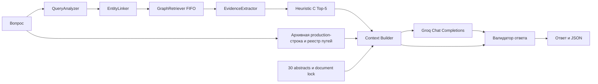

# Архитектура Stage 3A.5.10

`llm_retrieval` загружает утверждённый PROFILE.json по SHA-256. Live сверяет исходники и версии, локальные файлы моделей и entity cache, затем выполняет read-only проверку fingerprint и полного снимка Neo4j до и после retrieval. Query Analysis, Linking, BFS, EvidenceExtractor и C используют существующие реализации. Лимит seeds применяется до штатной дедупликации GraphRetriever. Порядок выдачи C передаётся явно. Полные графовые свойства не копируются в генерацию.

Replay принимает дословный approved A/B/C вопрос из матрицы Stage 3A.5.9. Проверяются manifest, отдельный индекс production-строк без оценочных данных и source registry. Исторические секунды в архиве имеют отдельные поля. Scope replay включает 25 архивных вопросов. Для нового вопроса применяется live.

На границе retrieval и Context Builder передаются упорядоченные пути, физические рёбра и привязки source triple → window. Каждое окно разрешается до документа из проверенного корпуса по ID, ревизии, SHA и абсолютному диапазону `[start,end)` в Unicode code points. Равные окна одного документа и ревизии получают один citation ID и все происхождения. Одинаковый текст из независимых документов сохраняется отдельно. Физические head/tail, traversal direction, predicate, triple ID и path ID видны в артефакте. Провайдер получает исходный текст и библиографическую привязку. Это исключает передачу графового предиката как утверждения и разрешает сравнивать документы только по их текстам.

Context Builder считает токены чата Harmony с резервом на framing Groq. Он проходит по окнам в порядке первого появления и оставляет только целые окна, которые помещаются. Позднее короткое окно может поместиться после исключённого длинного. Артефакт фиксирует отправленные ID и исключения с привязками. Пустой контекст даёт локальный INSUFFICIENT_EVIDENCE и ноль вызовов. Если сам вопрос и инструкции превышают бюджет, CLI возвращает ERROR.

`llm_groq` выполняет ограниченные запросы OpenAI-compatible JSON Object Mode. `llm_context.validate_answer` требует ссылки на каждый блок, разрешает их только до переданных окон и формирует метаданные из корпуса. Сбой валидации меняет статус на ERROR и блокирует выдачу всего черновика. Смысловая проверка проводится отдельным чтением источников.

CLI сохраняет входной вопрос, retrieval, точные сообщения, источники, исключения, итоговый answer, блоки, citations, limitations, модель, API usage, настройки, идентификаторы запроса и секунды. Запись полного артефакта включается через `--output`. Для повторения используют новый файл. Live и replay имеют разные значения `mode`.
